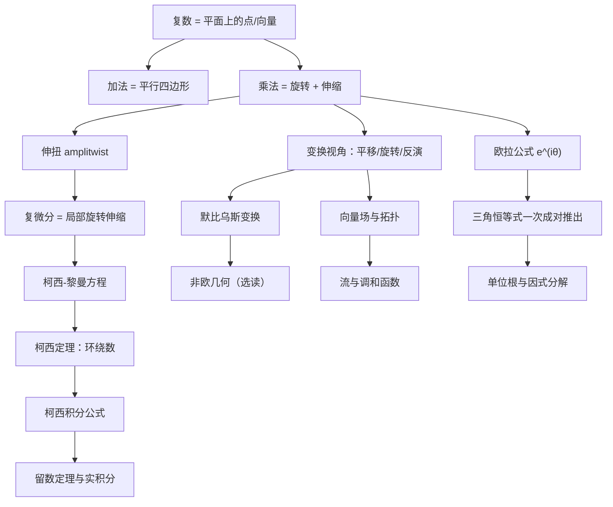

# 《复分析：可视化方法》点化学习系统

## 这本书在讲什么

Needham 想把复分析从"代数计算课"改回"几何课"。他的主张只有一句：复数乘法就是平面的旋转加伸缩， derivative 就是"局部伸缩旋转"（他造了个词叫 amplitwist，中译"伸扭"）。全书用这一条几何直觉重推柯西定理、留数、调和函数，凡是能用图说清的地方就不摆公式。

## 全书心智模型

## 学习路径（推荐顺序）

| 步骤 | 章节 | 主题 | 前置 | 检查点 |
|---|---|---|---|---|
| 01 | ch01 | 几何和复算术 | 无 | 通过第 1 章自测（≥80%） |
| 02 | ch02 | 作为变换看的复函数 | ch01 | 能画出 z²、e^z 把网格变成什么 |
| 03 | ch03 | 默比乌斯变换和反演 | ch02 | 能把圆映成圆讲清并算出像 |
| 04 | ch04 | 微分学：伸扭的概念 | ch03 | 能解释"导数=局部旋转+伸缩" |
| 05 | ch05 | 微分学的进一步几何研究 | ch04 | 能推出柯西-黎曼方程 |
| 06 | ch06 | 非欧几何学（选读） | ch03 | 能说出双曲几何的"直线"是什么 |
| 07 | ch07 | 环绕数与拓扑学 | ch05 | 能算环绕数并判断点在同侧 |
| 08 | ch08 | 复积分：柯西定理 | ch07 | 能说明为什么闭路积分为零 |
| 09 | ch09 | 柯西公式及其应用 | ch08 | 能用公式算积分并估上界 |
| 10 | ch10 | 向量场：物理学与拓扑学 | ch09 | 能算散度、旋度、指数 |
| 11 | ch11 | 向量场与复积分 | ch10 | 能把留数定理翻译成向量场语言 |
| 12 | ch12 | 流与调和函数 | ch11 | 能解释调和函数与流的对偶 |

## 章节索引

- 第 1 章 几何和复算术（难度 ★☆☆）→ `chapters/ch01-几何和复算术.md` …… 已完成
- 第 2 章 作为变换看的复函数（难度 ★★☆）→ `chapters/ch02-作为变换看的复函数.md` …… 已完成
- 第 3–12 章 …… 待生成（按章节批次推进）

## 前置知识（零基础缺口补讲）

| 缺口 | 对应补讲位置 | 学完标志 |
|---|---|---|
| 极坐标与三角函数 | 第 1 章概念 1、3 | 能把 r∠θ 与 x+iy 互转 |
| 向量加法与点乘叉乘 | 第 1 章 1.3.6 节、概念 5 | 能说出 ab = a·b + i(a×b) 的来源 |
| 导数作为速度 | 第 1 章 1.3.4 节、概念 3 深度片段 | 能解释 dZ/dt 是速度向量 |
| 复数为什么合理 | 第 1 章 1.1.2 庞贝利、1.1.5 等价性 | 能复述三次方程悖论 |

## 术语表 / 模式库 / 速查表

见侧边栏「术语表」「模式库」「速查表」三页；术语随章节生成同步补入。
