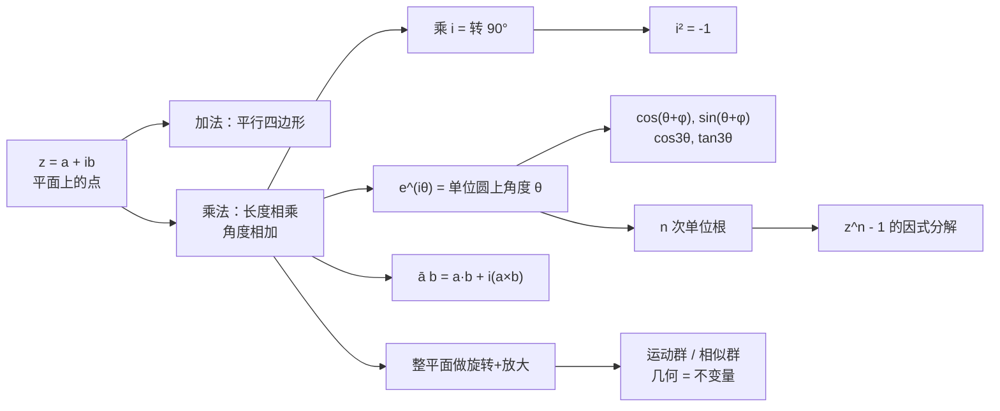

# 第 1 章：几何和复算术

- **难度**：★☆☆ | **预估学时**：3–4 小时 | **前置**：高中代数、三角函数、向量初步（忘了也能补，本章会重讲）

## 学习目标

学完本章，你能：

1. 把 $a+ib$ 和平面上的点 $(a,b)$ 来回翻译，并说明为什么两数相加就是平行四边形对角线。
2. 用"长度相乘、角度相加"这一条算出 $i^2=-1$、$3i=3\cdot i$，并解释乘以 $i$ 为什么等于逆时针转 90°。
3. 说清 $e^{i\theta}$ 为什么落在单位圆上、辐角为什么就是 $\theta$，而不是背一条定义。
4. 用一次复数乘法同时推出 $\cos(\theta+\varphi)$ 与 $\sin(\theta+\varphi)$，再推出 $\cos 3\theta$ 与 $\tan 3\theta$。
5. 把一个几何命题（四边形四边作正方形，对边中心连线垂直且等长）翻译成一个复等式并证完。

## 一句话核心

复数是一台"平面变换机"：加法负责挪位置，乘法负责转角度、改大小；把乘法看成对整个平面做旋转加放大，三角、几何、微积分就都归到同一件事上。

## 零基础讲解

### 概念 1：复数就是一个平面点（基础）

$z=a+ib$ 里 $a,b$ 是两个普通实数，$i$ 满足 $i^2=-1$。先别把 $a+ib$ 当成"算不出来的数"，把它读成坐标：$a$ 是横坐标，$b$ 是纵坐标，$z$ 就是平面上的一点，也等于从原点指向这点的箭头（向量）。这张平面叫**复平面**，记作 $\mathbb{C}$。

四个基本量（教材 p.5 的表，图 1-4）：

| 名称 | 含义 | 记号 |
|---|---|---|
| 模 | 箭头长度 $r$ | $|z|$ |
| 辐角 | 箭头与正实轴的夹角 $\theta$ | $\arg z$ |
| 实部 | 横坐标 | $\operatorname{Re} z$ |
| 虚部 | 纵坐标 | $\operatorname{Im} z$ |

$z$ 对实轴的镜像叫**复共轭**，记 $\bar z=a-ib$。两条恒等式后面一直要用：$\operatorname{Re} z=\frac{1}{2}(z+\bar z)$，$\operatorname{Im} z=\frac{1}{2i}(z-\bar z)$，以及 $z\bar z=|z|^2$。

记号上有个坑：$|z|^2=z\bar z$ 是实数，不是 $z^2$。$z^2$ 一般还是复数，方向会转。算模长时用前者，千万别用后者。

**极坐标读法**：$z=r\angle\theta$，$r=|z|$ 是长度，$\theta=\arg z$ 是角度。这种写法不唯一，因为转整圈回到原地：

$$\cdots=r\angle(\theta-4\pi)=r\angle(\theta-2\pi)=r\angle\theta=r\angle(\theta+2\pi)=\cdots$$

这个"角度可以随便加减 $2\pi$"的事实，第 7 章讲环绕数时会变成主角，现在先记住它。

### 概念 2：加法是拼接位移（基础）

两个复数相加，实部加实部、虚部加虚部：

$$(a+ib)+(c+id)=(a+c)+i(b+d).$$

几何上就是向量加法：把 $B$ 的起点挪到 $A$ 的终点，从原点连到新终点，得到 $A+B$；等价说法是平行四边形对角线（教材图 1-2a）。所以 $4+3i$ 真的就是"先走 4，再往上走 3"。

### 概念 3：乘法是旋转加放大（进阶，本章地基）

乘法不能按"实部乘实部、虚部乘虚部"去理解，那样得到的式子又长又没几何意义。教材给的乘法规则只有两条（式 1.2）：

> $AB$ 的长度 $=|A|\,|B|$；$AB$ 的辐角 $=\arg A+\arg B$。

用极坐标写出来非常短：

$$(R\angle\varphi)(r\angle\theta)=(Rr)\angle(\varphi+\theta).$$

拿它验算三个熟面孔：

- $3\cdot i$：$3$ 的角度是 $0°$，$i$ 的角度是 $90°$，长度 $3\cdot1=3$，角度 $0+90=90°$，结果就是 $3i$。
- $i\cdot i$：长度 $1\cdot1=1$，角度 $90°+90°=180°$，落到负实轴上的 $-1$。这就是 $i^2=-1$ 的几何来历，它不需要被规定，它是"转两次直角"的必然结果。
- $(2+i)^3$：$2+i$ 的长度 $\sqrt5$、角度 $\arctan\frac12$，三次方后长度 $5\sqrt5$、角度 $3\arctan\frac12$。用代数硬乘也能得 $2+11i$（$(2+i)^2=3+4i$，再乘 $2+i$ 得 $2+11i$），两条路结果一样。

**关键一步：把乘法看成对整个平面动手。** 固定一个 $A=R\angle\varphi$，让平面上每一点 $z$ 都去乘 $A$。按上面的规则，每个点的长度都放大 $R$ 倍、角度都增加 $\varphi$。所以（式 1.9）：

> 乘以 $A=R\angle\varphi$，就是把整个平面绕原点转 $\varphi$，再放大 $R$ 倍。

$R<1$ 时"放大"其实是缩小。先转再放大、先放大再转，结果相同，因为两件事互不干扰。

这条视角一立起来，很多事变成一句话：

- 乘以 $i$ = 转 $90°$，所以 $i^2$ = 转 $180°$ = 取负。
- 乘法分配律 $A(B+C)=AB+AC$ 为什么成立？旋转加放大把平行四边形还是变成平行四边形，第四个顶点自然对应 $A(B+C)$（教材图 1-5）。
- 几何法则和代数法则（庞贝利那把括号硬乘开得到的式 1.6）是等价的，不是两套东西。教材 1.1.5 节用"转 $90°$ 再拆成 $4z+3(iz)$"证了这个等价。

### 概念 4：欧拉公式 $e^{i\theta}=\cos\theta+i\sin\theta$（高难）

教材 p.9 的式 (1.10)：

$$e^{i\theta}=\cos\theta+i\sin\theta.$$

它说的是：$e^{i\theta}$ 是单位圆上辐角为 $\theta$ 的那一点。有了它，$z=r\angle\theta$ 可以写成 $z=re^{i\theta}$，乘法变成指数相加：

$$(Re^{i\varphi})(re^{i\theta})=Rre^{i(\theta+\varphi)}.$$

这不是新规则，只是把"角度相加"换了个写法。真正的问题是：$e^{i\theta}$ 到底什么意思？为什么指数上放个虚数还能算？

教材拒绝"定义 $e^{i\theta}=\cos\theta+i\sin\theta$ 就完事"，给了两个启发式论证。

**论证一：把 $e^{it}$ 看成动点。** 实数情形下 $e^x$ 由"导数等于自己、初值 $1$"刻画。把这个性质照搬到虚数上：

$$\frac{d}{dt}e^{it}=ie^{it}.$$

左边是动点 $Z(t)=e^{it}$ 的速度，右边是 $iZ$。乘以 $i$ 等于把向量转 $90°$，所以这句话读成：

> 速度的方向永远垂直于当前位置向量。

起点 $Z(0)=e^0=1$，初速度 $i$ 竖直向上，于是这个点只能贴着单位圆走，而且速度大小恒为 $1$。走了时间 $t=\theta$，它在圆上走过的弧长就是 $\theta$，所在位置的辐角自然就是 $\theta$。这就是 $e^{i\theta}$ 的几何身份。

**论证二：把幂级数画成螺旋。** 把 $e^x=1+x+\frac{x^2}{2!}+\frac{x^3}{3!}+\cdots$ 里的 $x$ 换成 $i\theta$：

$$e^{i\theta}=1+i\theta+\frac{(i\theta)^2}{2!}+\frac{(i\theta)^3}{3!}+\cdots$$

每一项都比前一项多转 $90°$（因为乘了 $i$），所以这串向量首尾相接，卷成一条螺旋线（教材图 1-9）。它收敛到某一点；把实部虚部分开记 $C(\theta)+iS(\theta)$，求导得 $C'=-S$、$S'=C$，再验算 $\frac{d}{d\theta}(C^2+S^2)=0$ 且初值为 $1$，得 $|e^{i\theta}|=1$；再验 $\tan\Theta=S/C$ 的导数为 $1$，得角度就是 $\theta$。

两个论证都不用泰勒定理，也不需要对 $e^{i\theta}$ 下定义。第 2 章会用另一种方式（把 $e^z$ 看成映射）再证一次。

顺带得到两条后面天天用的公式（式 1.12）：

$$\cos\theta=\frac{e^{i\theta}+e^{-i\theta}}{2},\qquad \sin\theta=\frac{e^{i\theta}-e^{-i\theta}}{2i}.$$

### 概念 5：单位根就是正 $n$ 边形的顶点（进阶）

$x^n-1=0$ 的根，在复数里一个不少，且都落在单位圆上：

$$z=e^{ik\frac{2\pi}{n}},\quad k=0,1,\dots,n-1.$$

因为 $(e^{ik2\pi/n})^n=e^{ik2\pi}=1$。这 $n$ 个点正好把单位圆分成 $n$ 等份，就是内接正 $n$ 边形的顶点。教材管它们叫 **$n$ 次单位根**。

有了这个观察，因式分解立刻到位：

$$z^n-1=(z-C_1)(z-C_2)\cdots(z-C_n),\quad C_k=e^{ik2\pi/n}.$$

共轭成对的两个根给出一个实二次因式：

$$(z-e^{ik2\pi/n})(z-e^{-ik2\pi/n})=z^2-2z\cos\frac{2k\pi}{n}+1.$$

教材 1.3.5 节讲了一段历史：18 世纪的科茨（Cotes）没有复数可用，却靠"点 $P$ 到正 $n$ 边形各顶点距离之积"这个几何事实，硬是把 $x^n-1$ 拆成实一次与实二次因式。他的结果

$$U_n(x)=PC_1\cdot PC_2\cdots PC_n$$

用复数看只是一句话：$PC_k=|z-C_k|$，乘起来就是 $|z^n-1|$。这条故事说明一件更重要的事：哪怕你想绕开复数，复平面的几何还是会在结果里冒出来。

### 概念 6：点乘和叉乘都藏在复数乘法里（进阶）

把 $z=x+iy$ 只当向量看，记成粗体 $\mathbf z=\binom{x}{y}$。两个向量的点乘、叉乘在物理里很常用，它们其实都能从一个复数乘法里读出来（式 1.20）：

$$\bar a b=\mathbf a\cdot\mathbf b+i(\mathbf a\times\mathbf b).$$

注意左边是 $\bar a b$，不是 $ab$。$a=|a|e^{i\alpha}$，$b=|b|e^{i\beta}$，那么

$$\bar a b=|a||b|e^{i(\beta-\alpha)}=|a||b|\cos\theta+i|a||b|\sin\theta,$$

实部正是点乘，虚部正是"由 $a$ 转到 $b$"的带符号面积，也就是叉乘。写成坐标：

$$\binom{x}{y}\cdot\binom{x'}{y'}=xx'+yy',\qquad \binom{x}{y}\times\binom{x'}{y'}=xy'-x'y.$$

叉乘在这里被重新定义为"有符号面积"，不再是三维向量。这个改写换来一个好处：多边形的面积可以用一个统一公式算，不管原点在形内还是形外（式 1.21）：

$$A=\frac12\operatorname{Im}\left(\bar a b+\bar b c+\bar c d+\bar d a\right).$$

原点跑到四边形外面时，某些三角形的有符号面积自动变负，公式照样对。这是"符号"在这里的真正用处。

### 概念 7：几何就是群的不变量（高难，教材标 * 可略）

这一节回答"什么是几何"。克莱因的答案：先选一族变换 $G$，几何就是研究 $G$ 下的不变量。

- **运动**：平面到自身、保持任意两点距离不变的映射（式 1.22）。
- **全等**：存在运动 $M$ 使 $F'=M(F)$。
- **几何性质**：在一切运动下不变的性质。

要能当"全等"用，这族变换必须满足三条：含恒等变换、每个变换有逆、两个变换的复合仍在族里。满足这三条的变换族叫**群**。所以欧氏几何 = 运动群的不变量研究；把群换成相似变换群，得到的是允许放大的欧氏几何（式 1.29）。

运动分两类：保持角度定向的（平移、旋转）叫**保向**；把定向翻过来的（反射）叫**反向**。教材给出两条结论：

1. 每个保向运动都能写成 $M(z)=e^{i\theta}z+v$。这就是"旋转 + 平移"，只有平移是例外情形（两线段恰好平行时概率为零）。
2. **三反射定理**：每个保向运动是两个反射的复合，每个反向运动是三个反射的复合。

反射为什么能生成旋转？两条相交直线 $L_1,L_2$ 交于 $O$、夹角 $\varphi$，连续做两次反射 $\mathcal R_{L_2}\circ\mathcal R_{L_1}$ 就是绕 $O$ 转 $2\varphi$；两条平行直线相隔向量 $V$，连续两次反射就是平移 $2V$。这里"角度翻倍、距离翻倍"的 2 不是巧合，是因为反射把"一半"的信息抵消了。

## 图示

**看图说明**：从 $z$ 出发只有两条主干。左边加法通向向量与平行四边形，右边乘法通向本章其余所有内容。读图时盯住"乘法"这个节点，它分出五条线：$i^2=-1$、欧拉公式、单位根、点乘叉乘、克莱因的变换视角。哪条线断了，回到"长度相乘、角度相加"这条规则重推。

## 类比与实例

**类比：乘法像调音台上的两个旋钮。** 一个旋钮管音量（长度放大 $R$ 倍），一个管相位（角度加 $\varphi$）。两个复数相乘等于把两组旋钮的设置叠加：音量乘起来，相位加起来。这个类比在"$R=0$"处失效——乘以 $0$ 会把整个平面压成一个点，角度信息全丢，此时谈不上"旋转"。

**实例：用复数证四边形的正方形定理。** 在任意四边形的四条边上各向外作正方形，把相对两个正方形的中心连起来。教材图 1-12a 说这两条线段垂直且等长，纯几何证法很难。

设四条边（带方向）为 $2a,2b,2c,2d$，封口条件是

$$a+b+c+d=0.$$

从一个顶点出发，正方形中心的位置依次是

$$p=(1+i)a,\quad q=2a+(1+i)b,\quad r=2a+2b+(1+i)c,\quad s=2a+2b+2c+(1+i)d.$$

两条待证线段对应复数

$$A=s-q=(b+2c+d)+i(d-b),\qquad B=r-p=(a+2b+c)+i(c-a).$$

"垂直且等长"合起来就是一个复等式 $B=iA$，等价于 $A+iB=0$。直接算：

$$A+iB=(a+b+c+d)+i(a+b+c+d)=0.$$

封口条件一出，结论自动成立。这条例子的价值不在技巧，而在"垂直等长"这类几何话可以被翻译成一个复方程，算完就完。

## 常见误解

- **别以为 $i$ 是"虚构的数"所以不能比较大小。** 实际是：复数没有与加法、乘法相容的大小顺序，但每个复数都有长度和角度，可以比较"谁更长"。教材开头讲了两百多年把复数叫 imaginary 的历史包袱，名字带"虚"不代表它不存在。
- **别以为乘法就是实部乘实部、虚部乘虚部。** 实际是：$(a+ib)(c+id)=ac-bd+i(ad+bc)$，交叉项要相加，$i^2$ 要换成 $-1$。套错这一条，后面所有公式都会错。
- **别以为 $e^{i\theta}=\cos\theta+i\sin\theta$ 是人为规定。** 实际是：只要坚持"$e^{it}$ 的导数等于 $ie^{it}$"，它就只能落在单位圆上、辐角只能等于 $t$。教材给了两个独立论证。
- **别以为辐角 $\arg z$ 是个确定的数。** 实际是：它可以差 $2\pi$ 的任意整数倍。写 $\arg z=\theta$ 时通常默认取某个范围（比如 $(-\pi,\pi]$），但别把它当成唯一值。
- **别以为 $\bar a b$ 里的共轭可以省。** 实际是：$ab$ 的辐角是 $\alpha+\beta$，$\bar ab$ 的辐角才是 $\beta-\alpha$，点乘叉乘公式依赖后者。

## 自测题（答案）

1. **（单选）$ (1+i)^4$ 等于多少？**
   A. $4$ B. $-4$ C. $4i$ D. $-4i$
   （答案：B；解析：$1+i=\sqrt2\angle45°$，四次方后长度 $(\sqrt2)^4=4$、角度 $180°$，落在负实轴，得 $-4$。）

2. **（单选）乘以 $i$ 对平面上每个非零向量的作用是什么？**
   A. 放大一倍 B. 逆时针转 $90°$ C. 关于实轴反射 D. 取倒数
   （答案：B；解析：$i$ 的长度为 $1$、辐角 $90°$，乘法只改角度，所以是纯旋转。）

3. **（填空）$z=3+4i$ 的模是 ____，辐角的一个值是 ____。**
   （答案：$5$；$\arctan\frac43$；解析：$\|z\|=\sqrt{9+16}=5$，$\tan\theta=\frac43$，第一象限取 $\arctan\frac43\approx53.13°$。）

4. **（单选）$z^5=1$ 的五个根在复平面上构成什么图形？**
   A. 一条直线 B. 内接正五边形 C. 一个圆内的随机五点 D. 两条相交直线
   （答案：B；解析：根是 $e^{ik2\pi/5}$，等角分布在单位圆上。）

5. **（多选）下面哪些命题等价于"$B=iA$"？**
   A. $B$ 由 $A$ 逆时针转 $90°$ 得到 B. $B$ 与 $A$ 垂直且等长 C. $A+iB=0$ D. $B$ 是 $A$ 的复共轭
   （答案：A、B、C；解析：$iA$ 即转 $90°$；转 $90°$ 同时保持长度，所以垂直等长；$B=iA\iff A+iB=0$。D 是镜像，方向不对。）

6. **（填空）$\cos^4\theta$ 用倍角表示是 ____。**
   （答案：$\frac18(\cos4\theta+4\cos2\theta+3)$；解析：由 $2\cos\theta=e^{i\theta}+e^{-i\theta}$，把四次方展开、配对成 $2\cos k\theta$，再除 $2^4$。）

7. **（简答）用一句话说明为什么 $\arg z$ 不能当成唯一确定的数。**
   （答案要点：绕原点转整圈回到同一点，所以角度加减 $2\pi$ 不改变复数；$\arg z$ 只能确定到 $2\pi$ 的整数倍。）

8. **（简答）教材为什么说"哪怕想绕开复数，复平面的几何也无法回避"？**
   （答案要点：科茨在没有复数语言的情况下分解 $x^n-1$，其结果恰好等于"点到正 $n$ 边形各顶点距离之积"，而这正是 $|z^n-1|$ 的几何读法；结论本身已经是复平面的事实。）

## 复习锚点

- 乘法两条：长度相乘、角度相加。乘以 $A$ 就是全平面转 $\varphi$ 放大 $R$。
- $i^2=-1$ 是"转两次 $90°$ 等于转 $180°$"的推论，不是额外规定。
- $e^{i\theta}$ 的身份是单位圆上的角度标记；它的两个论证分别靠"速度垂直位置"和"幂级数卷成螺旋"。
- $z^n-1$ 的根是正 $n$ 边形顶点；共轭成对 → 实二次因式。
