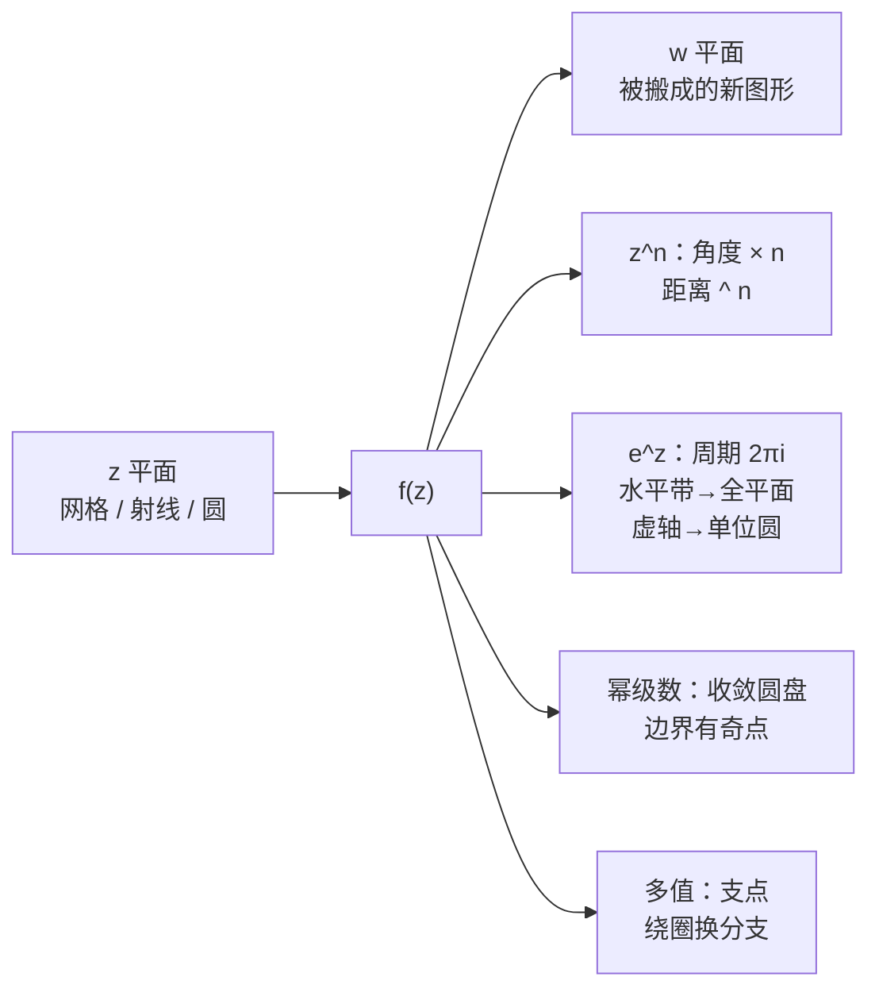

# 第 2 章：作为变换看的复函数

- **难度**：★★☆ | **预估学时**：4–5 小时 | **前置**：第 1 章（复数乘法、欧拉公式、单位根）

## 学习目标

学完本章，你能：

1. 把一个复函数读成"把 $z$ 平面上的图形搬到 $w$ 平面上的变换"，并说出 $u,v$ 与 $R,\varphi$ 两种坐标各适合看什么。
2. 画出 $z\mapsto z^n$ 对射线和圆弧的效果，并用它解 $z^n=c$（答案是一个正 $n$ 边形的顶点）。
3. 解释幂级数的收敛域为什么一定是个圆盘，以及边界上"至少有一个点挡路"是什么意思。
4. 说出 $e^z$ 的三条几何事实：周期 $2\pi i$、水平带铺满 $w$ 平面、虚轴在单位圆上无限缠绕。
5. 区分"多值函数"与"单值函数"，说清 $z^{1/3}$ 的支点为什么在 $0$、绕几圈才回到原值。

## 一句话核心

复函数不是一条曲线，而是一张"搬运地图"：它把 $z$ 平面上的每个点搬到 $w$ 平面上的某点，看它的最好方式是看它把网格、射线、圆搬成了什么形状。

## 零基础讲解

### 概念 1：两个平面，一张规则（基础）

复函数 $w=f(z)$ 就是一条规则：给每个 $z$ 指定唯一的 $w$。画它需要两个平面：**$z$ 平面**（定义域）和 **$w$ 平面**（象平面）。$z=x+iy$，$w=u+iv$，于是

$$w=f(z)=u(x,y)+iv(x,y).$$

同一条规则可以写成两种坐标：

- 笛卡儿形式 $u(x,y),v(x,y)$：适合看"横竖网格被搬成什么"。
- 极坐标形式 $R(r,\theta),\varphi(r,\theta)$：适合看"长度和角度怎么变"。

教材 p.46 的例子 $f(z)=(1+i\sqrt3)z$：因为 $1+i\sqrt3=2e^{i\pi/3}$，极坐标下就是

$$R=2r,\qquad \varphi=\theta+\frac{\pi}{3}.$$

读法很直接：长度统一放大 2 倍，角度统一加 $60°$。这正是第 1 章的乘法，只是换了个"函数"的说法。

**为什么不能画图像。** 实函数 $y=f(x)$ 的图像是一条曲线，占两维；复函数要画 $(z,f(z))$ 需要四维。教材的替代方案有三个：① 只看映射效果（本书主用）；② 只看模 $|f(z)|$，画成三维的"模曲面"；③ 画黎曼曲面（把多值函数铺成一层层曲面）。本书走 ①，最后三章会碰到 ③ 的思想。

### 概念 2：$z^n$ 把角度放大 $n$ 倍（进阶）

把 $z=re^{i\theta}$ 代入 $w=z^n$：

$$w=r^ne^{in\theta}.$$

两条规则：距离升到 $n$ 次方，角度乘以 $n$。所以

- 从原点出发的射线（$\theta$ 固定）还是射线，只是角度变成 $n\theta$；
- 以原点为心的圆（$r$ 固定）还是圆，半径变成 $r^n$；
- 一个张角为 $\alpha$ 的角形区域，被"折"成张角 $n\alpha$ 的区域。$n=2$ 时上半平面被对折成整个平面，这就是"二重覆盖"的直观来源。

**解 $z^n=c$。** 设 $c=Re^{i\varphi}$。要求 $z=re^{i\theta}$ 满足 $r^ne^{in\theta}=Re^{i\varphi}$，比较长度和角度：

$$r^n=R,\qquad n\theta=\varphi+2m\pi.$$

所以

$$z_m=\sqrt[n]{R}\,e^{i(\varphi+2m\pi)/n},\quad m=0,1,\dots,n-1.$$

相邻两个解相差 $2\pi/n$，正好绕一圈均匀排开：$n$ 个解是半径 $\sqrt[n]{R}$ 的圆上正 $n$ 边形的顶点，其中一个的角度是 $\varphi/n$。教材图 2-6 画的就是这件事。

这也解释了第 1 章"$z^n=1$ 的根是正 $n$ 边形"的另一种读法：$w=z^n$ 把 $z$ 平面上的单位圆仍映成单位圆，但角速度变成 $n$ 倍。$z$ 转 $1/n$ 圈，$w$ 就转满一圈回到 $1$。所以 $w=1$ 的原象是 $z$ 转 $1/n$ 圈依次到达的 $n$ 个位置。

### 概念 3：幂级数的收敛域是一个圆盘（高难）

考虑以原点为中心的幂级数

$$P(z)=c_0+c_1z+c_2z^2+\cdots$$

它的部分和是一串多项式 $P_n(z)$。若 $P_n(a)$ 越来越靠近某个点 $A$，就说级数在 $a$ 收敛于 $A$。

关键事实（教材式 2.8）：

> 若 $P(z)$ 在 $z=a$ 处收敛，则它在整个圆盘 $|z|<|a|$ 内处处收敛（而且绝对收敛）。

直观理由：$z$ 的模比 $a$ 小，$c_jz^j$ 就比 $c_ja^j$ 衰减得更快，收敛性只会更好。既然在 $a$ 处部分和已经"挤"进任意小的圆盘，模更小的 $z$ 处挤得更紧。教材用三角不等式把它写成了严格证明：$|P_n(a)-P_m(a)|$ 不超过各项模之和。

由此得到**收敛圆**的结构：存在一个半径 $\rho$（可能为 $0$ 或 $\infty$），使得

- $|z|<\rho$ 内处处收敛；
- $|z|>\rho$ 处处发散；
- $|z|=\rho$ 的圆周上，每个点要单独判断。

边界上不能全收敛，否则半径还能再扩大——所以圆周上至少有一个"挡路"的点，级数在那里出问题。这个点就是后面要讲的奇点。

收敛半径的算法（教材 2.3.6）：若极限存在，

$$\rho=\lim_{n\to\infty}\left|\frac{c_n}{c_{n+1}}\right|,$$

或者用 Cauchy–Hadamard 形式 $\rho=1/\limsup_n\sqrt[n]{|c_n|}$。

### 概念 4：$e^z$ 是一台"缠圆机"（高难）

$e^z$ 的幂级数

$$e^z=1+z+\frac{z^2}{2!}+\frac{z^3}{3!}+\cdots$$

对一切 $z$ 收敛（半径无穷）。它满足 $e^{z_1+z_2}=e^{z_1}e^{z_2}$，所以

$$e^{x+iy}=e^xe^{iy}.$$

三条几何事实（教材图 2-19）：

1. **周期 $2\pi i$**：$z$ 向上走 $2\pi$，$w=e^z$ 绕原点转一整圈回到原处。所以 $e^z$ 不是一对一的，同一个 $w$ 有无穷多个原象，相差 $2\pi i$。
2. **水平带铺满全平面**：高度为 $2\pi$ 的水平带 $\{x+iy:-\pi<y\le\pi\}$ 被映成整个 $w$ 平面（去掉 $w=0$）。$x\to-\infty$ 时 $w\to0$，$x\to+\infty$ 时 $|w|\to\infty$。
3. **虚轴缠在单位圆上**：$z=iy$ 时 $w=e^{iy}$，正是单位圆上角度 $y$ 的点。$y$ 从 $-\infty$ 到 $+\infty$，这个点就在单位圆上绕无穷多圈。左半平面 $x<0$ 映成单位圆内部，右半平面映成外部。

教材还给了另一种定义方式：

$$e^z=\lim_{n\to\infty}\left(1+\frac{z}{n}\right)^n.$$

它的好处是几何意义直接可见：$1+\frac{z}{n}$ 是一个长度略大于 $1$、角度约为 $\frac{y}{n}$ 的复数，把它自乘 $n$ 次，长度趋向 $e^x$、角度趋向 $y$。推导见本章折叠片段。

### 概念 5：多值函数与支点（进阶）

$w=\sqrt[3]{z}$ 不是"一个函数"，因为每个 $z\ne0$ 有三个立方根。这类对象叫**多值函数**。

把 $z=re^{i\theta}$ 代入：

$$\sqrt[3]{z}=\sqrt[3]{r}\,e^{i\theta/3}.$$

角度 $\theta$ 可以取 $\theta+2m\pi$，于是得到三个值，相差 $120°$。所以 $\sqrt[3]{z}$ 有三个"分支"。

**支点**的定义（教材 2.6.1）：点 $q$ 叫 $f$ 的支点，如果 $z$ 绕 $q$ 走一圈回到原处时，$f(z)$ 回不到原来的值。

对 $\sqrt[3]{z}$，支点是 $0$：绕 $0$ 一圈，$\theta$ 增加 $2\pi$，$\theta/3$ 增加 $2\pi/3$，函数值变成另一个立方根；绕两圈变成第三个；绕三圈才回到原值。所以 $0$ 是 $\sqrt[3]{z}$ 的**二阶支点**（要绕 $3$ 圈才回来，阶数 $=3-1$）。一般 $z^{1/n}$ 的支点在 $0$，阶数 $n-1$。

**单值支**：把平面沿一条从支点出发的射线剪开（比如沿负实轴），在这个剪开的区域里，角度可以连续地选成一个值，$\sqrt[3]{z}$ 就变成三个各自单值的函数。换一条路径但绕支点的圈数相同，得到同一个值；圈数不同，值就换一个。

对数 $\log z$ 更极端：$z=re^{i\theta}$ 时 $\log z=\ln r+i\theta$，绕原点一圈 $\theta$ 加 $2\pi$，值永远回不到原处。所以 $0$ 是**对数支点**（无穷阶）。这就是"对数多值"的几何来源。

### 概念 6：根的平均值就是系数的几何中心（拓展）

教材 2.8 节讲平均值。一个漂亮结论：多项式

$$P_n(z)=z^n+a_{n-1}z^{n-1}+\cdots+a_0$$

的 $n$ 个根（计入重数）的平均值等于 $-a_{n-1}/n$。也就是说，根在平面上的"质心"由第二项系数决定。$z^n-c$ 的第二项系数为 $0$，所以它的 $n$ 个根（正 $n$ 边形顶点）的质心在原点——这和第 1 章的单位根图像一致。

教材还用正多边形和圆周上的平均值推出了一些恒等式，属于选读，不影响后续章节。

## 图示

**看图说明**：图的左边是"输入图形"，右边是"输出图形"，中间 $f$ 是搬运工。四条分支是本章四种典型搬运方式。看 $z^n$ 时盯角度变化，看 $e^z$ 时盯周期与缠绕，看幂级数时盯收敛圆，看多值时盯绕支点的圈数。

## 类比与实例

**类比：复函数像地图投影。** 把地球仪（$z$ 平面）摊到平面地图（$w$ 平面）上，有的投影保面积、有的保角度、有的把极点拉成一条线。复函数就是这类"投影"，本章关心的正是它把什么形状搬成了什么形状。类比的失效边界：地图投影一般不是"处处相似"的，而复解析函数（第 4 章起）在每一点附近都近似一个旋转加放大。

**实例：解 $z^3=8i$。** $8i=8e^{i\pi/2}$，所以

$$z_m=\sqrt[3]{8}\,e^{i(\pi/2+2m\pi)/3}=2e^{i(\pi/6+2m\pi/3)},\quad m=0,1,2.$$

三个解的角度分别是 $30°$、$150°$、$270°$，模都是 $2$。验算：$(2e^{i30°})^3=8e^{i90°}=8i$。三个点构成半径 2 的正三角形，一个顶点在 $30°$ 方向。

## 常见误解

- **别以为复函数"画不出图像"就没法研究。** 实际是：看它怎么搬图形，比看一条曲线信息更多。本书全程用这个视角。
- **别以为 $e^z$ 是一对一的。** 实际是：它周期为 $2\pi i$，每个非零 $w$ 都有无穷多个原象，相差 $2\pi i$ 的整数倍。
- **别以为幂级数在收敛圆周上一定收敛或一定发散。** 实际是：圆周上每点要单独判断，同一个圆上可以有的点收敛、有的点发散。
- **别以为 $\sqrt[3]{z}$ 是"算不出来"。** 实际是：它有三个确定的值，只是不能用一个连续单值的方式同时选出来；剪开平面就能分出三个单值支。
- **别以为支点只有 $0$。** 实际是：$\sqrt{z-1}$ 的支点在 $1$，$\log(z^2+1)$ 的支点在 $\pm i$；支点位置由函数结构决定。

## 自测题（答案）

1. **（单选）$w=z^3$ 把张角 $30°$ 的角形区域映成多大的角？**
   A. $10°$ B. $30°$ C. $90°$ D. $120°$
   （答案：C；解析：$z^3$ 把角度乘以 3，$30°\times3=90°$。）

2. **（单选）$z^4=16$ 的解在复平面上构成什么图形？**
   A. 半径 2 的正方形四个顶点 B. 半径 4 的正方形 C. 半径 2 的圆上任意四点 D. 一条直线
   （答案：A；解析：$r^4=16\Rightarrow r=2$，四个解相差 $90°$，是内接正方形。）

3. **（单选）幂级数在 $z=a$ 处收敛，可以推出什么？**
   A. 在全平面收敛 B. 在 $|z|<|a|$ 内绝对收敛 C. 在 $|z|=|a|$ 上收敛 D. 在 $|z|>|a|$ 发散
   （答案：B；解析：教材式 2.8：在 $a$ 收敛则圆盘 $|z|<|a|$ 内处处绝对收敛。）

4. **（多选）下面哪些是 $e^z$ 的几何事实？**
   A. 周期为 $2\pi i$ B. 把高度 $2\pi$ 的水平带铺满全平面（去掉 0） C. 把虚轴映成单位圆 D. 是一对一映射
   （答案：A、B、C；解析：$e^z$ 周期 $2\pi i$，非一对一；虚轴 $e^{iy}$ 在单位圆上。）

5. **（单选）$\sqrt[3]{z}$ 的支点在哪，阶数是多少？**
   A. $z=1$，一阶 B. $z=0$，二阶 C. $z=0$，一阶 D. 没有支点
   （答案：B；解析：绕 0 三圈才回到原值，$n=3$，阶数 $n-1=2$。）

6. **（单选）$z^3=c$ 的三个解，相邻两个相差多少角度？**
   A. $60°$ B. $90°$ C. $120°$ D. $180°$
   （答案：C；解析：解为 $\sqrt[3]{R}e^{i(\varphi+2m\pi)/3}$，相邻差 $2\pi/3=120°$。）

7. **（简答）为什么 $e^z$ 的收敛半径是无穷，而 $\frac{1}{1-z}$ 的幂级数只有半径 1？**
   （答案要点：$e^z$ 的系数 $1/n!$ 衰减极快，级数对一切 $z$ 收敛；$\frac{1}{1-z}=1+z+z^2+\cdots$ 的系数全是 1，$|z|\ge1$ 时通项不趋于零，且在 $z=1$ 处函数本身发散，所以半径只能到 1。）

8. **（简答）"绕支点一圈回不到原值"这句话，用 $\sqrt[3]{z}$ 具体说明。**
   （答案要点：$z=re^{i\theta}$，绕 0 一圈后 $\theta\to\theta+2\pi$，$\sqrt[3]{z}$ 的角变成 $\theta/3+2\pi/3$，值换成了另一个立方根；绕三圈才回到原来的值。）

## 复习锚点

- 复函数 = 两个平面之间的搬运规则；看效果，不画曲线。
- $z^n$：距离 $n$ 次方，角度乘 $n$；$z^n=c$ 的解是正 $n$ 边形。
- 幂级数收敛在圆盘内，圆周上逐点判断，边界必有奇点。
- $e^z$ 周期 $2\pi i$，水平带铺满全平面，虚轴缠单位圆。
- 多值函数的支点：绕一圈不回原值；$\sqrt[n]{z}$ 的支点在 0、阶数 $n-1$。
