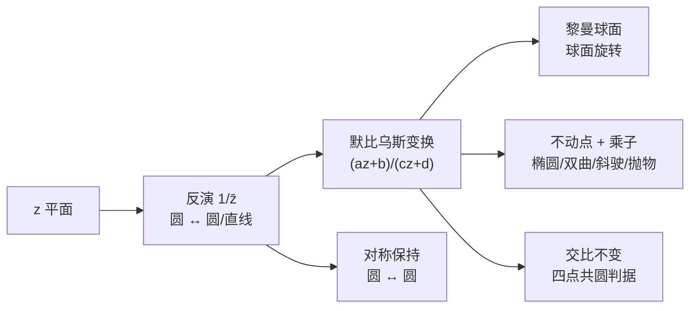

# 第 3 章：默比乌斯变换和反演

- **难度**：★★★ | **预估学时**：5–6 小时 | **前置**：第 1 章（乘法、共轭）、第 2 章（映射、幂级数）

## 学习目标

学完本章，你能：

1. 写出反演 $z\mapsto 1/\bar z$ 的几何效果，并说明它为什么把圆和直线互相转换。
2. 用黎曼球面解释"直线是过无穷远点的圆"，说清球极射影把平面上的圆对应成球面上的圆。
3. 把默比乌斯变换拆成平移、反演、伸缩旋转、平移四步，并用三点定一个变换。
4. 解不动点方程，按乘子把变换分成椭圆、双曲、斜驶、抛物四类。
5. 用交比判断四点是否共圆，用对称性解释变换把圆映成圆。

## 一句话核心

默比乌斯变换是黎曼球面的旋转；在平面上看，它由"平移 + 反演 + 伸缩旋转 + 平移"拼成，把圆映成圆、把对称保持住。

## 零基础讲解

### 概念 1：反演把里面翻到外面（基础）

复反演

$$z\mapsto \frac{1}{\bar z}.$$

写 $z=re^{i\theta}$：$1/\bar z=\frac1r e^{i\theta}$。所以分两步看：长度取倒数，角度先取相反数（对实轴反射）。教材把它拆成"几何反演 $z\mapsto 1/z$"再共轭。

对单位圆而言，圆内翻到圆外，圆上的点不动。对任意圆心 $q$、半径 $R$ 的圆 $K$，反演公式是

$$I_K(z)=q+\frac{R^2}{\overline{z-q}}.$$

它同样把 $K$ 的内外互换、把 $K$ 上的点钉住。

**关键性质**：反演把圆映成圆，把过圆心的直线映成直线（看成半径无穷大的圆）。更一般地，不过反演中心的圆会被映成另一个圆。第 3 章用大量图说明这件事，教材 3.2.2 给出了纯几何证明：用相似三角形，见本章深度片段。

### 概念 2：黎曼球面与无穷远点（进阶）

平面加上一个点 $\infty$ 叫扩充复平面。规定

$$\frac{1}{\infty}=0,\qquad \frac10=\infty.$$

这样一来 $z\mapsto 1/z$ 成了扩充平面到自身的一一映射，不再是"0 没有象"的半截子映射。

**球极射影**：把复平面水平放，上面放一个单位球 $\Sigma$，南极在原点。从北极 $N$ 连一条线到平面上的点 $p$，与球面的交点 $\hat p$ 就是 $p$ 的球极象。于是

- $0$ 对应南极 $S$；
- 单位圆对应赤道；
- 单位圆外对应北半球；
- $\infty$ 对应北极 $N$。

在这个对应下，**平面上的圆和直线，正好对应球面上的圆**（直线是过 $N$ 的圆）。这就是"直线是无穷大半径的圆"的严格版本。

更妙的是：默比乌斯变换在球面上看，就是球面的旋转（教材 3.4.3、3.5.1）。平面上那些看起来复杂的公式，在球面上只是"把球转一下"。

### 概念 3：默比乌斯变换（进阶）

形如

$$M(z)=\frac{az+b}{cz+d},\qquad ad-bc\ne0$$

的映射叫默比乌斯变换。条件 $ad-bc\ne0$ 排除"常值映射"这种退化情形。

它可以拆成四步（教材式 3.3）：

1. $z\mapsto z+d/c$：平移；
2. $z\mapsto 1/z$：反演；
3. $z\mapsto -\frac{ad-bc}{c^2}z$：伸缩加旋转；
4. $z\mapsto z+a/c$：再平移。

四步都是"把圆映成圆"的映射，所以复合起来也把圆映成圆（直线算作过 $\infty$ 的圆）。

**三点定变换**：给定三个不同的点 $z_1,z_2,z_3$ 和它们的目标 $w_1,w_2,w_3$，存在唯一的默比乌斯变换把前者依次送到后者。这跟"两点定一条直线、三点定一个圆"是同一种自由度计数。

**矩阵写法**：把 $M$ 对应到矩阵 $\begin{pmatrix}a&b\\c&d\end{pmatrix}$，复合对应矩阵相乘，相差一个非零常数算同一个变换。这是第 3.6 节的内容，也是"默比乌斯变换构成群"的代数说法。

### 概念 4：不动点与四类变换（高难）

解 $M(z)=z$，得

$$cz^2+(d-a)z-b=0.$$

两个根就是两个不动点（重根时只有一个）。若把两个不动点分别送到 $0$ 和 $\infty$，变换就化成

$$\tilde M(\tilde z)=m\tilde z,$$

其中复数 $m=\rho e^{i\alpha}$ 叫**乘子**。它把变换的几何本性完全暴露出来：

- $|m|=1$：椭圆型，绕两个不动点转，像球面绕轴旋转；
- $m>0$ 实数：双曲型，沿一条链"推"向一个不动点、远离另一个；
- $m$ 为非实数复数：斜驶型，旋转加伸缩同时发生；
- 两个不动点重合：抛物型，像平移。

教材 3.7 用"过两不动点的圆族 + 与它们正交的圆族"画出了这四类变换的流线。这张图（图 3-29）是本章最值得记住的一张。

### 概念 5：对称与交比（进阶）

**对称**：点 $p,p^*$ 关于圆 $K$ 对称，指 $p^*$ 在射线 $qp$ 上且 $|qp||qp^*|=R^2$；等价说法是"过 $p,p^*$ 的每个圆都与 $K$ 正交"。默比乌斯变换保持对称：$p,p^*$ 关于 $K$ 对称，则 $M(p),M(p^*)$ 关于 $M(K)$ 对称。

**交比**：

$$(z_1,z_2;z_3,z_4)=\frac{(z_3-z_1)(z_4-z_2)}{(z_3-z_2)(z_4-z_1)}.$$

默比乌斯变换保持交比不变。四点共圆（或共线）当且仅当交比是实数。这是判断"四点是否在同一个圆上"的最快工具。

## 图示

**看图说明**：反演是砖块，默比乌斯是四块砖拼成的墙；球面视角说明它为什么"看起来复杂、本质是旋转"；不动点和交比是两个可用工具。

## 类比与实例

**类比：反演像把气球从里面翻到外面。** 单位圆是气球皮，圆内的点翻到圆外，越靠近圆心的点翻得越远。类比的失效边界：反演还会把角度方向反过来（因为它带共轭），而翻气球不会改变左右手性。

**实例：上半平面 → 单位圆盘。** 取

$$M(z)=\frac{z-i}{z+i}.$$

验三点：$z=i$ 得 $0$（内部）；$z=-i$ 得 $\infty$；$z=1$ 得 $\frac{1-i}{1+i}=-i$，在单位圆上；$z=0$ 得 $-1$，也在圆上。实轴上的 $x$ 满足 $|x-i|=|x+i|$，所以 $|M(x)|=1$：实轴映成单位圆。上半平面的点（虚部为正）离 $i$ 比离 $-i$ 近，故 $|M|<1$，落在圆内。这个变换是第 6 章非欧几何的入口。

## 常见误解

- **别以为反演只是"取倒数"。** 实际是 $1/\bar z$：先几何反演 $1/z$，再对实轴反射。少了共轭，圆内外的角度方向会反。
- **别以为直线不是圆。** 实际是在扩充复平面上，直线是过 $\infty$ 的圆；球面上它就是一个过北极的圆。
- **别以为默比乌斯变换只有分式。** 实际 $c=0$ 时它退化成线性变换 $az+b$，仍然算默比乌斯变换（矩阵行列式非零）。
- **别以为不动点总是两个。** 实际可能重根（抛物型），也可能一个是 $\infty$（例如 $z\mapsto z+1$）。
- **别以为 $ad-bc\ne0$ 是技术性条件。** 实际它保证映射非常值；等于 0 时整个平面被压成一个点。

## 自测题（答案）

1. **（单选）$z\mapsto 1/\bar z$ 把单位圆内的点送到哪里？**
   A. 圆内 B. 圆外 C. 圆上 D. 原点
   （答案：B；解析：$|1/\bar z|=1/|z|$，$|z|<1$ 时结果大于 1。）

2. **（单选）默比乌斯变换 $M(z)=\frac{az+b}{cz+d}$ 非退化的条件是？**
   A. $a+d\ne0$ B. $ad-bc\ne0$ C. $a\ne0$ D. $c\ne0$
   （答案：B；解析：行列式为 0 时映射退化成常值。）

3. **（单选）$M(z)=\frac{z-i}{z+i}$ 把上半平面映成什么？**
   A. 单位圆外 B. 单位圆内 C. 右半平面 D. 上半平面
   （答案：B；解析：实轴映成单位圆，$i$ 映成 0，故上半平面落入圆内。）

4. **（多选）下面哪些是默比乌斯变换的分解步骤？**
   A. 平移 B. 反演 $1/z$ C. 伸缩加旋转 D. 取共轭后再平方
   （答案：A、B、C；解析：教材式 3.3 的四步里没有"共轭后再平方"。）

5. **（单选）不动点方程 $cz^2+(d-a)z-b=0$ 有两个不同根时，变换属于？**
   A. 一定是椭圆型 B. 一定有两个不同不动点 C. 一定是抛物型 D. 无法判断类型
   （答案：B；解析：两根就是两个不动点；类型还要看乘子。）

6. **（单选）乘子 $m$ 满足 $|m|=1$ 时，变换是？**
   A. 椭圆型 B. 双曲型 C. 抛物型 D. 恒等变换
   （答案：A；解析：$|m|=1$ 表示纯旋转。）

7. **（简答）为什么"直线是圆"这个说法在普通复平面上不成立，在扩充复平面上成立？**
   （答案要点：普通平面没有 $\infty$，直线缺少"闭合"的那一点；添上 $\infty$ 后，直线可看成过 $\infty$ 的圆，球极射影下对应球面上过北极的圆。）

8. **（简答）用交比判断 $1,i,-1,-i$ 四点是否共圆。**
   （答案要点：计算 $(1,i;-1,-i)=\frac{(-1-1)(-i-i)}{(-1-i)(-i-1)}$，化简得实数，故四点共圆；实际上它们就是单位圆上的四个点。）

## 复习锚点

- 反演 $1/\bar z$：长度取倒数、角度取反；圆变圆、直线变圆。
- 黎曼球面：$\infty$ 是北极，直线是过北极的圆，默比乌斯变换是球面旋转。
- 默比乌斯变换 = 平移 + 反演 + 伸缩旋转 + 平移；三点唯一确定。
- 不动点方程 + 乘子 → 椭圆、双曲、斜驶、抛物四类。
- 交比不变，实交比等价于四点共圆。
