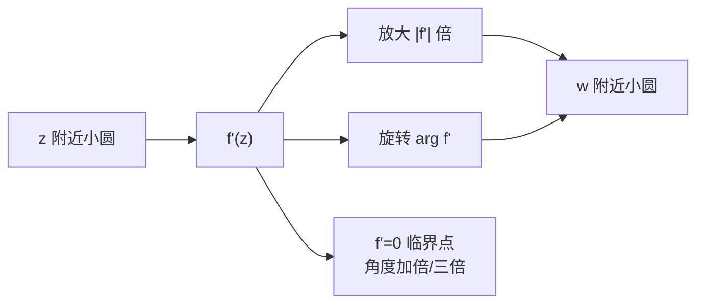

# 第 4 章：微分学：伸扭的概念

- **难度**：★★★ | **预估学时**：5 小时 | **前置**：第 1–3 章

## 学习目标

学完本章，你能：

1. 把复导数 $f'(z)$ 读成"局部伸缩率 + 局部扭转角"这个复数，而不是斜率。
2. 用伸扭解释"解析 = 保角"，并说明为什么 $f'(z)=0$ 的点是临界点。
3. 写出柯西–黎曼方程，并用它判断一个函数是否解析。
4. 说出 $z^2$ 在原点把角度加倍、$z^3$ 把角度三倍这类临界点行为。

## 一句话核心

复导数不是斜率，而是一个"局部乘子"：在 $z$ 附近，$f$ 近似于把无穷小图形放大 $|f'|$ 倍、旋转 $\arg f'$，这个动作叫伸扭。

## 零基础讲解

### 概念 1：从实导数到伸扭（进阶）

实函数 $f(x)$ 的导数 $f'(x)$ 可以看成"切线的斜率"，也可以看成"把 $x$ 处的小位移 $dx$ 放大成 $df$ 的倍数"：

$$df=f'(x)\,dx.$$

到了复平面，$f'(z)$ 不再是一条直线的斜率，而是一个复数。复数同时携带两个信息：模和角。于是

$$dw=f'(z)\,dz$$

读作：把 $z$ 处的一个无穷小向量 $dz$，先按 $|f'(z)|$ 伸缩，再按 $\arg f'(z)$ 旋转，得到 $w$ 处的 $dw$。

教材给这个复合动作起了个名字：**伸扭**（amplitwist = amplify + twist）。

- 伸缩率：$|f'(z)|$；
- 扭转度：$\arg f'(z)$。

例：$f(z)=z^2$，$f'(z)=2z$。在 $z=re^{i\theta}$ 处，伸缩率 $2r$，扭转度 $\theta$。所以 $z^2$ 在每一点附近都把图形放大 $2r$ 倍、转 $\theta$ 角。这正好解释了教材图 4-1 里"小正方形被映成小正方形"的现象。

### 概念 2：解析 = 保角（高难）

若 $f$ 在 $z_0$ 附近有导数且 $f'(z_0)\ne0$，则局部效果是"伸缩 + 旋转"，而这两种动作都保持任意两条曲线的交角（大小和方向）。所以 $f$ 在 $z_0$ 处**保角**（conformal）。

反过来，若一个映射在每一点局部都是"伸缩 + 旋转"（保向相似），它必然满足复可导的条件，因而解析。教材 4.6 节把这条说成"共形 = 解析"。

**临界点**：若 $f'(z_0)=0$，伸缩率变成 0，角度失去意义，保角性失效。这种点叫**临界点**。例：

- $z^2$ 在 0：$f'=2z$，$f'(0)=0$；角度被加倍（$z=re^{i\theta}\mapsto r^2e^{2i\theta}$）。
- $z^3$ 在 0：角度三倍。
- $e^z$ 没有临界点（$f'=e^z\ne0$），所以处处保角。

### 概念 3：柯西–黎曼方程（高难）

写 $f=u+iv$，$z=x+iy$。$f$ 解析的一个等价条件是

$$\frac{\partial u}{\partial x}=\frac{\partial v}{\partial y},\qquad \frac{\partial u}{\partial y}=-\frac{\partial v}{\partial x}.$$

这就是柯西–黎曼方程（CR）。它还有复数写法：

$$\frac{\partial f}{\partial\bar z}=0,$$

意思是 $f$ 只依赖 $z$，不依赖 $\bar z$。

**怎么用**：给定 $f=u+iv$，算四个偏导，验两条等式。例如 $f(z)=z^2=(x^2-y^2)+2ixy$：

$$u_x=2x,\ v_y=2x;\qquad u_y=-2y,\ -v_x=-2y.$$

两条都成立，所以 $z^2$ 解析，且

$$f'(z)=u_x+iv_x=2x+2iy=2z.$$

这与直接用幂法则算出的 $2z$ 一致。

**为什么是这两条**：复导数要求"从任何方向逼近 $z_0$，差商都趋向同一个复数"。从水平方向逼近给出 $u_x+iv_x$，从竖直方向逼近给出 $v_y-iu_y$（注意除以 $i$ 等于乘 $-i$）。两者相等就得到 CR。详细推导见本章深度片段。

### 概念 4：临界点与分支行为（进阶）

在临界点 $f'(z_0)=0$ 附近，映射不再是一对一的局部相似，而会"折叠"：

- $f(z)=z^2$ 在 0 附近把上半平面和下半平面都折到同一侧，角度加倍，所以原点附近是二重覆盖。
- $f(z)=z^3$ 在 0 附近角度三倍，三重覆盖。
- $f(z)=z^2-2z$ 的临界点在 $z=1$，那里 $f'=2z-2=0$。

临界点在后面的章节里会反复出现：第 5 章的曲率、第 6 章的共形映射、第 9 章的留数，都要先看导数在哪里为零。

## 图示

**看图说明**：伸扭把"长度"和"角度"分开画；临界点是伸扭退化成"只放大 0 倍"的地方，保角性在那里失效。

## 类比与实例

**类比：伸扭像复印机。** 复印时可以设定缩放比例（伸缩率），也可以把纸转一个角度（扭转角）。正常的解析函数在每一点都是一台设定好的复印机；临界点则是缩放比例调到 0，复印出来的东西退化成一点。类比的失效边界：复印机是全局统一比例，而 $f'(z)$ 随位置变化，每点比例不同。

**实例：$f(z)=z^2$ 在 $z=1+i$。** $f'(1+i)=2(1+i)=2+2i$，伸缩率 $|2+2i|=2\sqrt2$，扭转角 $45°$。取 $z$ 处一个小位移 $dz=0.01$，则 $dw\approx(2+2i)(0.01)=0.02+0.02i$，长度 $0.0283$，方向 $45°$——正好是"放大 $2\sqrt2$ 倍、转 $45°$"。

## 常见误解

- **别以为 $f'(z)$ 是切线斜率。** 实际它是一个复数，模是伸缩率、角是扭转角；斜率只是实函数情形下的特例。
- **别以为解析和可导是一回事。** 实际解析要求在一个小邻域内处处可导，不只是单点可导。
- **别以为 $f'=0$ 的点函数就"坏了"。** 实际函数仍然连续、仍然有值，只是局部不再保角、不再一一对应。
- **别以为 CR 方程只是计算技巧。** 实际它刻画了"局部是伸扭"这件事，是解析性的几何内容。

## 自测题（答案）

1. **（单选）$f'(z)$ 的模表示什么？**
   A. 切线斜率 B. 局部伸缩率 C. 扭转角 D. 曲率
   （答案：B；解析：$|f'|$ 是无穷小向量的放大倍数。）

2. **（单选）$f(z)=z^2$ 在 $z=i$ 处的扭转角是？**
   A. $0°$ B. $45°$ C. $90°$ D. $180°$
   （答案：C；解析：$f'(i)=2i$，$\arg(2i)=90°$。）

3. **（单选）下面哪个函数在原点有临界点？**
   A. $e^z$ B. $z^3$ C. $z+1$ D. $1/z$
   （答案：B；解析：$(z^3)'=3z^2$，在 0 处为 0。）

4. **（多选）柯西–黎曼方程包括？**
   A. $u_x=v_y$ B. $u_y=-v_x$ C. $u_x=v_x$ D. $u_y=v_y$
   （答案：A、B；解析：CR 是这两条，另外两条不是。）

5. **（单选）$f(z)=z^2$ 的导数是？**
   A. $2z$ B. $z$ C. $2\bar z$ D. $z^2$
   （答案：A；解析：幂法则，或 CR 算得 $u_x+iv_x=2x+2iy=2z$。）

6. **（单选）$f(z)=\bar z$ 在复平面上是否解析？**
   A. 是 B. 否 C. 除原点外是 D. 只在实轴上是
   （答案：B；解析：$u=x,v=-y$，$u_x=1$，$v_y=-1$，CR 不成立。）

7. **（简答）为什么 $f'(z_0)=0$ 时保角性失效？**
   （答案要点：伸扭的伸缩率是 $|f'|$，等于 0 时所有方向都被压成一点，角度没有定义；局部映射不再是一一对应。）

8. **（简答）用 CR 验证 $f(z)=e^z$ 解析，并求导数。**
   （答案要点：$e^z=e^x\cos y+ie^x\sin y$，$u_x=e^x\cos y=v_y$，$u_y=-e^x\sin y=-v_x$，CR 成立；$f'=u_x+iv_x=e^x\cos y+ie^x\sin y=e^z$。）

## 复习锚点

- 复导数 = 局部乘子：伸缩率 $|f'|$、扭转角 $\arg f'$。
- 解析 ⇔ 局部伸扭 ⇔ 保角（在 $f'\ne0$ 处）。
- CR：$u_x=v_y$、$u_y=-v_x$；复形式 $\partial f/\partial\bar z=0$。
- 临界点 $f'=0$：角度加倍/三倍，局部不再一一对应。
- 教材例子：$z^2$ 伸缩 $2r$、扭转 $\theta$。
