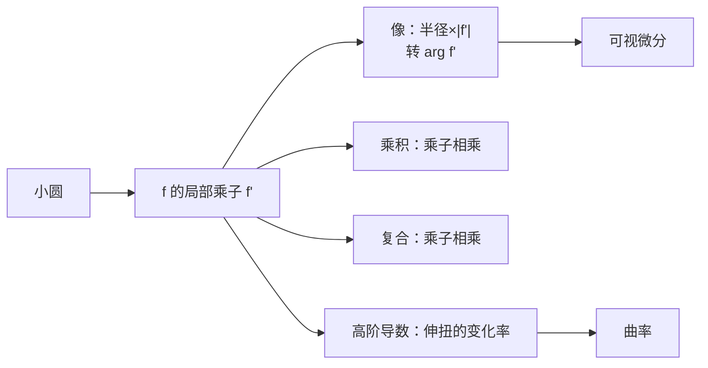

# 第 5 章：微分学的进一步的几何研究

- **难度**：★★★ | **预估学时**：5 小时 | **前置**：第 4 章（伸扭、CR）

## 学习目标

学完本章，你能：

1. 用"小圆的象"读出 $f'(z)$，并解释 $\log z$、$z^n$、$e^z$ 的导数公式在几何上分别做了什么。
2. 用伸扭解释乘积法则、商法则、链式法则：模相乘、角相加，链式则乘子相乘。
3. 说出曲率在共形映射下怎么变，以及高阶导数为什么能描述"弯曲"。
4. 解释解析延拓的唯一性：两块区域内相等的解析函数，在重叠区相等就整体相等。

## 一句话核心

微分法则不是符号游戏，而是"局部乘子"的算术：乘积的乘子相乘，复合的乘子相乘，导数的几何内容始终是伸缩加扭转。

## 零基础讲解

### 概念 1：可视微分法（进阶）

教材 5.1 提出"可视微分法"：在 $z$ 处画一个半径极小的小圆，看它在 $w$ 平面上的象。若 $f$ 解析且 $f'\ne0$，象近似是一个小圆，其半径是原半径的 $|f'|$ 倍，并且转了 $\arg f'$ 角。于是

$$f'(z)\approx\frac{\text{象圆半径}}{\text{原圆半径}}\,e^{i(\text{转角})}.$$

让半径趋于 0，近似变精确，这就是导数的几何读法。它比公式好在：拿到一个陌生函数，画一张图就能估出导数。

**例子：$\log z$。** 在 $z=re^{i\theta}$ 处，$(\log z)'=1/z=\frac1r e^{-i\theta}$。伸缩率 $1/r$，扭转角 $-\theta$。几何上：离原点越远，局部放大率越小；角度按 $-\theta$ 转。这和第 2 章反演 $1/z$ 的效果一致——$\log$ 的导数就是反演。

### 概念 2：微分法则的几何（进阶）

**乘积**：$(fg)'=f'g+fg'$。几何读法：$fg$ 的局部乘子由两部分叠加；在 $f,g$ 都不为零时，也可以写成对数导数

$$\frac{(fg)'}{fg}=\frac{f'}{f}+\frac{g'}{g},$$

即"伸缩率的对数相加、扭转角相加"。这就是为什么乘法的几何是"长度相乘、角度相加"。

**商**：$\left(\frac fg\right)'=\frac{f'g-fg'}{g^2}$，对数导数是 $\frac{f'}{f}-\frac{g'}{g}$：伸缩率相除、角度相减。

**链式**：$(f\circ g)'(z)=f'(g(z))\,g'(z)$。几何读法最直接：先乘 $g'$ 再乘 $f'$，两个乘子相乘，伸缩率相乘、扭转角相加。

**幂与级数**：$(z^n)'=nz^{n-1}$，逐项求导保持收敛半径不变（圆内一致收敛）。这为第 9 章的泰勒展开打底。

### 概念 3：$e^z$ 的几何解法（进阶）

教材 5.8 提出：不解方程，直接找"导数等于自己"的映射。

要求 $f'(z)=f(z)$，即局部乘子等于函数值本身。设 $f=Re^{i\varphi}$，则

- 伸缩率 $|f'|=R$；
- 扭转角 $\arg f'=\varphi$。

在 $z=x+iy$ 处，沿实轴走 $dx$，长度按 $R\,dx$ 增长；沿虚轴走 $dy$，角度按 $\varphi$ 转。这正好是"长度随 $x$ 指数增长、角度随 $y$ 线性增加"，解就是 $e^z$。这条推导不依赖幂级数，只用伸扭的几何，因此回答了"为什么 $e^z$ 的导数还是自己"。

### 概念 4：曲率与高阶导数（高难）

曲线的曲率 $\kappa$ 描述"弯得多厉害"，定义为单位弧长上切线转过的角。对解析映射 $w=f(z)$，像曲线的曲率与原型曲线、$f'$、$f''$ 都有关系。教材 5.9 给出的核心结论是：

$$\kappa_w=\frac{\kappa_z+\text{（由 }f'\text{、}f''\text{ 决定的项）}}{|f'|},$$

即共形映射把曲率"缩放"并加上一项由映射本身弯曲程度决定的修正。精确公式不必背，但要记住两点：

- $f'\ne0$ 时，曲率是有限的，保角映射把圆弧映成圆弧（一阶近似）；
- $f''$ 描述"伸缩率随位置怎么变"，$f''=0$ 时局部二阶近似是纯伸缩旋转。

高阶导数因此可以读成"伸扭的变化率"：$f'$ 管一次，$f''$ 管一次变化，$f'''$ 管二次变化。

### 概念 5：解析延拓（高难）

若两个解析函数在某个有聚点的集合上相等（例如在一条曲线上、或一个小圆盘内相等），则它们在共同定义域内处处相等。这条叫解析延拓的唯一性。

**用法**：先在一个小区域里把函数写成幂级数，再沿路径把这个级数"续"到更大区域。第 9 章的洛朗级数、第 12 章的黎曼映射定理都用它。

**边界**：延拓不能越过奇点。$\frac1{1-z}$ 在 $|z|<1$ 内是 $1+z+z^2+\cdots$，但级数在 $z=1$ 处失效，不能靠它"续"过 $1$。

## 图示

**看图说明**：所有微分法则都回到同一个动作"乘一个复数"；曲率是二阶修正，解析延拓是把局部信息拼成整体。

## 类比与实例

**类比：可视微分像用放大镜看地图。** 在一点放一个很小的圆，看它在地图上变成多大的椭圆/圆、转了多少度，就能读出该点的"局部比例尺"。失效边界：如果该点是临界点，小圆会被压扁成一点或拉成多瓣，比例尺不存在。

**实例：$(z^2)'=2z$ 的可视验证。** 在 $z=1+i$ 处画半径 $0.01$ 的圆，$f=z^2$ 把圆心送到 $2i$，半径约 $|2z|\times0.01=0.0283$，转角 $45°$。这与公式一致，也与第 4 章算例一致。

## 常见误解

- **别以为可视微分是近似、不严格。** 实际它是导数定义的几何翻译：半径趋于 0 时极限就是 $f'$。
- **别以为链式法则是"乘 $f'$ 再乘 $g'$"的记号游戏。** 实际是两个伸扭首尾相接，乘子自然相乘。
- **别以为解析延拓可以随便越过奇点。** 实际奇点会挡住级数的收敛圆，越过去需要换展开点。
- **别以为曲率只跟曲线有关。** 实际共形映射会改变曲率，$f''$ 就是修正项。

## 自测题（答案）

1. **（单选）$(\log z)'$ 在 $z=2$ 处的伸缩率是？**
   A. 2 B. 1/2 C. 1 D. 4
   （答案：B；解析：$1/z=1/2$，模为 $1/2$。）

2. **（单选）链式法则的几何意思是？**
   A. 乘子相加 B. 乘子相乘 C. 乘子相除 D. 乘子取共轭
   （答案：B；解析：$(f\circ g)'=f'(g)g'$，两个乘子相乘。）

3. **（单选）$(fg)'/(fg)$ 等于？**
   A. $f'/f+g'/g$ B. $f'/f-g'/g$ C. $f'g'$ D. $f/g$
   （答案：A；解析：对数导数相加。）

4. **（多选）下面哪些是解析延拓的必要条件？**
   A. 两块区域有重叠 B. 在重叠区相等 C. 函数解析 D. 函数有界
   （答案：A、B、C；解析：有界不是必要条件。）

5. **（单选）$f''(z)$ 描述什么？**
   A. 函数值 B. 伸缩率的变化率 C. 曲线的长度 D. 收敛半径
   （答案：B；解析：$f'$ 管一次伸扭，$f''$ 管它的变化。）

6. **（单选）$e^z$ 的导数是？**
   A. $e^z$ B. $ze^{z-1}$ C. $1/e^z$ D. $e^{-z}$
   （答案：A；解析：$e^z$ 的伸扭乘子等于它自身。）

7. **（简答）为什么 $\frac{1}{1-z}$ 的幂级数不能延拓过 $z=1$？**
   （答案要点：级数在 $|z|<1$ 收敛，$z=1$ 是奇点，收敛圆被它挡住；越过去要换展开点。）

8. **（简答）用可视微分说明 $(z^3)'=3z^2$。**
   （答案要点：$z^3$ 在 $z$ 处把角度乘 3、长度立方；局部小圆的像半径是 $3|z|^2$ 倍、转角 $2\arg z$，正是 $3z^2$ 的模与角。）

## 复习锚点

- 可视微分：小圆的象给出 $f'$ 的模与角。
- 乘积、商、复合的乘子分别相乘、相除、相乘；对数导数把乘法变加法。
- $e^z$ 是"伸扭等于自身"的唯一解。
- 曲率由 $f'$、$f''$ 修正；高阶导数 = 伸扭的变化率。
- 解析延拓靠唯一性，不能越过奇点。
