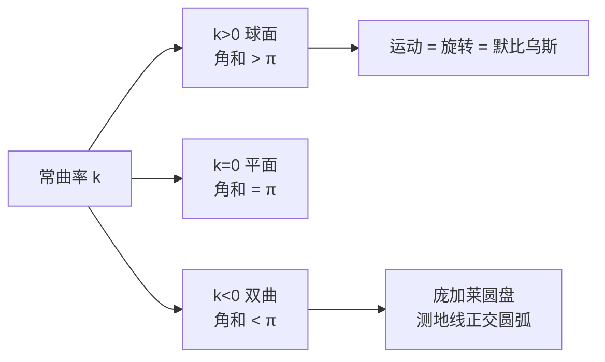

# 第 6 章：非欧几何学

- **难度**：★★★ | **预估学时**：5 小时 | **前置**：第 3 章（默比乌斯变换）、第 4 章（共形）

## 学习目标

学完本章，你能：

1. 说出欧氏、球面、双曲三种几何在"过直线外一点有几条平行线"上的差别。
2. 用球面的大圆、三角形内角和大于 $\pi$ 解释正曲率几何。
3. 写出庞加莱圆盘的度量，说明测地线是正交于边界的圆弧，三角形内角和小于 $\pi$。
4. 解释为什么三种几何的等距变换都能写成默比乌斯变换。

## 一句话核心

几何的"直"由度量决定；常曲率只有三种符号，对应球面（正）、平面（零）、双曲（负），而它们的运动群都能装进默比乌斯变换。

## 零基础讲解

### 概念 1：三种几何的分岔（基础）

欧几里得第五公设等价于"过直线外一点，恰有一条平行线"。把它换成"没有"或"无穷多"，就得到另外两种几何：

- 球面几何：任意两条"直线"（大圆）都相交，没有平行线；
- 双曲几何：过直线外一点有无穷多条不相交的"直线"。

教材 6.1 用"蚂蚁在曲面上走"的比喻说明：几何的性质是**内蕴**的，蚂蚁不需要知道曲面在三维空间里长什么样，只要知道怎么量距离。

### 概念 2：球面几何（进阶）

球面上的"直线"是大圆（过球心的平面与球面的交线），因为它是两点间最短路径。三条大圆围成的球面三角形，内角和

$$A+B+C=\pi+\frac{\text{面积}}{R^2}.$$

也就是说，内角和总大于 $\pi$，超出部分正好是"球面多余面积"。曲率 $k=1/R^2>0$。

球面的等距变换（保距映射）是三维空间中的旋转；通过球极射影投到复平面，正好是第 3 章的默比乌斯变换。所以"球面运动 = 默比乌斯变换"不是巧合，而是同一群对象的两种写法。

### 概念 3：双曲几何与庞加莱圆盘（高难）

双曲几何的曲率 $k=-1/R^2<0$。最方便的模型是**庞加莱圆盘**：单位圆盘内，度量是

$$d\hat s=\frac{2|dz|}{1-|z|^2}.$$

靠近边界时，分母趋于 0，同样的坐标距离对应越来越大的真实距离——所以边界是"无穷远"。

**测地线**（双曲直线）是与单位圆正交的圆弧（直径也算）。它们满足"过直线外一点有无穷多条平行线"。

**三角形内角和**：

$$A+B+C=\pi-\frac{\text{面积}}{R^2},$$

总小于 $\pi$。面积越大，亏得越多。

**等距变换**：把圆盘映到自身的默比乌斯变换，形如

$$M(z)=e^{i\theta}\frac{z-a}{1-\bar a z},\qquad |a|<1.$$

它们在圆盘内保双曲距离，构成双曲几何的运动群。

### 概念 4：测地线（进阶）

测地线是"局部最短"的曲线。在欧氏平面是直线；在球面是大圆；在庞加莱圆盘是与边界正交的圆弧。

教材 6.2 用"球面上的运动由旋转生成"证明：任意两个等距的球面三角形之间，恰有一个旋转把其中一个搬到另一个。双曲情形同样由默比乌斯变换生成。

**为什么测地线重要**：它把"几何的直线"从"看起来直"改成"量起来最短"。这是整个非欧几何的出发点，也是第 12 章黎曼映射定理的几何背景。

### 概念 5：曲率与三种几何（高难）

高斯曲率 $k$ 是内蕴量：蚂蚁在曲面上量小三角形的角和，就能算出 $k$ 的符号。常曲率曲面只有三类（局部）：

- $k>0$：球面型，三角形角和 $>\pi$；
- $k=0$：平面型，角和 $=\pi$；
- $k<0$：伪球面型（双曲），角和 $<\pi$。

教材 6.2、6.3 分别用球面和伪球面（曳物线旋转面）构造模型，并证明曲率分别是 $\pm1/R^2$。第 12 章会把这个分类用到流体与调和函数上。

## 图示

**看图说明**：三种几何的分岔只看曲率符号；球面和双曲的运动都能写成默比乌斯变换。

## 类比与实例

**类比：三种几何像三种地图投影。** 球面地图保角但保不了面积；庞加莱圆盘把无限大的双曲平面塞进单位圆，越靠边比例尺越大。类比的失效边界：地图投影是"表示"曲面，而球面/双曲几何本身就是曲面的内蕴几何，不是表示问题。

**实例：庞加莱圆盘里的"直线"。** 取圆盘内两点 $0$ 与 $0.5$。过这两点的测地线是直径（一段直线）。取两点 $0.5i$ 与 $0.5$，测地线是过这两点、与单位圆正交的圆弧，不是欧氏直线。沿这条弧量距离比沿欧氏弦更"长"，因为靠近边界的比例尺变大。

## 常见误解

- **别以为非欧几何是"假想"。** 实际球面几何就是地球表面（局部）的几何，双曲几何在相对论、网络结构里都有实现。
- **别以为庞加莱圆盘的"直线"是弯的所以不算直线。** 实际"直"由度量定义：测地线是局部最短，圆弧在双曲度量下就是最短。
- **别以为三种几何互不相干。** 实际它们由同一个曲率参数连起来，$k\to0$ 时双曲/球面都退化成欧氏。
- **别以为默比乌斯变换只属于平面。** 实际它同时是球面和双曲几何的运动群。

## 自测题（答案）

1. **（单选）球面三角形的内角和？**
   A. 等于 $\pi$ B. 大于 $\pi$ C. 小于 $\pi$ D. 不确定
   （答案：B；解析：正曲率，角和 $=\pi+$ 面积/$R^2$。）

2. **（单选）庞加莱圆盘的测地线是？**
   A. 欧氏直线 B. 与边界正交的圆弧 C. 椭圆 D. 抛物线
   （答案：B；解析：双曲测地线是正交于单位圆的圆弧。）

3. **（单选）双曲几何中过直线外一点有几条平行线？**
   A. 0 B. 1 C. 2 D. 无穷多
   （答案：D；解析：双曲几何的平行公设是"无穷多条"。）

4. **（多选）三种常曲率几何包括？**
   A. 球面 B. 平面 C. 双曲 D. 环面
   （答案：A、B、C；解析：环面曲率不均匀。）

5. **（单选）庞加莱圆盘度量 $2|dz|/(1-|z|^2)$ 在边界附近会？**
   A. 趋于 0 B. 趋于无穷 C. 保持不变 D. 变成负的
   （答案：B；解析：分母趋于 0，真实距离趋于无穷。）

6. **（单选）球面等距变换投到平面上是什么？**
   A. 线性函数 B. 默比乌斯变换 C. 指数函数 D. 多项式
   （答案：B；解析：球面旋转经球极射影对应默比乌斯变换。）

7. **（简答）为什么"三角形内角和"能判断曲率符号？**
   （答案要点：正曲率角和大于 $\pi$，零曲率等于 $\pi$，负曲率小于 $\pi$；这是高斯–博内特公式的初等情形。）

8. **（简答）写出把单位圆盘映到自身的默比乌斯变换的一般形式。**
   （答案要点：$M(z)=e^{i\theta}\frac{z-a}{1-\bar a z}$，$|a|<1$。）

## 复习锚点

- 三种几何由曲率符号区分：$+1,0,-1$。
- 球面：大圆是直线，角和 $>\pi$；双曲：正交圆弧是直线，角和 $<\pi$。
- 庞加莱圆盘度量 $2|dz|/(1-|z|^2)$，边界是无穷远。
- 球面/双曲的运动群都是默比乌斯变换。
- 教材用曳物线旋转面（伪球面）构造负曲率模型。
