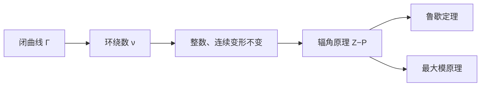

# 第 7 章：环绕数与拓扑学

- **难度**：★★★ | **预估学时**：4–5 小时 | **前置**：第 2 章（多值、支点）、第 3 章（球面）

## 学习目标

学完本章，你能：

1. 定义环绕数，并说明它为什么是整数、为什么在连续变形下不变。
2. 用辐角原理数零点和极点：$\frac1{2\pi i}\oint f'/f\,dz=Z-P$。
3. 用鲁歇定理判断圆内零点个数，不必解方程。
4. 说出最大模原理，并解释它为什么排除"内部取到最大"。

## 一句话核心

绕着一个点转几圈，是一个整数；这个整数在连续变形下不变，函数的零点与极点就靠它来数。

## 零基础讲解

### 概念 1：环绕数（基础）

给定一条闭曲线 $\Gamma$ 和一个不在曲线上的点 $a$，环绕数 $\nu(\Gamma,a)$ 是"$\Gamma$ 绕 $a$ 转的圈数"，逆时针为正、顺时针为负。

严格定义：让 $z$ 沿 $\Gamma$ 走一圈，看角度 $\arg(z-a)$ 的连续变化，总变化量是 $2\pi$ 的整数倍：

$$\nu(\Gamma,a)=\frac{1}{2\pi}\Delta_\Gamma\arg(z-a).$$

**为什么是整数**：回到起点时方向必须与出发时相同，角度只能差 $2\pi$ 的整数倍。

**为什么不变**：$\Gamma$ 连续变形时，只要不扫过 $a$，角度累计只能连续变化；而它又只能取整数，所以只能不变。这就是"拓扑不变量"。

例：单位圆绕 0 一圈，$\nu=1$；绕 2 一圈，$\nu=0$；绕 0 顺时针一圈，$\nu=-1$。

### 概念 2：辐角原理（高难）

设 $f$ 在 $\Gamma$ 内解析（除孤立极点外），在 $\Gamma$ 上不为零。则

$$\frac{1}{2\pi i}\oint_\Gamma \frac{f'(z)}{f(z)}\,dz=Z-P,$$

其中 $Z$ 是零点个数（计重数），$P$ 是极点个数（计阶数）。

**读法**：$f'/f$ 是 $\log f$ 的导数；沿闭曲线积分一圈，得到 $\log f$ 的"总变化" $2\pi i(Z-P)$。每绕一个零点，$\log f$ 多 $2\pi i$；每绕一个极点，多 $-2\pi i$。

**特例**：$f$ 在 $\Gamma$ 内解析且无零点，则积分等于 0。

### 概念 3：鲁歇定理（进阶）

若在 $\Gamma$ 上 $|g(z)|<|f(z)|$，则 $f$ 与 $f+g$ 在 $\Gamma$ 内有相同个数的零点（计重数）。

**为什么**：看 $f_t=f+tg$（$t$ 从 0 到 1）。在 $\Gamma$ 上 $|tg|<|f|$，所以 $f_t$ 不为零。零点个数由辐角原理给出，是整数；随 $t$ 连续变化且不跳，故不变。$t=0$ 是 $f$，$t=1$ 是 $f+g$。

**用法**：数 $z^5+3z^2+1$ 在单位圆内的零点。取 $f=3z^2$（在 $|z|=1$ 上模为 3），$g=z^5+1$（模不超过 2）。$|g|<|f|$，所以零点个数与 $3z^2$ 相同：2 个。

### 概念 4：最大模原理（高难）

若 $f$ 在区域 $D$ 内解析、不恒为常数，则 $|f|$ 在 $D$ 内不能取到最大值；最大值只能出现在边界上。

**直观**：若 $|f|$ 在内部点 $z_0$ 取最大，则 $z_0$ 附近 $f$ 的象落在以 $f(z_0)$ 为心的小圆盘内。但解析映射局部是伸扭（放大 + 旋转），小圆会被放大，必然有更大的模——矛盾。

**推论**：有界解析函数在区域内的最大模在边界取到；若 $f$ 在区域内无零点，则 $1/f$ 解析，$|f|$ 也不能取最小（除非是常数）。

### 概念 5：施瓦茨–皮克引理（拓展）

若 $f$ 把单位圆盘映到自身、$f(0)=0$，则

$$|f'(0)|\le1,\qquad |f(z)|\le|z|.$$

等号成立当且仅当 $f(z)=e^{i\theta}z$。它给出解析函数"不能增长太快"的定量限制，是第 6 章双曲几何的度量推论。

## 图示

**看图说明**：拓扑不变量（环绕数）是根，辐角原理是它的积分版，鲁歇和最大模是两条推论。

## 类比与实例

**类比：环绕数像门禁计数器。** 你绕着大楼走一圈，计数器加一；走两圈加二；倒着走减一。不管你走的路是圆是方、绕多大，只要没穿过大楼，计数只看圈数。类比的失效边界：计数器只认"绕不绕"，不认路径长度和形状——这正是拓扑不变量的意思。

**实例：数 $z^3-1$ 在单位圆内的零点。** 取 $f=-1$，$g=z^3$。在 $|z|=1$ 上 $|g|=1$，$|f|=1$，不满足严格小于。换 $f=2$，$g=z^3-3$：$|g|\le1+3=4$，不满足。更直接：$z^3=1$ 的三个根都在单位圆上，不在"内部"，所以单位圆内零点数为 0（边界上有 3 个）。这说明鲁歇定理要求"边界上不为零"，本题边界恰好有零点，不能直接用。

## 常见误解

- **别以为环绕数依赖曲线形状。** 实际只依赖"绕不绕、绕几圈"，是拓扑量。
- **别以为辐角原理只数零点。** 实际它数的是 $Z-P$，极点会抵消零点。
- **别以为鲁歇定理可以随便取 $f$。** 实际要在边界上严格满足 $|g|<|f|$，边界有零点时失效。
- **别以为最大模原理说"没有最大值"。** 实际它说内部没有最大，边界上可以有。

## 自测题（答案）

1. **（单选）单位圆绕点 2 一圈的环绕数是？**
   A. 0 B. 1 C. 2 D. −1
   （答案：A；解析：点 2 在圆外，曲线没绕它。）

2. **（单选）$\frac1{2\pi i}\oint f'/f\,dz$ 等于？**
   A. $Z+P$ B. $Z-P$ C. $P-Z$ D. 0
   （答案：B；解析：辐角原理，零点计重数、极点计阶数。）

3. **（单选）鲁歇定理的条件是？**
   A. 边界上 $|g|<|f|$ B. 边界上 $|g|>|f|$ C. $f$ 为常数 D. $g$ 无零点
   （答案：A；解析：严格小于保证 $f_t$ 在边界不为零。）

4. **（多选）下面哪些是拓扑不变量？**
   A. 环绕数 B. 曲线长度 C. 零点个数（计重数） D. 曲线形状
   （答案：A、C；解析：长度和形状会随变形改变。）

5. **（单选）最大模原理说最大值出现在？**
   A. 区域内部 B. 边界 C. 原点 D. 无穷远
   （答案：B；解析：内部不能取最大，除非常数。）

6. **（单选）$f$ 在单位圆内解析且无零点，则 $\oint f'/f\,dz$ 等于？**
   A. $2\pi i$ B. 0 C. $2\pi$ D. $i$
   （答案：B；解析：$Z=P=0$。）

7. **（简答）用鲁歇定理数 $z^5+3z^2+1$ 在单位圆内的零点。**
   （答案要点：取 $f=3z^2$、$g=z^5+1$，边界上 $|g|\le2<3=|f|$，故零点数与 $3z^2$ 相同，为 2。）

8. **（简答）为什么环绕数在连续变形下不变？**
   （答案要点：变形不扫过被绕点时，角度累计连续变化；它只能取 $2\pi$ 的整数倍，连续变化只能保持不变。）

## 复习锚点

- 环绕数 = 角度总变化 / $2\pi$，整数、拓扑不变。
- 辐角原理：$\frac1{2\pi i}\oint f'/f=Z-P$。
- 鲁歇：边界上 $|g|<|f|$，则 $f$ 与 $f+g$ 零点数相同。
- 最大模在边界；内部不能取最大（除非常数）。
- 施瓦茨–皮克：$|f'(0)|\le1$，$|f(z)|\le|z|$。
