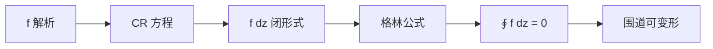

# 第 8 章：复积分：柯西定理

- **难度**：★★★ | **预估学时**：5 小时 | **前置**：第 4 章（CR）、第 7 章（环绕数）

## 学习目标

学完本章，你能：

1. 把复积分 $\int_\Gamma f\,dz$ 拆成实部与虚部，并解释它们的物理意义。
2. 叙述柯西定理，说明"解析 + 单连通"这两个条件各自的作用。
3. 用格林公式证明柯西定理，理解 CR 方程在其中的位置。
4. 用"变形不变"把复杂围道换成简单围道。

## 一句话核心

解析函数沿闭曲线的积分等于零；这不是计算技巧，而是 CR 方程在积分层面的必然结果。

## 零基础讲解

### 概念 1：复积分（基础）

设 $\Gamma$ 是复平面上的曲线，$f$ 在其上定义。复积分

$$\int_\Gamma f(z)\,dz=\lim\sum f(z_k)\Delta z_k.$$

把 $f=u+iv$、$dz=dx+i\,dy$ 代入，得

$$\int f\,dz=\int(u\,dx-v\,dy)+i\int(u\,dy+v\,dx).$$

右边两个实积分分别是"功"和"通量"：$u\,dx-v\,dy$ 是向量 $(u,-v)$ 沿曲线的切向分量；$u\,dy+v\,dx$ 是法向分量。所以复积分同时算了两个物理量。

**基本例子**：$\oint_\Gamma dz/(z-a)=2\pi i\,\nu(\Gamma,a)$（第 7 章的环绕数）。

### 概念 2：柯西定理（高难）

若 $f$ 在单连通区域 $D$ 内解析，$\Gamma$ 是 $D$ 内一条闭曲线，则

$$\oint_\Gamma f(z)\,dz=0.$$

**两个条件**：

- 解析：保证 $f$ 满足 CR 方程，从而 $f\,dz$ 是"闭形式"。
- 单连通：保证 $\Gamma$ 围住的区域完全在 $D$ 内，没有洞。

**为什么**：把 $f\,dz$ 拆开，利用格林公式，积分等于 $\iint_D(-v_x-u_y)\,dxdy+i\iint_D(u_x-v_y)\,dxdy$。CR 方程 $u_x=v_y$、$u_y=-v_x$ 正好让两个被积函数都为零。

### 概念 3：变形的围道（进阶）

柯西定理的重要推论：若两条闭曲线围住同样的"奇点集合"，则 $f$ 沿它们的积分相等。因为两条曲线之间的环形区域里 $f$ 解析，沿环形边界积分抵消。

这允许把复杂围道"缩"成小圆。例如

$$\oint_{|z|=2}\frac{dz}{z-1}=\oint_{|z-1|=0.1}\frac{dz}{z-1}=2\pi i.$$

**注意**：变形时不能扫过奇点，否则积分值会变。

### 概念 4：莫雷拉定理（拓展）

柯西定理的逆：若 $f$ 连续，且沿任意闭曲线积分为 0，则 $f$ 解析。

这说明"闭积分恒为零"是解析性的等价刻画，不只是必要条件。第 9 章的刘维尔定理、第 12 章的调和函数都用它。

### 概念 5：柯西定理的证明思路（高难）

教材给出两条路线：

1. **格林公式路线**：假设 $f'$ 连续，用格林公式和 CR 方程直接得 0。这条路线直观，但要求偏导连续。
2. **古尔萨路线**：不假设 $f'$ 连续，把三角形不断四分，积分值按几何级数缩小，最终逼到 0。这条路线更严格，说明解析本身（不用 $f'$ 连续）就足够。

两条路线都指向同一结论；区别只在技术假设。

## 图示

**看图说明**：解析 → CR → 格林 → 积分为零 → 围道变形，是一条单向链。

## 类比与实例

**类比：柯西定理像"保守力场绕一圈做功为零"。** 重力场绕任意闭合路径做功为 0，因为存在势函数；解析函数也有"势"（原函数），所以闭路径积分为 0。类比的失效边界：复积分有两组物理量（功与通量），势函数对应的是"无旋 + 无源"，需要 CR 同时成立。

**实例：$\oint_{|z|=1} z^2\,dz=0$。** 直接参数化 $z=e^{i\theta}$，$dz=ie^{i\theta}d\theta$，$z^2dz=ie^{3i\theta}d\theta$，从 0 到 $2\pi$ 积分为 0。与柯西定理一致。

## 常见误解

- **别以为柯西定理对任何闭曲线都成立。** 实际要求曲线围住的区域在解析区域内；绕奇点时积分不为零。
- **别以为"解析"可以换成"可导"。** 实际解析是邻域内可导，比单点可导强。
- **别以为围道变形可以随便越过奇点。** 实际越过奇点会改变积分值。
- **别以为积分为零就说明 $f$ 是常数。** 实际只说明沿该闭曲线积分为零，与函数是否常数无关。

## 自测题（答案）

1. **（单选）$\oint_{|z|=1}dz/z$ 等于？**
   A. 0 B. $2\pi i$ C. $\pi i$ D. $2\pi$
   （答案：B；解析：绕 0 一圈，环绕数 1。）

2. **（单选）柯西定理要求区域？**
   A. 单连通 B. 有界 C. 对称 D. 无界
   （答案：A；解析：单连通保证围道内部全在解析区。）

3. **（单选）$f\,dz$ 的实部对应？**
   A. 通量 B. 功 C. 面积 D. 长度
   （答案：B；解析：$u\,dx-v\,dy$ 是切向分量，即功。）

4. **（多选）柯西定理的证明路线包括？**
   A. 格林公式 B. 古尔萨三角形分割 C. 留数定理 D. 最大模原理
   （答案：A、B；解析：前者假设偏导连续，后者不假设。）

5. **（单选）$\oint_{|z|=2}\frac{dz}{z-1}$ 等于？**
   A. 0 B. $2\pi i$ C. $4\pi i$ D. $\pi i$
   （答案：B；解析：1 在圆内，环绕数 1。）

6. **（单选）若 $f$ 在单连通区域内解析，则沿任意闭曲线积分为？**
   A. $2\pi i$ B. 1 C. 0 D. 依赖曲线
   （答案：C；解析：柯西定理。）

7. **（简答）为什么绕奇点的积分不能靠"变形"消掉？**
   （答案要点：变形不能扫过奇点；奇点处 $f$ 不解析，格林公式的条件被破坏，积分值由环绕数决定。）

8. **（简答）写出复积分拆成实部的两个实积分。**
   （答案要点：$\int f\,dz=\int(u\,dx-v\,dy)+i\int(u\,dy+v\,dx)$。）

## 复习锚点

- 复积分 = 功 + $i$ 通量。
- 柯西定理：解析 + 单连通 ⇒ 闭积分为 0。
- 证明靠 CR 方程 + 格林公式（或古尔萨分割）。
- 围道可变形，但不能越过奇点。
- 莫雷拉定理是逆命题：闭积分恒零 ⇒ 解析。
