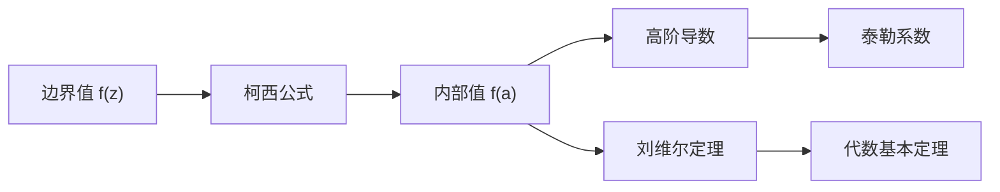

# 第 9 章：柯西公式及应用

- **难度**：★★★ | **预估学时**：5 小时 | **前置**：第 8 章（柯西定理、围道变形）

## 学习目标

学完本章，你能：

1. 写出柯西积分公式，说明它为什么能把"边界值"变成"内部值"。
2. 用高阶导数公式求 $f^{(n)}(a)$，不必真的求导。
3. 用刘维尔定理证明代数基本定理。
4. 写出解析函数的泰勒展开，并说明收敛半径由最近奇点决定。

## 一句话核心

函数在内部一点的值，由它在边界上的值完全决定；这条公式把复分析变成"边界控制内部"的理论。

## 零基础讲解

### 概念 1：柯西积分公式（高难）

设 $f$ 在单连通区域 $D$ 内解析，$\Gamma$ 是 $D$ 内一条逆时针闭曲线，$a$ 在 $\Gamma$ 内部。则

$$f(a)=\frac{1}{2\pi i}\oint_\Gamma\frac{f(z)}{z-a}\,dz.$$

**读法**：$\frac{1}{z-a}$ 在 $a$ 处有奇点，积分提取出 $f(a)$。这不是"平均"，而是"筛"——$1/(z-a)$ 像一个筛子，只把 $a$ 点的值筛出来。

**为什么**：把 $f(z)$ 在 $a$ 附近写成 $f(a)+f'(a)(z-a)+\cdots$，除以 $z-a$ 后，只有 $f(a)/(z-a)$ 这一项积分不为零，等于 $2\pi i f(a)$；其余项解析，积分为 0。

### 概念 2：高阶导数公式（进阶）

对上式求导 $n$ 次：

$$f^{(n)}(a)=\frac{n!}{2\pi i}\oint_\Gamma\frac{f(z)}{(z-a)^{n+1}}\,dz.$$

**用法**：不必真求导，只要算一个积分。第 9 章的留数计算全靠它。

**例子**：$f(z)=e^z$，$a=0$，$\Gamma$ 为单位圆：

$$f^{(n)}(0)=\frac{n!}{2\pi i}\oint\frac{e^z}{z^{n+1}}dz=1,$$

因为 $e^z$ 的泰勒系数全是 $1/n!$。

### 概念 3：刘维尔定理与代数基本定理（高难）

**刘维尔定理**：有界整函数（在整个复平面解析且有界）必为常数。

**证明思路**：对任意 $a$，用柯西公式在半径 $R$ 的大圆上估计：

$$|f'(a)|\le\frac{M}{R},$$

$M$ 是 $|f|$ 的上界。让 $R\to\infty$，得 $f'(a)=0$；$a$ 任意，所以 $f$ 常数。

**代数基本定理**：$n$ 次复系数多项式至少有一个根。

**证明**：若 $p(z)$ 无根，则 $1/p(z)$ 整函数；$|p(z)|\to\infty$（$|z|\to\infty$），所以 $1/p$ 有界。由刘维尔定理，$1/p$ 是常数，矛盾（$p$ 非常数）。

### 概念 4：泰勒级数与收敛半径（进阶）

若 $f$ 在 $a$ 的圆盘内解析，则

$$f(z)=\sum_{n=0}^\infty\frac{f^{(n)}(a)}{n!}(z-a)^n.$$

收敛半径等于"$a$ 到最近奇点的距离"。这不是巧合：奇点处级数必失效，所以半径被它卡住。

**例子**：$\frac1{1-z}$ 在 $0$ 处展开，半径 1，奇点 $z=1$；$\log z$ 在 $1$ 处展开，半径 1，奇点 $z=0$。

### 概念 5：平均值性质（拓展）

解析函数的 $f(a)$ 等于以 $a$ 为心的小圆上 $f$ 的平均值：

$$f(a)=\frac{1}{2\pi}\int_0^{2\pi}f(a+re^{i\theta})\,d\theta.$$

它是柯西公式的几何版，也是最大模原理的另一条证明路线。

## 图示

**看图说明**：边界 → 内部 → 导数 → 级数，一条链把整章串起来。

## 类比与实例

**类比：柯西公式像"全息"。** 一张全息底片的每一小块都包含整个物体的信息；解析函数的边界值也包含内部全部信息。类比的失效边界：全息是物理成像，柯西公式是积分恒等式，后者严格到可以逐点算。

**实例：算 $\oint_{|z|=1}\frac{e^z}{z}\,dz$。** 由柯西公式，$a=0$，$f=e^z$，积分 $=2\pi i\,e^0=2\pi i$。直接参数化也能算，但公式一步到位。

## 常见误解

- **别以为柯西公式只对圆成立。** 实际对任意逆时针闭曲线成立，只要 $a$ 在内部。
- **别以为刘维尔定理说"有界解析函数不存在"。** 实际它说"整函数 + 有界 ⇒ 常数"；圆盘内的有界解析函数多得是。
- **别以为泰勒级数收敛半径可以随便取。** 实际由最近奇点决定，奇点挡住级数。
- **别以为高阶导数公式只是形式。** 实际它把求导变成积分，是留数计算的核心。

## 自测题（答案）

1. **（单选）柯西公式中 $a$ 必须在？**
   A. 曲线外 B. 曲线内 C. 曲线上 D. 无穷远
   （答案：B；解析：$a$ 在内部，$1/(z-a)$ 才有奇点。）

2. **（单选）$\oint_{|z|=1}\frac{e^z}{z}dz$ 等于？**
   A. 0 B. $2\pi i$ C. $2\pi ie$ D. $\pi i$
   （答案：B；解析：$f(0)=1$，乘 $2\pi i$。）

3. **（单选）刘维尔定理说？**
   A. 有界整函数为常数 B. 解析函数有界 C. 整函数无零点 D. 多项式有根
   （答案：A；解析：整 + 有界 ⇒ 常数。）

4. **（多选）泰勒收敛半径由什么决定？**
   A. 最近奇点 B. 展开中心 C. 函数值 D. 导数阶数
   （答案：A、B；解析：半径 = 中心到最近奇点的距离。）

5. **（单选）$f^{(n)}(a)$ 的积分公式分母是？**
   A. $(z-a)^n$ B. $(z-a)^{n+1}$ C. $z^n$ D. $(z+a)^{n+1}$
   （答案：B；解析：$n!/(2\pi i)\oint f/(z-a)^{n+1}$。）

6. **（单选）代数基本定理的证明用？**
   A. 刘维尔定理 B. 留数定理 C. 最大模原理 D. 柯西–黎曼方程
   （答案：A；解析：假设无根，$1/p$ 有界整函数，得常数，矛盾。）

7. **（简答）为什么 $1/(1-z)$ 在 0 处的泰勒级数半径是 1？**
   （答案要点：最近奇点在 $z=1$，距离为 1；级数在奇点处失效。）

8. **（简答）写出柯西积分公式并解释每一项。**
   （答案要点：$f(a)=\frac1{2\pi i}\oint_\Gamma \frac{f(z)}{z-a}dz$；$f(z)$ 是边界值，$1/(z-a)$ 提供奇点，$2\pi i$ 是环绕数归一化。）

## 复习锚点

- 柯西公式：边界值定内部值。
- 高阶导数：$f^{(n)}(a)=\frac{n!}{2\pi i}\oint f/(z-a)^{n+1}$。
- 刘维尔：有界整函数为常数；由此证代数基本定理。
- 泰勒半径 = 到最近奇点的距离。
- 平均值性质：$f(a)$ 等于小圆上的平均。
