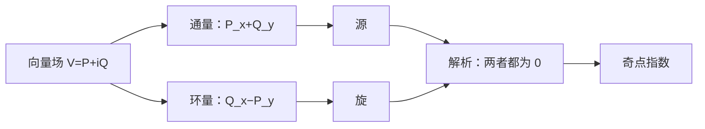

# 第 10 章：向量场：物理学与拓扑学

- **难度**：★★★ | **预估学时**：4–5 小时 | **前置**：第 8 章（复积分）、第 7 章（环绕数）

## 学习目标

学完本章，你能：

1. 把向量场写成复数形式 $V=P+iQ$，说出 $P,Q$ 的物理意义。
2. 用通量与环量描述源和旋，写出它们的积分表达式。
3. 定义向量场在奇点处的指数，并说明它为什么是整数。
4. 解释"解析向量场"与"无源无旋"的对应。

## 一句话核心

向量场的源与旋，可以用一个复积分同时读出；奇点的指数是拓扑量，只能在整数间跳。

## 零基础讲解

### 概念 1：向量场与复表示（基础）

平面向量场给每点一个箭头 $(P,Q)$。把它写成复数

$$V(z)=P(x,y)+iQ(x,y)$$

（注意：这里 $V$ 不是解析函数，只是一个"逐点给箭头"的映射）。

**例子**：$V(z)=z$ 是"从原点向外辐射"的场；$V(z)=iz$ 是"绕原点逆时针旋转"的场；$V(z)=\bar z$ 是"向原点汇聚"的场。

### 概念 2：通量与环量（进阶）

沿曲线 $\Gamma$ 的通量（法向流量）：

$$\text{Flux}=\oint_\Gamma(P\,dy-Q\,dx).$$

沿曲线 $\Gamma$ 的环量（切向流量）：

$$\text{Circ}=\oint_\Gamma(P\,dx+Q\,dy).$$

这两个量正好是第 8 章复积分的实部与虚部（差一个符号/共轭，取决于约定）：

$$\oint_\Gamma \bar V\,dz=\text{Flux}+i\,\text{Circ}.$$

所以一个复积分同时算两个物理量。

**格林公式**：对闭曲线，

$$\text{Flux}=\iint_D(P_x+Q_y)\,dxdy,\qquad \text{Circ}=\iint_D(Q_x-P_y)\,dxdy.$$

$P_x+Q_y$ 是散度（源强度），$Q_x-P_y$ 是旋度（旋转强度）。

### 概念 3：奇点与指数（高难）

向量场在某点为零，称为奇点。绕奇点一圈，箭头方向转过的总角度除以 $2\pi$，就是指数：

$$\text{Index}=\frac{1}{2\pi}\Delta_\Gamma\arg V(z).$$

**常见指数**：

- 源（$V=z$）：指数 $+1$；
- 汇（$V=-z$）：指数 $+1$；
- 旋转（$V=iz$）：指数 $+1$；
- 鞍点（$V=\bar z$）：指数 $-1$；
- 偶极（$V=1/z$）：指数 $-1$。

指数是整数，且在连续变形下不变（只要不扫过奇点）。

### 概念 4：解析向量场与无源无旋（高难）

这里有个符号约定要盯紧。若 $V=P+iQ$ 解析，CR 给

$$P_x=Q_y,\qquad P_y=-Q_x.$$

此时散度 $P_x+Q_y=2P_x$、旋度 $Q_x-P_y=2Q_x$，一般**不**为零。所以"$V$ 解析"不等于无源无旋。

无源无旋要求的是 $\bar V=P-iQ$ 解析：它的 CR 方程是

$$P_x=-Q_y,\qquad P_y=Q_x,$$

于是

$$\text{散度}=P_x+Q_y=0,\qquad \text{旋度}=Q_x-P_y=0.$$

物理上的来历：复势 $\Omega=\phi+i\psi$ 解析，速度是 $\bar\Omega'=\phi_x-i\phi_y$，所以速度场的共轭才是解析函数。教材里"解析向量场"指的就是这一支。

反过来，若 $\bar V$ 无源无旋（单连通），则它解析（莫雷拉定理）。这条对应才是整章的核心：解析 ⇔ 无源无旋，但要认准是 $\bar V$ 而不是 $V$。

### 概念 5：向量场的拓扑（拓展）

平面上孤立奇点的指数之和，与区域拓扑有关。直观上，若区域没有奇点，向量场可以连续变形为常向量场；奇点是指数"卡"在那里的地方，不能靠连续变形消掉。

第 11 章会把这条用到"绕奇点的积分"上。

## 图示

**看图说明**：源和旋是两个独立读数；解析让它们同时为零；奇点指数是拓扑残留。

## 类比与实例

**类比：向量场像人群的流动。** 源是"有人从地下冒出来"，汇是"有人掉进洞里"，旋是"人群绕圈打转"。通量是穿过某条线的总人数，环量是沿某条线走一圈感受到的"推着转"的趋势。类比的失效边界：人群可以压缩、加速，向量场只记录瞬时箭头，不记录密度变化。

**实例：$V(z)=z$ 沿单位圆。** $V=e^{i\theta}$ 在圆上，箭头径向向外。通量 $=2\pi$（源强度 1），环量 $=0$（不旋转）。指数 $+1$。

**实例：$V(z)=iz$ 沿单位圆。** 箭头切向逆时针。通量 $=0$，环量 $=2\pi$，指数 $+1$。

## 常见误解

- **别以为 $V$ 解析就等于无源无旋。** 实际要看 $\bar V$ 是否解析；$V$ 解析一般给散度和旋度都不为零。
- **别以为指数可以取任意实数。** 实际它是整数，连续变形只能保持不变或跳变。
- **别以为奇点可以随便消掉。** 实际指数不为零的奇点有拓扑保护，不能靠局部微调消除。
- **别以为通量和环量是一回事。** 实际一个看法向、一个看切向，格林公式给的是散度和旋度。

## 自测题（答案）

1. **（单选）$V(z)=z$ 在原点处的指数是？**
   A. −1 B. 0 C. +1 D. +2
   （答案：C；解析：源，绕一圈箭头转一圈。）

2. **（单选）无源无旋向量场满足？**
   A. 散度与旋度都为 0 B. 只有散度为 0 C. 只有旋度为 0 D. 指数为 1
   （答案：A；解析：无源即散度 0，无旋即旋度 0；对应 $\bar V$ 解析。）

3. **（单选）$V(z)=\bar z$ 的指数是？**
   A. −1 B. 0 C. +1 D. +2
   （答案：A；解析：鞍点，绕一圈箭头反向转。）

4. **（多选）格林公式给出的两个量是？**
   A. 散度 B. 旋度 C. 指数 D. 留数
   （答案：A、B；解析：通量对应散度，环量对应旋度。）

5. **（单选）指数在连续变形下不变的条件是？**
   A. 不变形 B. 不扫过奇点 C. 场保持线性 D. 区域有界
   （答案：B；解析：扫过奇点时方向无定义。）

6. **（单选）$V(z)=iz$ 的通量是？**
   A. 0 B. $2\pi$ C. $-2\pi$ D. $\pi$
   （答案：A；解析：纯旋转场，法向分量为零。）

7. **（简答）为什么解析向量场无源无旋？**
   （答案要点：CR 方程 $P_x=Q_y$、$P_y=-Q_x$ 使散度 $P_x+Q_y=0$、旋度 $Q_x-P_y=0$。）

8. **（简答）写出通量与环量的积分表达式。**
   （答案要点：Flux $=\oint(P\,dy-Q\,dx)$，Circ $=\oint(P\,dx+Q\,dy)$。）

## 复习锚点

- 向量场 $V=P+iQ$；通量看法向，环量看切向。
- 格林公式：通量 = 散度面积分，环量 = 旋度面积分。
- 解析 ⇔ 无源无旋：认准 $\bar V$ 解析（单连通）。
- 奇点指数是整数，连续变形不变。
- 源/汇/旋转指数 $+1$，鞍点指数 $-1$。
