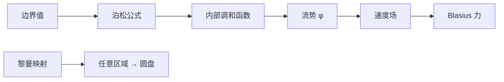

# 第 12 章：流与调和函数

- **难度**：★★★ | **预估学时**：5 小时 | **前置**：第 11 章（复势、留数）、第 9 章（柯西公式）

## 学习目标

学完本章，你能：

1. 说明调和函数与解析函数的关系，并用均值性质。
2. 写出泊松公式，用它解圆盘上的狄利克雷问题。
3. 用 Blasius 公式算绕障碍物的力与力矩。
4. 叙述黎曼映射定理，并说出它为什么重要。

## 一句话核心

平面流的势函数是调和函数；调和函数由边界值决定，所以"绕障碍物的流"可以由"边界上的一个函数"完全算出。

## 零基础讲解

### 概念 1：调和函数（进阶）

满足拉普拉斯方程

$$\Delta\phi=\phi_{xx}+\phi_{yy}=0$$

的函数叫调和函数。解析函数的实部与虚部都是调和函数（CR 方程求导即得）。

**例子**：$\phi=x$、$\phi=\log r$、$\phi=x/(x^2+y^2)$ 都是调和函数。

**均值性质**：调和函数在一点的值等于以该点为心的小圆上的平均值。这条性质与解析函数相同，是最大模原理的基础。

### 概念 2：泊松公式与狄利克雷问题（高难）

**狄利克雷问题**：给定区域边界上的值，求内部调和函数。

**圆盘上的解**（泊松公式）：

$$\phi(re^{i\theta})=\frac{1}{2\pi}\int_0^{2\pi}\frac{1-r^2}{1-2r\cos(\theta-t)+r^2}\,\phi(e^{it})\,dt.$$

核

$$P_r(\theta-t)=\frac{1-r^2}{1-2r\cos(\theta-t)+r^2}$$

叫泊松核。它把边界值"加权平均"到内部：$r\to0$ 时核趋于 1，回到均值；$r\to1$ 时核变成尖峰，逼近边界值。

**来源**：柯西公式的实部。把 $\frac{e^{it}+z}{e^{it}-z}$ 的实部算出来，就是泊松核。

### 概念 3：Blasius 公式（高难）

绕障碍物的流，复势 $\Omega$，速度 $\bar V=\Omega'$。障碍物受的合力

$$F_x-iF_y=\frac{i\rho}{2}\oint_\Gamma(\Omega')^2\,dz,$$

力矩

$$M=\operatorname{Re}\left[-\frac{\rho}{2}\oint_\Gamma z(\Omega')^2\,dz\right].$$

**用法**：把 $\Omega'$ 在障碍物外展开，留数求和，即得升力与阻力。库塔–儒可夫斯基定理就是这么来的：升力 $L=\rho U\Gamma$，$\Gamma$ 是环量。

**为什么**：流对障碍物的压力沿边界积分，伯努利方程把压力写成速度平方，复积分把平方项集中，留数提取总力。

### 概念 4：黎曼映射定理（高难）

任意单连通区域（边界不止一点），都存在共形映射到单位圆盘；映射在给定一点和方向下唯一。

**为什么重要**：它把"任意形状的障碍物"化成"单位圆"，绕圆柱的流有现成公式，再映射回去就得到绕任意形状的流。这是第 12 章构造流场的主方法。

**例子**：儒可夫斯基映射

$$z\mapsto z+\frac1z$$

把圆外部映成机翼外部（近似），用来算机翼升力。

### 概念 5：施瓦茨–克里斯托费尔映射（拓展）

把上半平面映到多边形内部的共形映射，形如

$$f(z)=A\int\prod_k(z-a_k)^{-\alpha_k}\,dz+B,$$

$\alpha_k$ 是多边形的内角比例。它用于管道、拐角、多边形障碍物的流场构造。

## 图示

**看图说明**：边界值 → 内部 → 流场 → 力；黎曼映射把任意区域拉回圆盘。

## 类比与实例

**类比：泊松公式像"边界值的加权平均"。** 想象一个圆形房间，墙上的温度固定；内部每一点的温度是墙上各点温度的加权平均，靠近哪边，哪边的权重就大。类比的失效边界：热传导是物理过程，泊松公式是数学恒等式，不依赖时间。

**实例：圆盘边界 $\phi=1$（常数）。** 泊松核积分为 1，所以内部处处 $\phi=1$。这与"常数是调和函数"一致。

**实例：$\phi(re^{i\theta})=r\cos\theta$。** 边界值 $\cos t$，泊松公式给 $r\cos\theta$，即 $\phi=x$。直接验证 $\Delta x=0$。

## 常见误解

- **别以为所有调和函数都是解析函数的实部。** 实际在单连通区域成立；多连通区域可能有"多值"障碍。
- **别以为泊松公式只对圆盘。** 实际其他区域要靠共形映射搬过去。
- **别以为升力只由形状决定。** 实际还依赖环量（库塔条件），同一机翼不同攻角升力不同。
- **别以为黎曼映射能随便构造。** 实际存在性由定理保证，具体映射往往要猜或数值求。

## 自测题（答案）

1. **（单选）解析函数的实部满足？**
   A. 拉普拉斯方程 B. 热方程 C. 波动方程 D. 无方程
   （答案：A；解析：CR 求导得 $\Delta u=0$。）

2. **（单选）泊松公式解决什么问题？**
   A. 圆盘狄利克雷问题 B. 留数计算 C. 泰勒展开 D. 一次方程
   （答案：A；解析：边界值定内部调和函数。）

3. **（单选）Blasius 公式算的是？**
   A. 流量 B. 障碍物受力 C. 温度 D. 留数
   （答案：B；解析：压力沿边界积分。）

4. **（多选）调和函数的性质包括？**
   A. 均值性质 B. 最大模原理 C. 一定是常数 D. 实部虚部都可调和
   （答案：A、B；解析：C 错；D 指解析函数的实虚部。）

5. **（单选）黎曼映射定理说单连通区域可共形映到？**
   A. 上半平面 B. 单位圆盘 C. 球面 D. 环面
   （答案：B；解析：任意单连通区域 → 单位圆盘。）

6. **（单选）库塔–儒可夫斯基定理的升力公式？**
   A. $L=\rho U\Gamma$ B. $L=\rho U^2$ C. $L=\Gamma/U$ D. $L=\rho/\Gamma$
   （答案：A；解析：升力正比于环量。）

7. **（简答）为什么调和函数由边界值唯一确定？**
   （答案要点：最大值最小值都在边界，两个解之差若为零边界则恒为零。）

8. **（简答）写出泊松核。**
   （答案要点：$P_r(\theta-t)=\frac{1-r^2}{1-2r\cos(\theta-t)+r^2}$。）

## 复习锚点

- 解析函数的实部虚部调和：$\Delta\phi=0$。
- 泊松公式：边界值加权平均到内部，核 $P_r$。
- Blasius：$F_x-iF_y=\frac{i\rho}{2}\oint(\Omega')^2dz$。
- 黎曼映射：任意单连通区域 → 单位圆盘，用于构造流场。
- 库塔–儒可夫斯基：升力 $=\rho U\Gamma$。
