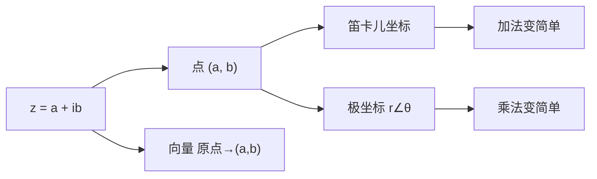

# 复数与复平面

- **难度**：基础 | **涉及章节**：第 1、2 章

## 一句话定义

复数 $z=a+ib$ 是平面上的一个点 $(a,b)$，也是从原点出发的一支箭头；$a$ 是横坐标（实部），$b$ 是纵坐标（虚部）。

## 为什么重要

整个可视化复分析建立在"数 = 点 = 箭头"这个等同之上。一旦接受它，加法就能画成平行四边形，乘法就能画成旋转加放大，后面的默比乌斯变换、向量场、流，都是在这张平面上做几何。第 1 章 p.2 把这件事的由来交代清楚了：韦塞尔、阿尔冈、高斯各自独立提出这个解释之后，复数才从"不可能数"变成合法对象。

## 图示

**看图说明**：同一个对象有三副面孔，选哪副取决于你在做加法还是乘法。做加法用笛卡儿坐标最省事；做乘法换成极坐标，两条规则就够了。

## 详解

### 四个基本量

$z=a+ib$ 的**模** $|z|=r=\sqrt{a^2+b^2}$ 是箭头长度，**辐角** $\arg z=\theta$ 是它与正实轴的夹角。实部 $\operatorname{Re}z=a$，虚部 $\operatorname{Im}z=b$。

两个常用的换算：

$$\operatorname{Re}z=\frac{z+\bar z}{2},\qquad \operatorname{Im}z=\frac{z-\bar z}{2i}.$$

复共轭 $\bar z=a-ib$ 是把点关于实轴翻个面。$z\bar z=a^2+b^2=|z|^2$，这条式子把"长度平方"变成了一个纯实数的乘法，后面算模长全靠它。

### 为什么必须认"不可分"

教材 p.5 有句话值得抄下来：只有当我们用数值坐标去描述点时，复数才成为"复合的"数。换句话说，$a+ib$ 里的 $+$ 不是"还没算完的加法"，它就是"这个点有横纵两个坐标"的写法。把复数当成一个整体，乘法法则才有几何意义；一旦拆成两个实数分别处理，就只剩下一堆看不出含义的代数式。

### 极坐标不唯一

$z=r\angle\theta$ 里 $\theta$ 可以换，因为转整圈回到原地：

$$r\angle(\theta+2k\pi)=r\angle\theta,\quad k\in\mathbb{Z}.$$

这个"多值性"在第 7 章会变成环绕数的定义基础。现在只需要记住：写 $\arg z$ 时要么约定一个范围，要么明确它只确定到 $2\pi$ 的整数倍。

### 一个具体换算

$z=-1+i$：$a=-1,b=1$，模 $\sqrt2$，角度 $135°$（第二象限），所以 $z=\sqrt2\angle135°$。写成指数形式是 $\sqrt2e^{i3\pi/4}$。它的共轭是 $-1-i$，模还是 $\sqrt2$，角度变成 $-135°$。

## 常见误解

- 别以为 $|z|^2=z^2$——实际上 $z\bar z=|z|^2$，$z^2$ 一般还是复数。
- 别以为辐角是唯一值——实际上它可以差 $2\pi$ 的整数倍。
- 别以为"虚部"是 $ib$——实际上虚部就是实数 $b$，$i$ 只是标记方向。

## 在书中出现的脉络

| 章节 | 语境 | 关键结论 |
|---|---|---|
| 第 1 章 | 复数的几何解释 | 数 = 点 = 向量，记作 $\mathbb{C}$ |
| 第 2 章 | 复函数作为映射 | 定义域与值域都是 $\mathbb{C}$ 中的区域 |
| 第 3 章 | 球极坐标 | 复平面加上无穷远点变成球面 |

## 相关概念

- 前置：无（高中坐标与勾股定理即可）
- 后续：[复数乘法：旋转加放大](c02-复数乘法.md)、[欧拉公式](c03-欧拉公式.md)
