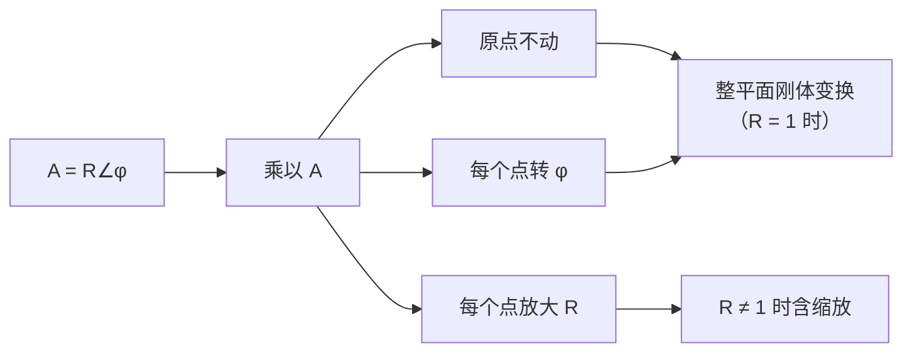

# 复数乘法：旋转加放大

- **难度**：进阶 | **涉及章节**：第 1、2、3、4 章

## 一句话定义

两个复数相乘，结果的长度等于两个长度的乘积，辐角等于两个辐角之和；固定一个因子去乘平面上所有点，等于对整个平面做一次"绕原点转 $\varphi$、放大 $R$ 倍"。

## 为什么重要

这是全书的主发动机。第 2 章用它解释 $z\mapsto Az$ 为什么把圆映成圆、把网格映成旋转网格；第 4 章把它局部化，得到"导数 = 局部旋转加放大"（伸扭）；第 3 章的默比乌斯变换、第 6 章的非欧几何都靠它。教材 p.7 的式 (1.9) 就是这条命题的正式表述。

## 图示

**看图说明**：想法只有一句——"对每个点同时做同样的事"。图上三条分支其实合成一个动作：中心在原点、先转后放（或先放后转）。$R=1$ 时退化成纯旋转，$\varphi=0$ 时退化成纯放大。

## 详解

### 规则本身

用极坐标写最清楚：

$$(R\angle\varphi)(r\angle\theta)=(Rr)\angle(\varphi+\theta).$$

三条直接推论：

- $i=1\angle90°$，所以乘以 $i$ 是逆时针转 $90°$；
- $i^2$：长度 $1$，角度 $180°$，得 $-1$；
- 乘以实数 $k$：角度不变，长度变 $k$ 倍；乘以 $-1$：角度加 $180°$，即中心对称。

### 代数法则从哪来

把 $A=a+ib$、$B=c+id$ 按分配律展开，再用 $i^2=-1$：

$$AB=(ac-bd)+i(ad+bc).$$

这条式子（教材式 1.6，庞贝利首次写出）看起来像硬凑的规则，其实和几何规则完全等价。教材 1.1.5 节的证法值得走一遍：设 $A=4+3i$，把 $A$ 拆成 $4+3i$，乘以 $z$ 就是

$$Az=4z+3(iz).$$

$4z$ 是沿原方向拉长 4 倍，$3(iz)$ 是把 $z$ 转 $90°$ 再拉长 3 倍，两者相加。画出来两个阴影三角形相似，斜边对应的复数正好是 $5\angle\varphi$，$\varphi=\arctan\frac34$。于是"乘 $A$" = "转 $\varphi$ 放大 5 倍"。

### 为什么分配律成立

$A(B+C)=AB+AC$ 在几何上也一目了然：$B+C$ 是平行四边形的第四个顶点，旋转加放大把平行四边形整体搬过去，还是平行四边形，第四个顶点自然是 $AB+AC$（教材图 1-5）。所以复数的乘法满足分配律，不需要额外证明。

### 局部化预告

第 4 章会把"整个平面转 $\varphi$ 放大 $R$"缩小到"每一点的邻域"，那时的 $R$ 和 $\varphi$ 随点变化，导数就是这一点的局部旋转放大率。教材给这个量起的名字是 **amplitwist**（中译"伸扭"），amplification 加 twist，长度和角度的双重变化。

## 常见误解

- 别把乘法当"实部乘实部"——交叉项 $\operatorname{Re}(AB)=ac-bd$ 里有一项是负的，来自 $i^2$。
- 别以为乘以复数的"旋转中心"可以随便选——不指定中心时，默认是原点。
- 别以为 $R<1$ 就不是"放大"——教材明确说"放大"包含缩小，$R$ 只表示倍率。

## 在书中出现的脉络

| 章节 | 语境 | 关键结论 |
|---|---|---|
| 第 1 章 1.1.5 | 符号法则与几何法则等价 | 分配律由平行四边形的刚性变换保证 |
| 第 2 章 | $z\mapsto Az$ 的几何 | 圆映成圆，网格映成旋转网格 |
| 第 4 章 | 导数的几何意义 | 局部旋转 $R$ 加放大 $\varphi$ = 伸扭 |
| 第 6 章 | 非欧几何的变换群 | 圆盘内的变换仍是"分式线性"，乘法结构不变 |

## 相关概念

- 前置：[复数与复平面](c01-复数与复平面.md)
- 后续：[欧拉公式](c03-欧拉公式.md)、[点乘叉乘与复数乘法](c05-点乘叉乘.md)
- 深度推导：见本页底部折叠片段
