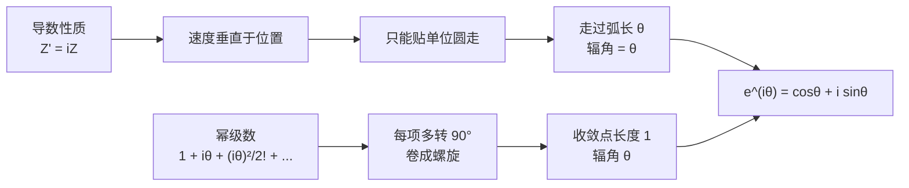

# 欧拉公式

- **难度**：高难 | **涉及章节**：第 1、2、5、12 章

## 一句话定义

$e^{i\theta}=\cos\theta+i\sin\theta$：指数上放一个虚数，得到的不是"算不出来的东西"，而是单位圆上辐角为 $\theta$ 的那个点。

## 为什么重要

它把"角度相加"翻译成"指数相加"，从此复数的乘法、幂、求导都按指数的规则走：

$$(Re^{i\varphi})(re^{i\theta})=Rre^{i(\theta+\varphi)}.$$

第 2 章用它画 $z\mapsto e^z$ 的网格；第 5 章用它求 $\cos$、$\sin$ 的幂级数；第 12 章讲调和函数时，$e^{i\theta}$ 又是傅里叶基。教材 p.9 说它是"奇迹般的公式"，但它其实是乘法法则 + 指数函数性质的必然结果。

## 图示

**看图说明**：两条独立的路通向同一个结论。上路是微分方程（速度与位置垂直），下路是幂级数（每项转 90°）。两路都不依赖 $\cos(\theta+\varphi)$ 恒等式，所以这个结论不是循环论证。

## 详解

### 它到底说了什么

$e^{i\theta}$ 就是单位圆上的"角度标记"。$z=re^{i\theta}$ 读成"先取方向 $e^{i\theta}$，再拉长到 $r$"。乘法因此变成

$$(Re^{i\varphi})(re^{i\theta})=Rre^{i(\theta+\varphi)},$$

这跟实数的 $e^xe^y=e^{x+y}$ 完全同构。凡是涉及角度加减的运算，换成指数形式都能一步写完。

### 为什么不能直接定义成 $\cos\theta+i\sin\theta$

教材 p.9 明确反对这种开法：那样等于把欧拉最伟大的成就之一降级成一句同义反复。定义可以随便下，但"为什么是这个定义"必须回答——否则读者只是记住了一条咒语。

### 两个论证

**论证一（动点）**：$e^x$ 由 $\frac{d}{dx}f=f$、$f(0)=1$ 唯一确定。把这个性质搬到虚数：$\frac{d}{dt}e^{it}=ie^{it}$。左边是动点 $Z(t)=e^{it}$ 的速度 $V$，右边是 $iZ$。乘 $i$ = 转 $90°$，所以"速度永远垂直于位置"。起点在 $1$，初速度竖直向上，这个点只能沿单位圆走；速度大小为 $1$，所以时间 $t$ 内走过的弧长就是 $t$，辐角也就等于 $t$。于是 $Z(\theta)=e^{i\theta}$ 是单位圆上角度 $\theta$ 的点。

**论证二（幂级数）**：把 $e^x$ 的级数在 $x=i\theta$ 处照抄，得到 $1+i\theta+\frac{(i\theta)^2}{2!}+\cdots$。每一项相对上一项都转了 $90°$，首尾相接卷成螺旋。把实部虚部分开记 $C(\theta)+iS(\theta)$，利用 $C'=-S$、$S'=C$ 可验证 $C^2+S^2$ 恒为 $1$（导数为零、初值为一），再用 $\tan\Theta=S/C$ 求导得 $\Theta'=1$，于是 $\Theta=\theta$。

完整的代数步骤见本页底部折叠片段。

### 两条副产品

$$\cos\theta=\frac{e^{i\theta}+e^{-i\theta}}{2},\qquad\sin\theta=\frac{e^{i\theta}-e^{-i\theta}}{2i}.$$

这两条是把三角函数换成指数的"翻译器"。第 1 章用它一次算出 $\cos^4\theta$ 的倍角表达式，第 5 章用它推 $\cos$、$\sin$ 的幂级数。

## 常见误解

- 别以为 $e^{i\theta}$ 是形式记号——实际上它有明确的几何位置：单位圆上角度 $\theta$ 的点。
- 别以为欧拉公式需要靠 $\cos(\theta+\varphi)$ 恒等式来证——实际上方向相反，恒等式是它的推论。
- 别以为 $|e^{i\theta}|$ 会随 $\theta$ 变——实际上它恒等于 $1$，只在圆上跑。

## 在书中出现的脉络

| 章节 | 语境 | 关键结论 |
|---|---|---|
| 第 1 章 1.2 | 提出并证明 | 单位圆上的角度标记 |
| 第 2 章 2.4 | $e^z$ 作为映射 | 把水平带映成角形区域 |
| 第 5 章 | 幂级数与几何 | $\cos$、$\sin$ 的级数由指数级数拆出 |
| 第 12 章 | 调和函数与流 | $e^{in\theta}$ 作为傅里叶基 |

## 相关概念

- 前置：[复数乘法：旋转加放大](c02-复数乘法.md)
- 后续：[单位根与因式分解](c04-单位根.md)
- 深度推导：见本页底部折叠片段
