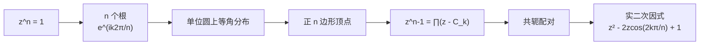

# 单位根与因式分解

- **难度**：进阶 | **涉及章节**：第 1、7 章

## 一句话定义

$n$ 次单位根是方程 $z^n=1$ 的全部解，共 $n$ 个，均匀落在单位圆上，正好是内接正 $n$ 边形的顶点：

$$z_k=e^{ik\frac{2\pi}{n}},\quad k=0,1,\dots,n-1.$$

## 为什么重要

它把"解方程"换成"画正多边形"，同时给出 $z^n-1$ 的完整因式分解。教材 1.3.5 节借这段内容讲了两件事：代数基本定理为什么可信（第 7 章正式证），以及为什么实系数多项式的复根必然成对共轭、从而总能拆成实一次与实二次因式。第 7 章讲环绕数时，单位根又会作为"绕原点转一圈"的最简模型出现。

## 图示

**看图说明**：图的顺序就是推理顺序。先有"解在圆上等角分布"这个几何事实，才有因式分解；共轭配对只是这个几何事实的代数翻译（正多边形关于实轴对称）。

## 详解

### 根为什么长这样

设 $z=re^{i\theta}$，则 $z^n=r^ne^{in\theta}$。要求它等于 $1$：

- 长度：$r^n=1$，$r$ 是正实数，所以 $r=1$；
- 角度：$n\theta$ 必须是 $2\pi$ 的整数倍，所以 $\theta=\frac{2k\pi}{n}$。

$k$ 取 $0$ 到 $n-1$ 就得到 $n$ 个不同的点，$k$ 再大就开始重复（转整圈回到原处）。

### 因式分解

笛卡儿因式定理说：$c$ 是 $P_n(z)=0$ 的根，则 $P_n(z)=(z-c)P_{n-1}(z)$。对 $z^n-1$ 反复用 $n$ 次，得

$$z^n-1=(z-C_1)(z-C_2)\cdots(z-C_n).$$

$C_k=e^{ik2\pi/n}$ 与 $C_{n-k}=e^{-ik2\pi/n}$ 互为共轭（正多边形关于实轴对称），把它们配成一对：

$$(z-C_k)(z-\overline{C_k})=z^2-(C_k+\overline{C_k})z+C_k\overline{C_k}=z^2-2z\cos\frac{2k\pi}{n}+1.$$

系数全是实数，这就是"实二次因式"。$k=0$ 与 $k=n/2$（$n$ 为偶数时）给出实线性因式 $z-1$ 与 $z+1$。

### 科茨的几何版本

18 世纪的科茨没有复数可用。他的结果：$C_1\cdots C_n$ 是内接于单位圆的正 $n$ 边形，$P$ 是实轴上距原点为 $x$ 的点，那么

$$x^n-1=PC_1\cdot PC_2\cdots PC_n.$$

用复数看，$PC_k=|x-C_k|$，而 $\prod_k(x-C_k)=x^n-1$ 正是上面的因式分解，取模就得到科茨的等式。教材用这件事说明：复平面的几何不是"人为添加的解释"，它就藏在实代数的结果里。

### 一个具体例子：$n=4$

根是 $1,i,-1,-i$。因式分解：

$$z^4-1=(z-1)(z+1)(z-i)(z+i)=(z^2-1)(z^2+1).$$

两个实二次因式对应两对共轭根。这个例子在教材式 (1.19) 里出现过。

## 常见误解

- 别以为 $z^n=1$ 只有 $z=1$ 一个根——实际上有 $n$ 个，而且都不相同。
- 别以为根可以不在单位圆上——实际长度方程 $r^n=1$ 强制 $r=1$。
- 别以为实系数多项式可以随便拆成实一次因式——实际上复根要成对出现，所以拆出来的是实一次加实二次，$x^2+1$ 就是拆不动的例子。

## 在书中出现的脉络

| 章节 | 语境 | 关键结论 |
|---|---|---|
| 第 1 章 1.3.5 | 科茨的因式分解 | $x^n-1$ 的根是正 $n$ 边形顶点 |
| 第 7 章 | 代数基本定理的几何证明 | 多项式根的个数与环绕数 |
| 第 9 章 | 留数计算 | 单位根用于算形如 $\int_0^{2\pi}$ 的积分 |

## 相关概念

- 前置：[欧拉公式](c03-欧拉公式.md)
- 后续：代数基本定理（第 7 章）
