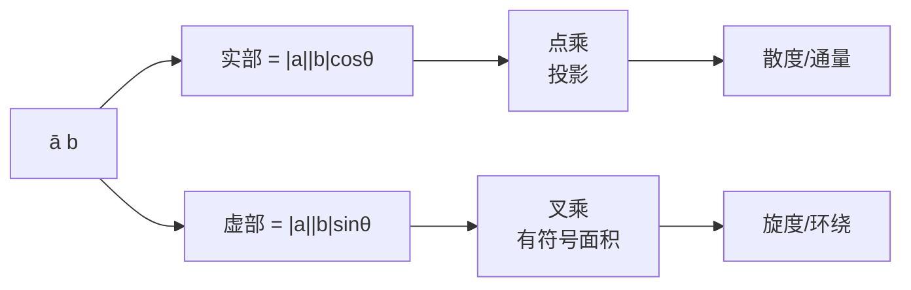

# 点乘、叉乘与复数乘法

- **难度**：进阶 | **涉及章节**：第 1、10、11 章

## 一句话定义

把 $a,b$ 都看成平面向量，则 $\bar a b$ 是一个复数，它的实部是点乘 $\mathbf a\cdot\mathbf b$，虚部是由 $\mathbf a$ 转到 $\mathbf b$ 的有符号面积（叉乘）：

$$\bar a b=\mathbf a\cdot\mathbf b+i(\mathbf a\times\mathbf b).$$

## 为什么重要

物理里的散度、旋度、通量都用点乘叉乘写；复分析里柯西定理、留数定理又用复数乘法写。这条等式是两套语言的字典：第 10、11 章讲向量场时，全靠它把"流体穿过边界"翻译成"复积分"。

## 图示

**看图说明**：一个复数乘法同时装了两条几何信息。实部管"投影"，虚部管"扫过的面积"。图里两条分支最后汇到向量场的两个基本运算，这是第 10 章的主线。

## 详解

### 为什么是 $\bar a b$ 而不是 $ab$

设 $a=|a|e^{i\alpha}$，$b=|b|e^{i\beta}$。则

$$\bar a b=|a|e^{-i\alpha}|b|e^{i\beta}=|a||b|e^{i(\beta-\alpha)}.$$

角度是 $\beta-\alpha$，也就是"由 $a$ 转到 $b$"的角。若用 $ab$，角度是 $\alpha+\beta$，跟两向量的夹角没关系。所以共轭不能丢。

### 坐标形式

$a=x+iy$，$b=x'+iy'$：

$$\bar a b=(x-iy)(x'+iy')=(xx'+yy')+i(xy'-x'y).$$

$$\binom{x}{y}\cdot\binom{x'}{y'}=xx'+yy',\qquad\binom{x}{y}\times\binom{x'}{y'}=xy'-x'y.$$

后者是带符号的：$a$ 逆时针转到 $b$ 时为正，反之为负。

### 多边形面积

顶点按逆时针为 $a,b,c,d$ 的四边形：

$$A=\frac12\left[(\mathbf a\times\mathbf b)+(\mathbf b\times\mathbf c)+(\mathbf c\times\mathbf d)+(\mathbf d\times\mathbf a)\right]=\frac12\operatorname{Im}(\bar ab+\bar bc+\bar cd+\bar da).$$

原点在形外时，某些三角形的有符号面积为负，正好抵消多算的部分。这个"自动抵消"是有符号面积的用处，也是第 8 章讲环绕数的伏笔：绕一圈的积分可以拆成各段的有符号贡献。

## 常见误解

- 别以为叉乘只存在于三维——实际在平面上它可以定义为有符号面积，这是本书用的版本。
- 别把共轭漏掉——$ab$ 的虚部是 $|a||b|\sin(\alpha+\beta)$，不是面积。
- 别以为面积公式要求原点在内部——实际上原点在哪都成立，符号会自动处理。

## 在书中出现的脉络

| 章节 | 语境 | 关键结论 |
|---|---|---|
| 第 1 章 1.3.6 | 向量运算的复数表示 | $\bar ab=\mathbf a\cdot\mathbf b+i(\mathbf a\times\mathbf b)$ |
| 第 8 章 | 复积分的几何意义 | 积分拆成切向与法向分量 |
| 第 10 章 | 向量场的散度与旋度 | 点乘叉乘给出通量与环量 |

## 相关概念

- 前置：[复数乘法：旋转加放大](c02-复数乘法.md)
- 后续：向量场与复积分（第 11 章，待生成）
