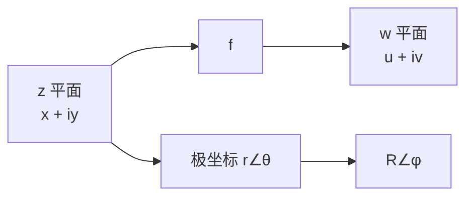

# 复函数：两个平面之间的搬运

- **难度**：基础 | **涉及章节**：第 2、3、4、10 章

## 一句话定义

复函数 $w=f(z)$ 是一条规则，把 $z$ 平面上的点搬到 $w$ 平面上的点；研究它就是研究这张"搬运地图"把网格、射线、圆搬成了什么。

## 为什么重要

从第 2 章起，全书不再把函数看成公式，而看成几何变换。第 3 章的默比乌斯变换、第 4 章的导数（局部搬运）、第 10 章的向量场，都是这个视角的延伸。教材 p.46 开篇就把它定为全书的基本方法。

## 图示

**看图说明**：左边是输入平面，右边是输出平面。中间只有一个规则，没有"曲线"。两种坐标对应两种读法：笛卡儿看网格，极坐标看长度与角度。

## 详解

$z=x+iy$，$w=u+iv$，于是 $f$ 可以写成两个实函数：

$$u=u(x,y),\qquad v=v(x,y).$$

换成极坐标 $z=re^{i\theta}$、$w=Re^{i\varphi}$，则

$$R=R(r,\theta),\qquad \varphi=\varphi(r,\theta).$$

教材的例子 $f(z)=(1+i\sqrt3)z$：极坐标下 $R=2r$、$\varphi=\theta+\pi/3$；笛卡儿下 $u=x-\sqrt3y$、$v=\sqrt3x+y$。两种写法描述同一件事，只是前者一眼看出"放大 2 倍、转 60°"。

**可视化方式**（教材 2.1）：映射效果、模曲面 $|f(z)|$、黎曼曲面。本书主用第一种；模曲面适合看"哪里大哪里小"，黎曼曲面适合理解多值函数。

## 常见误解

- 别以为复函数需要四维图像才能研究——实际上看它搬图形的效果就够了。
- 别以为 $u,v$ 与 $x,y$ 无关——实际上它们通过 $f$ 耦合，$u$ 通常同时依赖 $x$ 和 $y$。

## 在书中出现的脉络

| 章节 | 语境 | 关键结论 |
|---|---|---|
| 第 2 章 | 建立映射视角 | $f$ 是平面到平面的变换 |
| 第 3 章 | 默比乌斯变换 | 圆映成圆的分式线性映射 |
| 第 4 章 | 导数 | 局部看，$f$ 是旋转加放大 |
| 第 10 章 | 向量场 | $f(z)$ 作为从 $z$ 出发的向量 |

## 相关概念

- 前置：[复数与复平面](c01-复数与复平面.md)
- 后续：[幂级数与收敛圆](c07-幂级数.md)、[指数映射](c08-指数映射.md)
