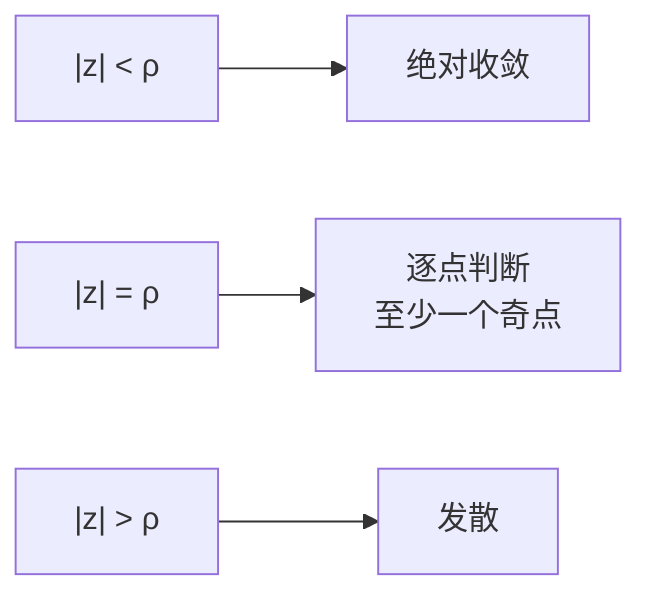

# 幂级数与收敛圆

- **难度**：高难 | **涉及章节**：第 2、5、9 章

## 一句话定义

幂级数 $P(z)=c_0+c_1z+c_2z^2+\cdots$ 的收敛区域一定是一个以原点为心的圆盘；盘内绝对收敛，盘外发散，圆周上逐点单独判断。

## 为什么重要

它是第 5 章"解析函数能展成幂级数"和第 9 章"留数计算"的基础。收敛圆还给出一个几何信息：圆周边界上至少有一个奇点，这个奇点的位置决定了半径。教材 2.3 节把"为什么是圆"证得很干净。

## 图示

**看图说明**：同心圆把平面分成三圈。内圈安全，外圈必坏，中间那圈是边界，需要逐点验。

## 详解

### 收敛的定义

部分和 $P_n(z)=c_0+\cdots+c_nz^n$。若 $P_n(a)$ 与某点 $A$ 的距离可以任意小（$n$ 足够大后），就说级数在 $a$ 收敛于 $A$。

### 绝对收敛更强

若 $\sum|c_jz^j|$ 收敛，则 $\sum c_jz^j$ 必收敛。证明只用三角不等式：$|P_n-P_m|\le\sum_{j=m+1}^n|c_ja^j|$。教材式 (2.7)。

### 为什么收敛域是圆

核心一步（式 2.8）：若在 $a\ne0$ 处收敛，则对任何 $|z|<|a|$ 都收敛。因为

$$\left|\frac{z}{a}\right|=k<1,$$

于是 $|c_jz^j|=|c_ja^j|k^j$，每一项都被"缩"了一个几何级数因子。既然 $\sum c_ja^j$ 的部分和有界，$k^j$ 又衰减，$\sum|c_jz^j|$ 收敛。模比 $a$ 小的所有点一起被拿下，收敛域就只能是一圈圈同心圆。

### 半径怎么算

$$\rho=\lim_{n\to\infty}\left|\frac{c_n}{c_{n+1}}\right|$$

（极限存在时），或 $\rho=1/\limsup\sqrt[n]{|c_n|}$。例：$\frac{1}{1-z}=1+z+z^2+\cdots$ 的系数全为 1，$\rho=1$；$e^z$ 的系数 $1/n!$，比值 $\to\infty$，$\rho=\infty$。

### 边界上的奇点

若圆周 $|z|=\rho$ 上处处收敛，用同样的比较论证可以把半径再推大一点，矛盾。所以边界上至少有一点让级数失效，那一点就是函数的奇点。$\frac{1}{1-z}$ 的奇点在 $z=1$，正好在收敛圆上。

## 常见误解

- 别以为收敛域可以是方形或带形——实际上以原点为中心的幂级数只能是圆盘。
- 别以为圆周上一定发散——实际上可以有点收敛、有点发散，例如 $\sum z^n/n$ 在 $z=-1$ 收敛、$z=1$ 发散。
- 别以为绝对收敛和收敛是一回事——实际上绝对收敛更强。

## 在书中出现的脉络

| 章节 | 语境 | 关键结论 |
|---|---|---|
| 第 2 章 | 幂级数的几何 | 收敛圆盘、边界奇点 |
| 第 5 章 | 解析函数的级数 | 圆内可展成幂级数 |
| 第 9 章 | 留数与展开 | 收敛半径决定展开范围 |

## 相关概念

- 前置：[复函数：两个平面之间的搬运](c06-复函数与映射.md)
- 后续：[指数映射](c08-指数映射.md)
- 深度推导：见本页底部折叠片段
