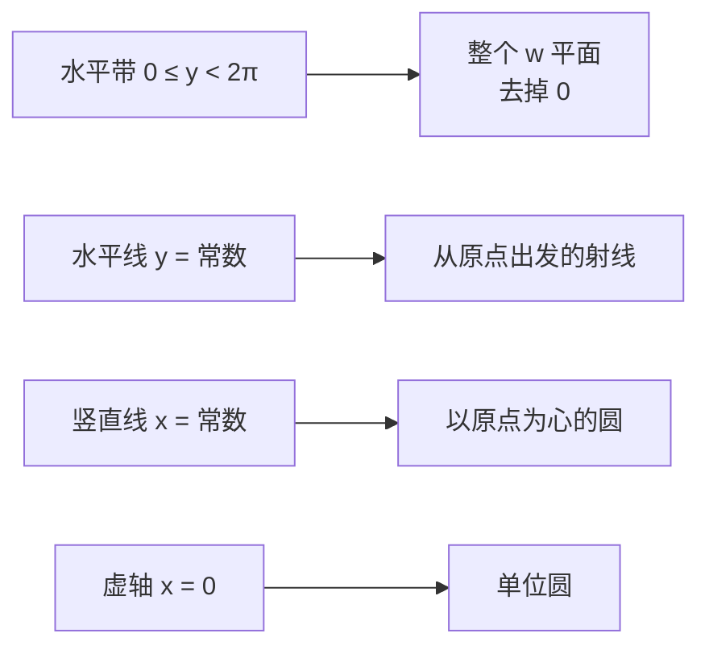

# 指数映射 $e^z$

- **难度**：高难 | **涉及章节**：第 2、5、9、12 章

## 一句话定义

$e^z$ 把 $z=x+iy$ 送到 $e^x e^{iy}$：横坐标管长度（指数放大），纵坐标管角度（绕圆旋转），因此它把一条条水平带卷成整个平面。

## 为什么重要

它是复分析里最重要的映射：周期 $2\pi i$ 说明它非一对一，直接导致对数多值；虚轴映成单位圆，把"角度"和"旋转"绑在一起；第 12 章讲调和函数时，$e^{in\theta}$ 又是傅里叶基。

## 图示

**看图说明**：横平竖直的网格被"卷"成极坐标网格。水平线变成射线，竖直线变成圆，虚轴正好是单位圆。

## 详解

### 代数性质

$$e^{z_1+z_2}=e^{z_1}e^{z_2},\qquad e^{x+iy}=e^xe^{iy}.$$

第二条是第一条加欧拉公式的直接结果。于是 $|e^z|=e^x$，$\arg e^z=y$（差 $2\pi$ 整数倍）。

### 三条几何事实

1. **周期 $2\pi i$**：$e^{z+2\pi i}=e^z$。$z$ 往上挪 $2\pi$，$w$ 绕原点转一圈回原处。
2. **水平带铺满全平面**：固定 $- \pi<y\le\pi$，$x$ 从 $-\infty$ 到 $+\infty$，$|w|=e^x$ 从 $0$ 到 $\infty$，角度扫遍一整圈。所以这条带一对一地铺满 $\mathbb{C}\setminus\{0\}$。
3. **虚轴缠单位圆**：$e^{iy}=\cos y+i\sin y$，$y$ 走多远，点就在单位圆上绕多少圈。

由此还能读出左右半平面的像：$x<0$ 时 $|w|<1$，落在单位圆内；$x>0$ 时落在圆外。

### 另一种定义

$$e^z=\lim_{n\to\infty}\left(1+\frac{z}{n}\right)^n.$$

几何读法：$1+\frac{z}{n}$ 是长度约 $1+\frac{x}{n}$、角度约 $\frac{y}{n}$ 的复数。自乘 $n$ 次后，长度趋向 $e^x$（复利公式），角度趋向 $y$（$n$ 份 $\frac{y}{n}$ 相加）。教材 2.4.3 用这个定义绕开了"先用级数再用欧拉公式"的循环论证。

### 保角预告

教材图 2-19 最后一条：小正方形的象"非常接近正方形"，两条相交直线的象交角不变。这个性质第 4 章会正式讲，叫**保角**（conformal）。$e^z$ 是保角映射的典型代表。

## 常见误解

- 别以为 $e^z$ 单调——实际上它周期重复，同一个值有无穷多个原象。
- 别以为 $e^z$ 永远不为零——实际上 $|e^z|=e^x>0$，$0$ 永远取不到，它是"被挖掉"的点。
- 别以为 $e^{z}$ 的实部虚部就是 $e^x\cos y$ 和 $e^x\sin y$ 之外的什么东西——实际上正是这两项，$u=e^x\cos y$，$v=e^x\sin y$。

## 在书中出现的脉络

| 章节 | 语境 | 关键结论 |
|---|---|---|
| 第 2 章 | 指数函数的映射 | 周期 $2\pi i$，带→全平面 |
| 第 5 章 | 初等函数的导数 | $(e^z)'=e^z$，仍是自身 |
| 第 9 章 | 留数计算 | $e^{iz}$ 用于实积分 |
| 第 12 章 | 调和函数 | $e^{in\theta}$ 作为傅里叶基 |

## 相关概念

- 前置：[欧拉公式](c03-欧拉公式.md)、[幂级数与收敛圆](c07-幂级数.md)
- 后续：[多值函数与支点](c09-多值函数.md)
- 深度推导：见本页底部折叠片段（另一条定义为何等价）
