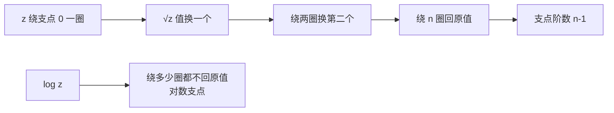

# 多值函数与支点

- **难度**：进阶 | **涉及章节**：第 2、3、7、9 章

## 一句话定义

多值函数是一个 $z$ 对应多个值的"函数"；支点是这样一个点：$z$ 绕它走一圈回到原处时，函数值回不到原来的值。

## 为什么重要

$\sqrt[n]{z}$、$\log z$、$z^\alpha$ 都是多值的。不理解支点，就没法理解为什么复积分要"绕开"某些点、为什么留数定理里"绕一圈"会多出一个 $2\pi i$。第 7 章的环绕数、第 9 章的留数，都以支点为几何背景。

## 图示

**看图说明**：绕圈的次数决定落在哪个分支。有限阶支点会"循环回来"，对数支点永远回不来。

## 详解

### 分数幂

$$\sqrt[n]{z}=\sqrt[n]{r}\,e^{i\theta/n}.$$

$\theta$ 可以取 $\theta+2m\pi$，于是有 $n$ 个值，角度相差 $2\pi/n$。

### 支点的定义

$q$ 是 $f$ 的支点，如果沿任意绕 $q$ 一周的闭路走一圈，$f$ 回不到原值。$\sqrt[n]{z}$ 的支点在 $0$：绕一圈，$\theta/n$ 增加 $2\pi/n$，值换了分支；绕 $n$ 圈才回来。所以 $0$ 是 $n-1$ 阶支点，一阶支点（$n=2$）叫简单支点。

### 单值支与剪开平面

从支点出发剪一条射线（例如负实轴），在剪开的区域里角度可以连续取定，$\sqrt[n]{z}$ 就分成 $n$ 个单值函数。换路径但只要绕支点的圈数相同，值不变——这就是"单值支"的几何含义。

### 对数

$$\log z=\ln r+i\theta.$$

绕原点一圈 $\theta$ 加 $2\pi$，值永远回不到原处：$0$ 是对数支点，无穷阶。剪开负实轴后得到主值支 $\ln r+i\arg z$（$\arg\in(-\pi,\pi]$）。

### 多值性的来源

一句话：**角度的多值性**。第 1 章说 $\arg z$ 可以差 $2\pi$ 整数倍，当时只是个记号问题；到了多值函数，它变成了"绕几圈"的几何问题。教材 2.6.1 把这条线索讲得很清楚。

## 常见误解

- 别以为多值函数"不是函数"——实际上它是多值映射，剪开平面后每个分支都是正常函数。
- 别以为支点一定是 0——实际上 $\sqrt{z-1}$ 的支点在 1，$\log(z^2+1)$ 的支点在 $\pm i$。
- 别以为绕支点一圈一定换值——实际上只有支点才换；绕非支点一圈会回到原值。

## 在书中出现的脉络

| 章节 | 语境 | 关键结论 |
|---|---|---|
| 第 2 章 | 多值函数与支点 | $\sqrt[n]{z}$ 的支点在 0，阶数 $n-1$ |
| 第 3 章 | 反演与默比乌斯变换 | 分式线性映射把支点搬走 |
| 第 7 章 | 环绕数 | 绕支点的圈数是整数不变量 |
| 第 9 章 | 留数 | 绕奇点一圈贡献 $2\pi i$ |

## 相关概念

- 前置：[指数映射](c08-指数映射.md)
- 后续：环绕数（第 7 章）
- 深度推导：见本页底部折叠片段
