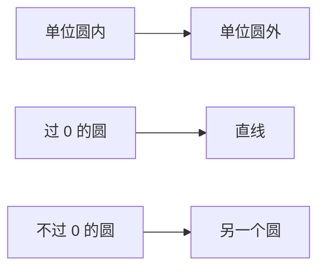

# 反演

- **难度**：进阶 | **涉及章节**：第 3、6 章

## 一句话定义

反演 $z\mapsto 1/\bar z$ 把长度取倒数、角度取反；对任意圆 $K$，反演把圆内翻到圆外、把圆和直线互相转换。

## 为什么重要

反演是默比乌斯变换的"砖块"：任何默比乌斯变换都能拆成平移、反演、伸缩旋转、平移。不懂反演，就看不出分式线性映射为什么保圆。第 6 章的非欧几何也用它构造双曲测地线。

## 图示

**看图说明**：圆内外的交换是反演的标志；过反演中心的圆会"拉直"成直线。

## 详解

写 $z=re^{i\theta}$：

$$\frac{1}{\bar z}=\frac{1}{r}e^{i\theta}.$$

所以分成两步：几何反演 $z\mapsto 1/z$（长度倒数、角度不变方向？注意 $1/z=\frac1r e^{-i\theta}$ 角度取反），再对实轴反射。教材把它写成"先 $1/z$ 再共轭"，两种次序结果一样。

对圆心 $q$、半径 $R$ 的圆 $K$：

$$I_K(z)=q+\frac{R^2}{\overline{z-q}}.$$

$K$ 上的点满足 $|z-q|=R$，代入得 $|I_K(z)-q|=R$，不动。圆内 $|z-q|<R$ 的点被送到圆外。

**保圆性**：反演把每个圆或直线映成圆或直线。过 $q$ 的直线（看成过 $\infty$ 的圆）映成过 $q$ 的直线；不过 $q$ 的圆映成另一个圆。证明用相似三角形，见本页底部深度片段。

**保角性**：反演保持角度大小、反转方向（因为它带共轭）。所以它属于"反演变换"，不是保向的默比乌斯变换。

## 常见误解

- 别以为反演就是 $1/z$——实际是 $1/\bar z$，共轭负责把方向翻回来。
- 别以为圆只能映成圆——过反演中心的圆会映成直线。

## 在书中出现的脉络

| 章节 | 语境 | 关键结论 |
|---|---|---|
| 第 3 章 | 反演的定义与性质 | 圆 ↔ 圆/直线 |
| 第 3 章 | 默比乌斯变换分解 | 反演是核心砖块 |
| 第 6 章 | 双曲几何 | 反演构造正交圆族 |

## 相关概念

- 前置：[复数与复平面](c01-复数与复平面.md)
- 后续：[黎曼球面](c11-黎曼球面.md)、[默比乌斯变换](c12-默比乌斯变换.md)
- 深度推导：见本页底部折叠片段
