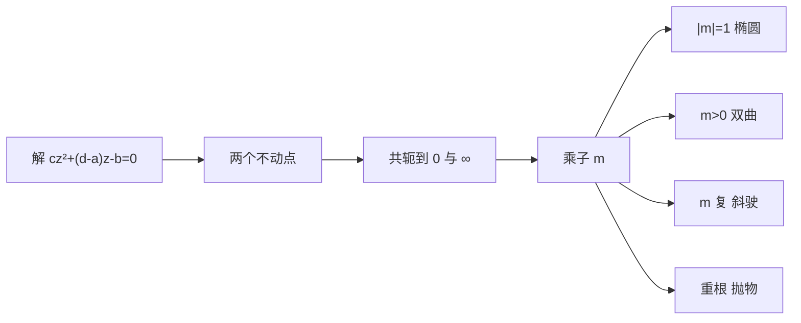

# 不动点与四类变换

- **难度**：高难 | **涉及章节**：第 3、6、7 章

## 一句话定义

解 $M(z)=z$ 得不动点；把两个不动点送到 $0,\infty$ 后，变换化成乘以乘子 $m$ 的简单形式。按 $m$ 的位置分成椭圆、双曲、斜驶、抛物四类。

## 为什么重要

分类把无穷多种分式变换压成四种几何动作。第 6 章用它分类双曲等距变换，第 7 章用不动点讨论迭代与动力系统。

## 图示

**看图说明**：先找不动点，再看乘子；乘子在单位圆上是旋转，在正实轴上是推拉，其余是旋转加推拉。

## 详解

不动点方程

$$cz^2+(d-a)z-b=0.$$

两个根 $\xi_+,\xi_-$。用 $F(z)=\frac{z-\xi_+}{z-\xi_-}$ 把两者送到 $0,\infty$，则

$$\tilde M=F\circ M\circ F^{-1},\qquad \tilde M(\tilde z)=m\tilde z.$$

**乘子怎么算**：若不动点互异，$m$ 等于 $M'(\xi_+)$，也等于 $M'(\xi_-)$（两个不动点处导数相同），可用矩阵特征值比表示。若重根，$m=1$，属抛物型。

**四类几何**：

- 椭圆型 $|m|=1$：每个点沿一个圆绕两个不动点转；
- 双曲型 $m>0$：每个点沿一条过两不动点的圆弧，从一个不动点流向另一个；
- 斜驶型 $m$ 非实数：旋转与推拉同时进行，轨迹是螺旋；
- 抛物型：只有一个不动点，轨迹是与该点相切的一族圆。

**例子**：

- $M(z)=2z$：不动点 $0,\infty$，$m=2$，双曲；
- $M(z)=iz$：不动点 $0,\infty$，$m=i$，$|m|=1$，椭圆；
- $M(z)=z+1$：不动点只有 $\infty$（重根），$m=1$，抛物（平移）。

## 常见误解

- 别以为两个不动点总在有限处——实际 $z\mapsto z+1$ 的不动点是 $\infty$。
- 别以为 $|m|=1$ 就一定是恒等——实际 $m=e^{i\alpha}$ 是转 $\alpha$ 角，$\alpha\ne0$ 时不是恒等。
- 别以为乘子依赖于坐标——实际换共轭坐标不改变 $m$（只可能取倒数，分类不变）。

## 在书中出现的脉络

| 章节 | 语境 | 关键结论 |
|---|---|---|
| 第 3 章 | 分类 | 四类几何动作 |
| 第 6 章 | 双曲等距 | 椭圆/双曲/抛物对应三种等距 |
| 第 7 章 | 迭代 | 不动点决定长期行为 |

## 相关概念

- 前置：[默比乌斯变换](c12-默比乌斯变换.md)
- 深度推导：见本页底部折叠片段
