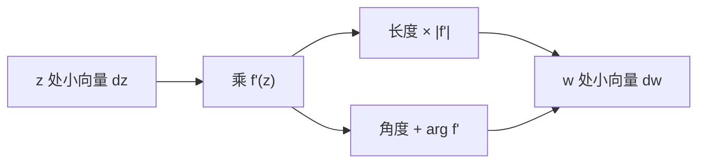

# 导数作为伸扭

- **难度**：进阶 | **涉及章节**：第 4、5 章

## 一句话定义

复导数 $f'(z)$ 是一个复数：它的模 $|f'|$ 是局部伸缩率，它的辐角 $\arg f'$ 是局部扭转角。这个"伸缩 + 扭转"的动作叫伸扭。

## 为什么重要

它把微积分从"求斜率"改造成"看局部形状怎么变"，是第 5 章可视微分法、第 6 章共形几何的语言基础。

## 图示

**看图说明**：一个乘法同时干两件事，这就是复数乘法第 1 章"长度相乘、角度相加"的直接应用。

## 详解

$dw=f'(z)\,dz$，即

$$|dw|=|f'(z)|\,|dz|,\qquad \arg(dw)=\arg(dz)+\arg f'(z).$$

所以 $f$ 在 $z$ 附近"看起来像"一个相似变换：放大 $|f'|$ 倍、转 $\arg f'$。教材 4.3.3 把这种局部效果命名为 amplitwist。

**例子**：

- $f(z)=z^2$：$f'=2z$，在 $re^{i\theta}$ 处伸缩 $2r$、扭转 $\theta$；
- $f(z)=e^z$：$f'=e^z$，伸缩 $|e^z|=e^x$、扭转 $y$；
- $f(z)=1/z$：$f'=-1/z^2$，伸缩 $1/r^2$、扭转 $\pi-2\theta$。

**与实导数的关系**：实函数 $f'(x)$ 可以看成复数 $f'(x)$，$f'>0$ 时扭转 0，$f'<0$ 时扭转 $\pi$。所以"实导数是伸扭的特例"这句话是字面成立的。

## 常见误解

- 别以为伸扭是近似——实际它是导数定义的精确内容：差商极限就是那个乘子。
- 别以为伸缩率只能是正数——实际 $|f'|\ge0$，等于 0 时退化为临界点。

## 在书中出现的脉络

| 章节 | 语境 | 关键结论 |
|---|---|---|
| 第 4 章 | 复导数 | 局部乘子 = 伸缩 + 扭转 |
| 第 5 章 | 可视微分 | 用伸扭读公式 |
| 第 6 章 | 共形几何 | 保角映射的局部结构 |

## 相关概念

- 前置：[复函数：两个平面之间的搬运](c06-复函数与映射.md)
- 后续：[解析与共形](c15-解析与共形.md)
- 深度推导：见本页底部折叠片段
