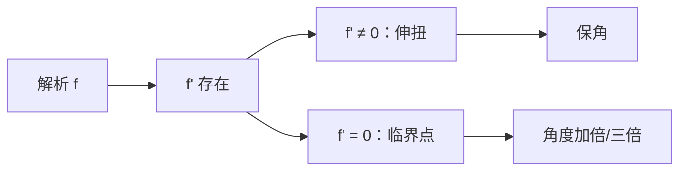

# 解析与共形

- **难度**：高难 | **涉及章节**：第 4、5、6 章

## 一句话定义

解析函数是在每一点附近都能写成"伸缩 + 旋转"的函数；只要 $f'(z)\ne0$，它就保角。反过来，局部保角的映射必然解析。

## 为什么重要

"共形 = 解析"是全书的核心等号。第 6 章的非欧几何、第 9 章的积分换元、第 12 章的流体力学，全都依赖"解析映射保角"这一条。

## 图示

**看图说明**：解析给出伸扭，伸扭给出保角；临界点是这条链断掉的地方。

## 详解

**解析**：$f$ 在 $z_0$ 的某个邻域内处处可导。单点可导不够——教材 4.6 节特别强调，"只在一点可导"不能保证局部是伸扭。

**共形**：两条曲线在交点处的夹角，经过映射后大小和方向都不变。伸扭是"放大 + 旋转"，两者都保角，所以 $f'\ne0$ 时解析函数共形。

**反方向**：若映射在每点局部是保向相似（伸缩 + 旋转），则它的差商有极限，因而解析。这条把几何性质翻译成可导性。

**临界点**：$f'(z_0)=0$ 时伸缩率为 0，所有小向量被压扁，角度信息丢失。典型例子 $z^n$ 在 0 处把角度乘 $n$，是 $n$ 重覆盖。教材 4.7 用 $z^2$ 和 $z^3$ 的图说明"折叠"。

## 常见误解

- 别以为解析等于"公式好看"——实际是"局部伸扭"这条几何性质。
- 别以为共形只看角度大小——实际方向也要保持；反演保角但反向，所以不算共形（它是反共形）。
- 别以为临界点一定在原点——实际 $z^2-2z$ 的临界点在 $z=1$。

## 在书中出现的脉络

| 章节 | 语境 | 关键结论 |
|---|---|---|
| 第 4 章 | 共形 = 解析 | 局部伸扭 |
| 第 5 章 | 可视微分 | 用伸扭检查公式 |
| 第 6 章 | 共形模型 | 保角映射构造非欧几何 |
| 第 12 章 | 流体 | 共形换元化曲为直 |

## 相关概念

- 前置：[导数作为伸扭](c14-导数作为伸扭.md)
- 后续：[柯西–黎曼方程](c16-柯西黎曼方程.md)
