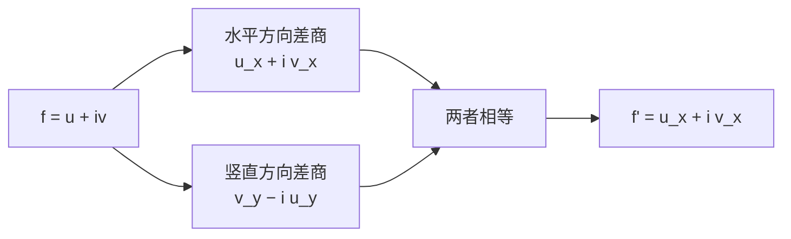

# 柯西–黎曼方程

- **难度**：高难 | **涉及章节**：第 4、5、9 章

## 一句话定义

写 $f=u+iv$、$z=x+iy$，则 $f$ 解析等价于

$$u_x=v_y,\qquad u_y=-v_x.$$

这两条就是柯西–黎曼方程（CR）。

## 为什么重要

它把"可导"翻译成四个偏导数之间的两条等式，是判断解析性、求导、构造共轭调和函数的标准工具。第 9 章的柯西定理也以它为起点。

## 图示

**看图说明**：两个方向逼近同一点，差商必须落到同一个复数；CR 就是"落在一起"的代数条件。

## 详解

从水平方向逼近：

$$f'(z)=\lim_{h\to0}\frac{f(z+h)-f(z)}{h}=u_x+iv_x.$$

从竖直方向逼近（$h=ik$，除以 $ik$ 等于乘 $-i/k$）：

$$f'(z)=\lim_{k\to0}\frac{f(z+ik)-f(z)}{ik}=v_y-iu_y.$$

两者相等，实部虚部分开：

$$u_x=v_y,\qquad v_x=-u_y.$$

这就是 CR。

**复形式**：定义 $\partial_{\bar z}=\frac12(\partial_x+i\partial_y)$，则 CR 等价于 $\partial f/\partial\bar z=0$，即 $f$ 不依赖 $\bar z$。

**求导公式**：CR 成立时，

$$f'(z)=u_x+iv_x=v_y-iu_y.$$

**例子**：$f=z^2=(x^2-y^2)+2ixy$，$u_x=2x$、$v_y=2x$、$u_y=-2y$、$-v_x=-2y$，CR 成立，$f'=2x+2iy=2z$。

## 常见误解

- 别以为 CR 成立就自动解析——实际还需要偏导数连续（或 $f$ 在邻域可微）。教材默认函数足够好。
- 别以为 CR 是四个偏导相等——实际是交叉相等：$u_x=v_y$，$u_y=-v_x$。
- 别以为 $f=\bar z$ 满足 CR——实际 $u_x=1$、$v_y=-1$，不成立。

## 在书中出现的脉络

| 章节 | 语境 | 关键结论 |
|---|---|---|
| 第 4 章 | 解析判据 | CR 与共形等价 |
| 第 5 章 | 可视微分 | CR 给公式的几何读法 |
| 第 9 章 | 柯西定理 | 解析函数的积分性质 |

## 相关概念

- 前置：[解析与共形](c15-解析与共形.md)
- 后续：[临界点](c17-临界点.md)
- 深度推导：见本页底部折叠片段
