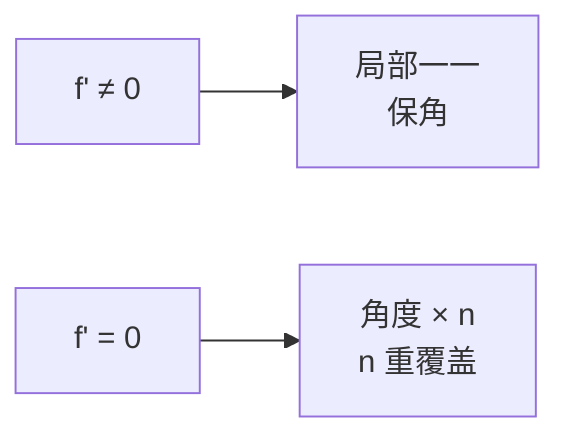

# 临界点

- **难度**：进阶 | **涉及章节**：第 4、5、9 章

## 一句话定义

$f'(z_0)=0$ 的点叫临界点；在那里伸扭的伸缩率变成 0，保角性失效，局部映射折叠成多重覆盖。

## 为什么重要

临界点决定映射的"折叠结构"：$z^n$ 在 0 处是 $n$ 重覆盖，第 5 章的曲率、第 9 章的留数都要先找临界点。

## 图示

**看图说明**：临界点不是"函数没定义"，而是"局部不再是一一对应"。

## 详解

$f'(z_0)=0$ 时，一阶近似消失，要看更高阶项。设

$$f(z)-f(z_0)\approx c(z-z_0)^n,\qquad c\ne0,$$

则 $z$ 绕 $z_0$ 一圈，$f(z)$ 绕 $f(z_0)$ 转 $n$ 圈。所以局部是 $n$ 重覆盖，角度被乘 $n$。

**例子**：

- $z^2$ 在 0：角度加倍，二重覆盖；
- $z^3$ 在 0：角度三倍；
- $z^2-2z$ 在 1：$f'=2z-2$，$f'(1)=0$；
- $e^z$ 无临界点，处处保角。

**与反函数**：$f'(z_0)\ne0$ 时局部有反函数，且 $(f^{-1})'(w_0)=1/f'(z_0)$。临界点处反函数出现支点，这正是第 2 章多值函数的来源。

## 常见误解

- 别以为临界点就是极值点——实际是导数（复）为零，几何上是折叠点。
- 别以为 $f'=0$ 处函数不可导——实际它仍然可导，只是导数等于 0。

## 在书中出现的脉络

| 章节 | 语境 | 关键结论 |
|---|---|---|
| 第 4 章 | 临界点定义 | 伸扭退化 |
| 第 5 章 | 曲率 | 临界点附近曲率行为 |
| 第 9 章 | 留数 | 极点与零点阶数 |

## 相关概念

- 前置：[柯西–黎曼方程](c16-柯西黎曼方程.md)
