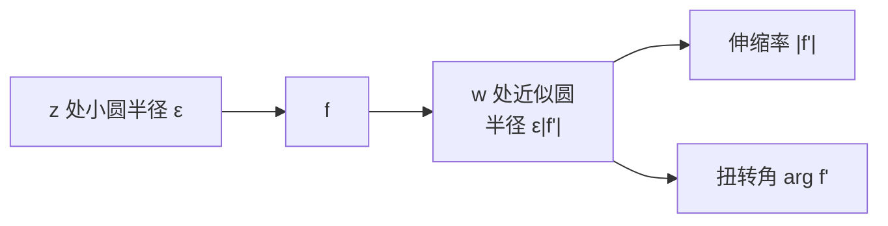

# 可视微分法

- **难度**：进阶 | **涉及章节**：第 5、9 章

## 一句话定义

在 $z$ 处画一个极小圆，看它在 $w$ 平面的象：象圆半径与原半径之比给出 $|f'|$，转角给出 $\arg f'$。这就是可视微分法。

## 为什么重要

它让导数从"算"变成"看"：拿到 $\log z$、$z^n$、$e^z$，不必背公式，画个小圆就能读出局部行为。第 9 章的留数估计也常用这种局部读数。

## 图示

**看图说明**：小圆是探针，象圆是读数；ε 越小，读数越准。

## 详解

设 $f$ 解析、$f'(z)\ne0$。小圆上的点 $z+\varepsilon e^{i\phi}$ 的象近似为

$$f(z)+\varepsilon e^{i\phi}f'(z)+o(\varepsilon).$$

这是一段"半径 $\varepsilon|f'|$、起点 $f(z)$、方向转 $\arg f'$"的圆。于是

$$f'(z)=\lim_{\varepsilon\to0}\frac{\text{象圆半径}}{\varepsilon}e^{i(\text{转角})}.$$

**读 $\log z$**：$(\log z)'=1/z$，伸缩 $1/r$、扭转 $-\theta$。离原点越远，局部放大越小；这跟"对数增长越来越慢"是同一件事。

**读 $z^n$**：伸缩 $n r^{n-1}$、扭转 $(n-1)\theta$。

**读 $e^z$**：伸缩 $e^x$、扭转 $y$。

## 常见误解

- 别以为象一定是圆——实际只在 $f'\ne0$ 时一阶近似是圆；临界点会变成多瓣。
- 别以为这是近似就不严格——实际 ε→0 的极限就是导数定义。

## 在书中出现的脉络

| 章节 | 语境 | 关键结论 |
|---|---|---|
| 第 5 章 | 可视微分 | 小圆读数 |
| 第 5 章 | $\log$、幂、指数 | 逐个读出导数 |
| 第 9 章 | 留数估计 | 局部放大率 |

## 相关概念

- 前置：[导数作为伸扭](c14-导数作为伸扭.md)
- 后续：[微分法则的几何](c19-微分法则的几何.md)
- 深度推导：见本页底部折叠片段
