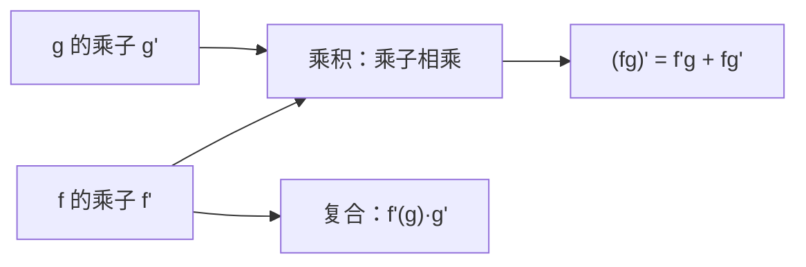

# 微分法则的几何

- **难度**：进阶 | **涉及章节**：第 5 章

## 一句话定义

乘积、商、复合的导数法则，几何上就是局部乘子的相乘、相除、相乘；对数导数把乘法变成加法。

## 为什么重要

它把一长串公式压缩成一条规则：先看每块的伸扭，再按运算组合。第 5 章用这条重新解释所有初等函数的导数。

## 图示

**看图说明**：乘法法则是"两块叠加"，链式法则是"两个伸扭接力"。

## 详解

**乘积**：$(fg)'=f'g+fg'$。除以 $fg$：

$$\frac{(fg)'}{fg}=\frac{f'}{f}+\frac{g'}{g}.$$

右边是"伸缩率的对数相加、扭转角相加"。

**商**：

$$\left(\frac fg\right)'=\frac{f'g-fg'}{g^2},\qquad \frac{(f/g)'}{f/g}=\frac{f'}{f}-\frac{g'}{g}.$$

**链式**：$(f\circ g)'=f'(g(z))g'(z)$。先乘 $g'$ 再乘 $f'$，两个乘子相乘。

**幂**：$(z^n)'=nz^{n-1}$，可以看成 $n$ 个 $z$ 相乘的对数导数：$n\cdot\frac1z$。

**级数**：逐项求导，收敛半径不变（圆内一致收敛）。

## 常见误解

- 别以为乘积法则就是"各自求导再乘"——实际是两项相加。
- 别以为链式法则是"乘 $(f')$ 和 $(g')$"——实际是 $f'(g(z))$，在 $g(z)$ 处取值。

## 在书中出现的脉络

| 章节 | 语境 | 关键结论 |
|---|---|---|
| 第 5 章 | 微分法则 | 乘子算术 |
| 第 5 章 | 幂级数 | 逐项求导 |
| 第 9 章 | 泰勒展开 | 系数与导数 |

## 相关概念

- 前置：[可视微分法](c18-可视微分法.md)
- 后续：[曲率与高阶导数](c20-曲率与高阶导数.md)
