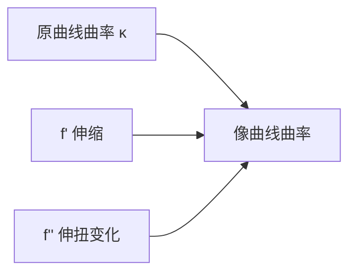

# 曲率与高阶导数

- **难度**：高难 | **涉及章节**：第 5、6、12 章

## 一句话定义

曲率 $\kappa$ 是单位弧长上切线转过的角；对解析映射，像曲线的曲率由原曲率加上 $f'$、$f''$ 决定的修正，再除以 $|f'|$。

## 为什么重要

它把"弯曲"量化，第 6 章的非欧几何用曲率区分球面、平面、双曲三种几何；第 12 章的流体也用曲率描述流线弯折。

## 图示

**看图说明**：共形映射不改变角度，但会改变"弯得多快"；$f''$ 就是修正来源。

## 详解

对参数曲线 $z(t)$，曲率

$$\kappa=\frac{\operatorname{Im}(\bar z'z'')}{|z'|^3}.$$

这是标准的复数曲率公式：分子是有符号面积项，分母是速度的三次方。

对 $w=f(z(t))$，链式法则给

$$w'=f'(z)z',\qquad w''=f''(z)(z')^2+f'(z)z''.$$

代入曲率公式，得到教材 5.9 的结构：

$$\kappa_w=\frac{\kappa_z}{|f'|}+\text{由 }f''\text{ 决定的项}.$$

**读法**：

- $|f'|$ 越大，像曲线越"平"（曲率被缩小）；
- $f''\ne0$ 时，即使原曲线是直线（$\kappa_z=0$），像也可能弯——这是映射本身"不均匀"造成的。

**例子**：$f(z)=z^2$ 把直线 $y=1$ 映成抛物线，$f''=2\ne0$，所以直线变弯。

## 常见误解

- 别以为共形映射保曲率——实际只保角，曲率会变。
- 别以为 $f''=0$ 就一定保曲率——实际 $|f'|$ 仍会缩放曲率。

## 在书中出现的脉络

| 章节 | 语境 | 关键结论 |
|---|---|---|
| 第 5 章 | 曲率公式 | $f''$ 修正 |
| 第 6 章 | 非欧几何 | 曲率定义空间类型 |
| 第 12 章 | 流线 | 曲率描述弯折 |

## 相关概念

- 前置：[微分法则的几何](c19-微分法则的几何.md)
- 后续：[解析延拓](c21-解析延拓.md)
