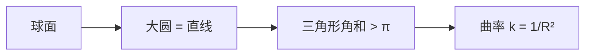

# 球面几何

- **难度**：进阶 | **涉及章节**：第 6 章

## 一句话定义

球面上的"直线"是大圆（过球心的平面与球面的交线），三角形内角和大于 $\pi$，曲率为正。

## 为什么重要

它是最直观的非欧几何：地球表面就是球面，航海、航空的"大圆航线"就是测地线。它也是理解正曲率的模型。

## 图示

**看图说明**：大圆是两点间最短路径；三角形"胖"出来的面积正好是角和超出 $\pi$ 的部分。

## 详解

**大圆**：过球心的平面截球面得到的圆。任意两点（非对径）有唯一大圆；大圆航线段最短。

**球面三角形**：三条大圆围成。角和

$$A+B+C=\pi+\frac{S}{R^2},$$

其中 $S$ 是球面三角形面积。这称为球面盈余。

**等距变换**：三维空间绕球心的旋转。经球极射影投到复平面，正好是默比乌斯变换（第 3 章）。

**例子**：地球赤道、经线都是大圆；从北京到纽约的最短航线沿大圆走，在地图上看起来"向北弯"。

## 常见误解

- 别以为球面三角形内角和总是 $\pi$——实际只要边长不是极小，就大于 $\pi$。
- 别以为大圆是"任意过两点的圆"——实际必须过球心。

## 在书中出现的脉络

| 章节 | 语境 | 关键结论 |
|---|---|---|
| 第 6 章 | 球面几何 | 大圆、角和、正曲率 |
| 第 6 章 | 共形映射 | 球面运动 = 默比乌斯 |
| 第 3 章 | 球极射影 | 平面圆 ↔ 球面圆 |

## 相关概念

- 前置：[黎曼球面](c11-黎曼球面.md)
- 后续：[双曲几何与庞加莱圆盘](c23-双曲几何.md)
