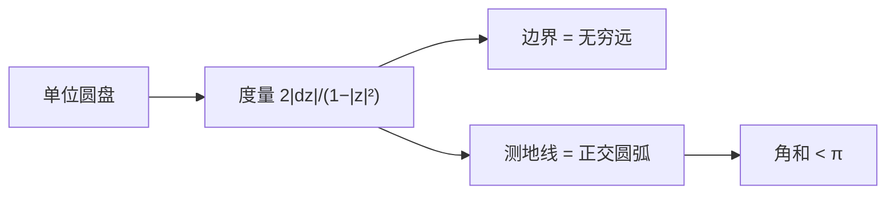

# 双曲几何与庞加莱圆盘

- **难度**：高难 | **涉及章节**：第 6、12 章

## 一句话定义

双曲几何是曲率为负的常曲率几何；庞加莱圆盘用单位圆盘作地图，度量 $2|dz|/(1-|z|^2)$，测地线是与边界正交的圆弧。

## 为什么重要

它把"过直线外一点有无穷多条平行线"变成可画的模型，是第 12 章黎曼映射与流体几何的背景，也是相对论时空几何的数学基础之一。

## 图示

**看图说明**：圆盘内部是双曲平面，边界不是"边"，而是无穷远处；越靠边，比例尺越大。

## 详解

**度量**：

$$d\hat s=\frac{2|dz|}{1-|z|^2}.$$

$|z|\to1$ 时分母趋于 0，同样的 $|dz|$ 对应越来越大的双曲距离。

**测地线**：与单位圆正交的圆弧（直径是退化情形）。两条这样的弧可以不相交，且过一点可作无穷多条与给定弧不相交——这就是双曲平行公设。

**三角形**：角和

$$A+B+C=\pi-\frac{S}{R^2},$$

称为角亏。

**等距变换**：

$$M(z)=e^{i\theta}\frac{z-a}{1-\bar a z},\qquad |a|<1.$$

这些默比乌斯变换把圆盘映到自身，且保双曲距离。

**伪球面**：教材用曳物线绕轴旋转得到的曲面（曲率 $-1/R^2$）作为三维中的实物模型，再把共形地图搬到圆盘上。

## 常见误解

- 别以为圆盘边界是"墙"——实际它是无穷远，走到边界需要无穷多步。
- 别以为双曲直线在欧氏眼里是弯的就不算直线——实际"直"由度量定义。

## 在书中出现的脉络

| 章节 | 语境 | 关键结论 |
|---|---|---|
| 第 6 章 | 双曲几何 | 度量、测地线、角亏 |
| 第 6 章 | 伪球面 | 负曲率模型 |
| 第 12 章 | 黎曼映射 | 共形模型 |

## 相关概念

- 前置：[球面几何](c22-球面几何.md)、[默比乌斯变换](c12-默比乌斯变换.md)
- 后续：[测地线](c24-测地线.md)
- 深度推导：见本页底部折叠片段
