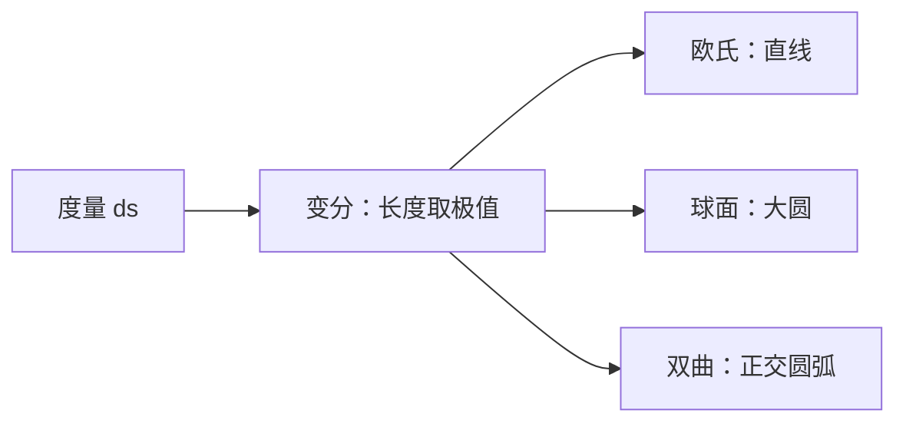

# 测地线

- **难度**：进阶 | **涉及章节**：第 6、12 章

## 一句话定义

测地线是曲面上"局部最短"的曲线；在欧氏平面是直线，在球面是大圆，在庞加莱圆盘是与边界正交的圆弧。

## 为什么重要

它把"直线"从一个视觉概念变成度量概念：只要会量距离，就知道什么是直。第 12 章的流线、黎曼映射都用它。

## 图示

**看图说明**：同一套"长度取极值"的规则，在不同度量下给出不同的"直线"。

## 详解

测地线满足：任取其上两点，沿它的弧长在附近所有曲线中最小（局部）。

**欧氏**：$ds=|dz|$，最短路径是直线段。

**球面**：$ds=R\,d\theta$（球面弧长），最短路径是大圆。

**双曲**：$ds=2|dz|/(1-|z|^2)$。可以证明，与单位圆正交的圆弧满足变分方程，因此是测地线。过圆盘内两点的测地线唯一（除非两点在边界上）。

**与默比乌斯变换**：等距变换把测地线映成测地线，所以"双曲直线"在圆盘自同构下保持"正交圆弧"这个性质。

## 常见误解

- 别以为测地线一定"看起来直"——实际它由度量决定，在庞加莱圆盘里是弯的。
- 别以为测地线一定唯一——实际球面上对径点之间有无穷多条大圆。

## 在书中出现的脉络

| 章节 | 语境 | 关键结论 |
|---|---|---|
| 第 6 章 | 球面/双曲 | 大圆、正交圆弧 |
| 第 6 章 | 等距变换 | 测地线映成测地线 |
| 第 12 章 | 流线 | 流线是测地线的类比 |

## 相关概念

- 前置：[双曲几何与庞加莱圆盘](c23-双曲几何.md)
- 后续：[曲率与三种几何](c25-曲率与三种几何.md)
- 深度推导：见本页底部折叠片段
