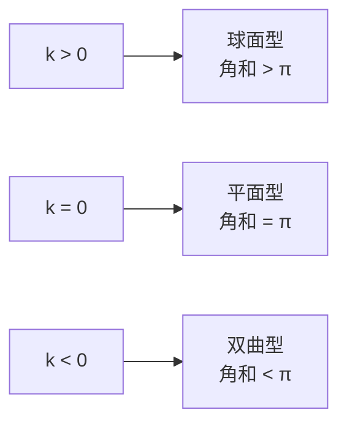

# 曲率与三种几何

- **难度**：高难 | **涉及章节**：第 6、12 章

## 一句话定义

高斯曲率是内蕴量；常曲率只有三种符号，对应球面型（$k>0$）、平面型（$k=0$）、双曲型（$k<0$）。

## 为什么重要

它用"量和角"就能判断几何类型，不必看曲面在三维里怎么弯。第 12 章用它把流体分成球面/平面/双曲三类背景。

## 图示

**看图说明**：曲率符号直接对应三角形角和的偏差方向。

## 详解

**高斯曲率**：两个主曲率之积 $k=\kappa_1\kappa_2$。球面 $k=1/R^2$，伪球面 $k=-1/R^2$，平面 $k=0$。

**内蕴性**：高斯绝妙定理说 $k$ 只由度量决定，与曲面在空间中的弯曲方式无关。蚂蚁量小三角形的角和与面积，就能算出 $k$。

**常曲率分类**（局部）：

- $k>0$：球面（或球面的一部分）；
- $k=0$：平面（或可展曲面）；
- $k<0$：伪球面型（双曲）。

**共形度量公式**：若度量写成 $ds=\lambda(z)|dz|$，则

$$k=-\frac{1}{\lambda^2}\Delta\ln\lambda.$$

对 $\lambda=2/(1-|z|^2)$ 算出 $k=-1$，这就是庞加莱圆盘曲率为负的证明（见本页底部深度片段）。

## 常见误解

- 别以为曲率是"外在看出来的弯"——实际它是内蕴量，蚂蚁也能测。
- 别以为负曲率曲面一定像马鞍——实际有无穷多种形状，内蕴几何相同。

## 在书中出现的脉络

| 章节 | 语境 | 关键结论 |
|---|---|---|
| 第 6 章 | 球面/伪球面 | 曲率 $\pm1/R^2$ |
| 第 6 章 | 内蕴几何 | 只依赖度量 |
| 第 12 章 | 流体几何 | 三种背景几何 |

## 相关概念

- 前置：[测地线](c24-测地线.md)
- 深度推导：见本页底部折叠片段
