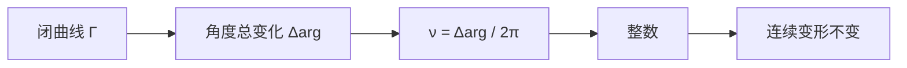

# 环绕数

- **难度**：进阶 | **涉及章节**：第 7、8 章

## 一句话定义

闭曲线 $\Gamma$ 绕点 $a$ 的环绕数，是角度 $\arg(z-a)$ 沿曲线一圈的总变化除以 $2\pi$：逆时针为正，顺时针为负。

## 为什么重要

它是第一个"拓扑不变量"：只依赖绕不绕、绕几圈，不依赖曲线形状。第 8 章的柯西定理、第 9 章的留数定理都用它把积分化成整数计数。

## 图示

**看图说明**：曲线怎么扭都行，只要不扫过 $a$，圈数就不变。

## 详解

**定义**：

$$\nu(\Gamma,a)=\frac{1}{2\pi}\Delta_\Gamma\arg(z-a).$$

**积分形式**：

$$\nu(\Gamma,a)=\frac{1}{2\pi i}\oint_\Gamma\frac{dz}{z-a}.$$

右边是第 8 章柯西积分公式的原型；它算出整数，说明积分值被拓扑"锁住"。

**性质**：

- $\nu$ 是整数；
- 曲线不扫过 $a$ 地连续变形，$\nu$ 不变；
- 曲线反向，$\nu$ 变号；
- 曲线绕 $a$ 两次，$\nu=2$。

**例子**：单位圆绕 0 得 1；绕 2 得 0；绕 0 顺时针得 −1。

## 常见误解

- 别以为环绕数与曲线长度有关——实际无关，只与圈数有关。
- 别以为在曲线外的点环绕数一定为 0——实际曲线可以绕它，只要点在曲线"洞里"。

## 在书中出现的脉络

| 章节 | 语境 | 关键结论 |
|---|---|---|
| 第 7 章 | 环绕数定义 | 整数、拓扑不变 |
| 第 8 章 | 柯西定理 | $\oint dz/(z-a)=2\pi i\nu$ |
| 第 9 章 | 留数 | 环绕数计数 |

## 相关概念

- 前置：[解析延拓](c21-解析延拓.md)
- 后续：[辐角原理](c27-辐角原理.md)
- 深度推导：见本页底部折叠片段
