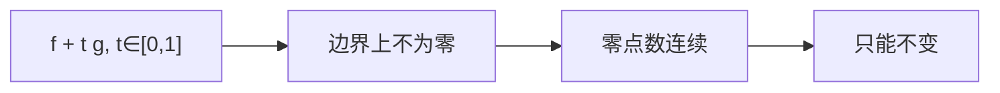

# 鲁歇定理

- **难度**：进阶 | **涉及章节**：第 7 章

## 一句话定义

若在闭曲线 $\Gamma$ 上 $|g(z)|<|f(z)|$，则 $f$ 与 $f+g$ 在 $\Gamma$ 内有相同个数的零点（计重数）。

## 为什么重要

它让你不解方程就能数零点个数。代数基本定理、控制理论中的稳定性判据都用它。

## 图示

**看图说明**：让 $g$ 从 0 慢慢"加"到 $f$，零点不能跨过边界，所以个数锁死。

## 详解

**证明**：设 $f_t=f+tg$。在 $\Gamma$ 上 $|tg|\le|g|<|f|$，所以 $f_t\ne0$。零点数 $N(t)$ 由辐角原理给出，是整数；$N(t)$ 随 $t$ 连续（$f_t$ 在边界无零点，根不会突然穿过边界），整数连续只能恒定。$N(0)$ 是 $f$ 的零点数，$N(1)$ 是 $f+g$ 的。

**例子**：$z^5+3z^2+1$ 在 $|z|<1$ 内。取 $f=3z^2$，$g=z^5+1$。边界上 $|g|\le2<3=|f|$，故零点数与 $3z^2$ 相同：$z=0$ 二重，共 2 个。

**注意**：结论是"个数相同"，不是"零点相同"；零点的位置会变。

## 常见误解

- 别以为 $|g|<|f|$ 可以换成 $\le$——实际边界上必须严格小于。
- 别以为 $f+g$ 的零点就是 $f$ 的零点——实际个数同、位置不同。

## 在书中出现的脉络

| 章节 | 语境 | 关键结论 |
|---|---|---|
| 第 7 章 | 鲁歇定理 | 零点数不变 |
| 第 7 章 | 代数基本定理 | $n$ 次多项式 $n$ 个根 |
| 第 9 章 | 留数 | 零点计数 |

## 相关概念

- 前置：[辐角原理](c27-辐角原理.md)
- 后续：[最大模原理](c29-最大模原理.md)
