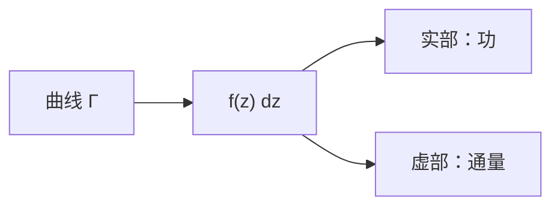

# 复积分

- **难度**：进阶 | **涉及章节**：第 8 章

## 一句话定义

复积分 $\int_\Gamma f\,dz$ 是把曲线上每一点的 $f$ 乘上小位移 $dz$ 再累加；拆成实部虚部后，分别对应"功"与"通量"。

## 为什么重要

它是柯西定理、柯西积分公式、留数定理的共同语言；把复分析从"看图形"推进到"算积分"。

## 图示

**看图说明**：同一个复积分同时算两个实物理量。

## 详解

**定义**：

$$\int_\Gamma f\,dz=\lim_{n\to\infty}\sum_{k=1}^n f(z_k)(z_k-z_{k-1}).$$

**拆解**：$f=u+iv$，$dz=dx+i\,dy$：

$$\int f\,dz=\int(u\,dx-v\,dy)+i\int(u\,dy+v\,dx).$$

- 实部：向量 $(u,-v)$ 沿切向的积分（功）；
- 虚部：向量 $(u,v)$ 沿法向的积分（通量）。

**基本积分**：$\oint_\Gamma\frac{dz}{z-a}=2\pi i\,\nu(\Gamma,a)$。这是第 7 章环绕数的积分版。

**例子**：$\int_0^{2\pi}e^{i\theta}ie^{i\theta}d\theta=i\int_0^{2\pi}e^{2i\theta}d\theta=0$。

## 常见误解

- 别以为复积分是两个实积分的简单相加——实际是"功 + i 通量"的组合。
- 别以为路径无关总成立——实际只有解析函数在单连通区域内才路径无关。

## 在书中出现的脉络

| 章节 | 语境 | 关键结论 |
|---|---|---|
| 第 8 章 | 复积分定义 | 功与通量 |
| 第 8 章 | 柯西定理 | 闭积分为 0 |
| 第 9 章 | 柯西公式 | 积分表示函数值 |

## 相关概念

- 前置：[环绕数](c26-环绕数.md)
- 后续：[柯西定理](c31-柯西定理.md)
- 深度推导：见本页底部折叠片段
