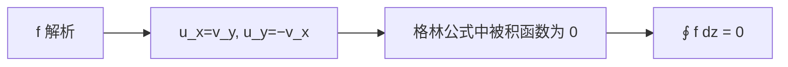

# 柯西定理

- **难度**：高难 | **涉及章节**：第 8、9、12 章

## 一句话定义

解析函数在单连通区域内沿任意闭曲线的积分为零：

$$\oint_\Gamma f(z)\,dz=0.$$

## 为什么重要

它是复分析的中心定理：由此推出路径无关、柯西积分公式、留数定理、泰勒展开。没有它，后面的章节无法展开。

## 图示

**看图说明**：CR 方程让格林公式的两个面积分同时消失。

## 详解

**条件**：$f$ 在单连通区域 $D$ 内解析，$\Gamma$ 是 $D$ 内闭曲线。

**证明（格林路线）**：

$$\oint f\,dz=\iint_D(-v_x-u_y)\,dxdy+i\iint_D(u_x-v_y)\,dxdy.$$

CR 方程 $u_x=v_y$、$u_y=-v_x$ 使两个被积函数都为 0。

**推论**：

- 路径无关：$\int_A^B f\,dz$ 只依赖端点（单连通、解析）。
- 原函数存在：$F'=f$。
- 围道可变形：不扫过奇点，积分不变。

**例子**：$\oint_{|z|=1}z^2\,dz=0$；$\oint_{|z|=1}dz/z=2\pi i$（后者不满足"区域内解析"，0 是奇点）。

## 常见误解

- 别以为柯西定理对多连通区域也直接成立——实际要先挖洞，考虑边界。
- 别以为 $f$ 连续就够了——实际需要解析（CR 成立）。

## 在书中出现的脉络

| 章节 | 语境 | 关键结论 |
|---|---|---|
| 第 8 章 | 柯西定理 | 闭积分为 0 |
| 第 8 章 | 古尔萨证明 | 不假设偏导连续 |
| 第 9 章 | 柯西公式 | 积分表示函数值 |

## 相关概念

- 前置：[复积分](c30-复积分.md)
- 后续：[围道变形](c32-围道变形.md)
- 深度推导：见本页底部折叠片段
