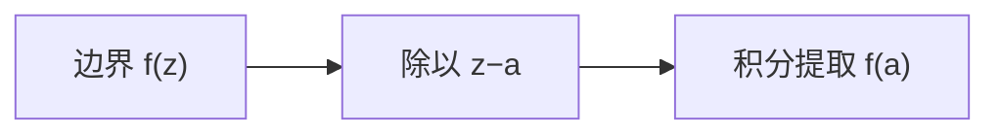

# 柯西积分公式

- **难度**：高难 | **涉及章节**：第 9、11 章

## 一句话定义

解析函数在内部一点的值，等于边界值的积分：

$$f(a)=\frac{1}{2\pi i}\oint_\Gamma\frac{f(z)}{z-a}\,dz.$$

## 为什么重要

它把"边界"与"内部"绑死：知道边界值就能算出内部任意点的值。第 11 章的留数计算、第 12 章的泊松公式都由它派生。

## 图示

**看图说明**：$1/(z-a)$ 是筛子，只留下 $a$ 点的值。

## 详解

**条件**：$f$ 在 $\Gamma$ 内及 $\Gamma$ 上解析，$a$ 在 $\Gamma$ 内部，$\Gamma$ 逆时针。

**推导**：把围道缩成以 $a$ 为心的小圆 $C_r$。在 $C_r$ 上，

$$\frac{f(z)}{z-a}=\frac{f(a)}{z-a}+\frac{f(z)-f(a)}{z-a}.$$

第二项在 $a$ 处有极限 $f'(a)$，有界，积分随 $r\to0$ 趋于 0；第一项积分 $=2\pi i f(a)$。所以原积分等于 $2\pi i f(a)$。

**平均值性质**：取 $z=a+re^{i\theta}$，代入得

$$f(a)=\frac{1}{2\pi}\int_0^{2\pi}f(a+re^{i\theta})\,d\theta.$$

**例子**：$\oint_{|z|=1}\frac{e^z}{z}dz=2\pi i$；$\oint_{|z|=1}\frac{dz}{z-2}=0$（2 在圆外，被积函数解析）。

## 常见误解

- 别以为 $a$ 可以在曲线外——实际那样积分是 0（柯西定理）。
- 别以为公式只对圆——实际任意闭曲线，只要 $a$ 在内部。

## 在书中出现的脉络

| 章节 | 语境 | 关键结论 |
|---|---|---|
| 第 9 章 | 柯西公式 | 边界定内部 |
| 第 9 章 | 平均值性质 | 几何版 |
| 第 11 章 | 留数 | 同类积分 |

## 相关概念

- 前置：[围道变形](c32-围道变形.md)
- 后续：[高阶导数公式](c35-高阶导数公式.md)
- 深度推导：见本页底部折叠片段
