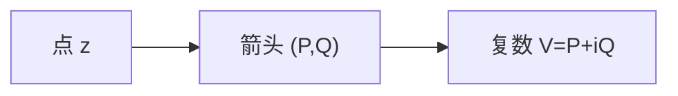

# 向量场与复表示

- **难度**：基础 | **涉及章节**：第 10、11 章

## 一句话定义

平面向量场给每点一个箭头；把箭头写成复数 $V(z)=P+iQ$，就能用复分析的工具处理它。

## 为什么重要

它是第 10–12 章的语言：源、旋、通量、环量、奇点都用复形式表达，复积分与物理量一一对应。

## 图示

**看图说明**：向量场是"逐点给箭头"的映射，不是解析函数。

## 详解

**定义**：$V(z)=P(x,y)+iQ(x,y)$，$P,Q$ 是实函数。

**常见场**：

- $V=z$：径向向外（源）；
- $V=-z$：径向向内（汇）；
- $V=iz$：绕原点逆时针（旋转）；
- $V=\bar z$：鞍点（沿实轴向外、沿虚轴向内）。

**与解析函数的区别**：解析函数也逐点给复数，但它额外满足 CR 方程；一般向量场没有这个约束。

## 常见误解

- 别以为向量场一定解析——实际大多数不是。
- 别以为复表示只是记号——实际它让通量和环量合成一个复积分。

## 在书中出现的脉络

| 章节 | 语境 | 关键结论 |
|---|---|---|
| 第 10 章 | 向量场 | 复表示 |
| 第 10 章 | 通量/环量 | 复积分 |
| 第 11 章 | 奇点 | 指数 |

## 相关概念

- 前置：[复积分](c30-复积分.md)
- 后续：[通量与环量](c39-通量与环量.md)
