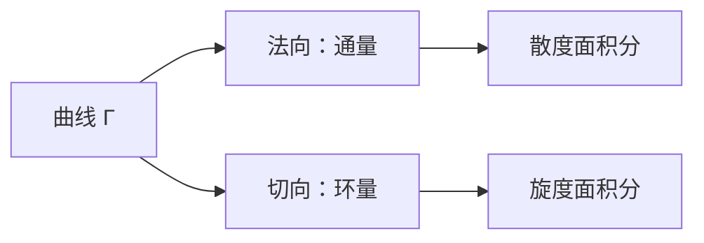

# 通量与环量

- **难度**：进阶 | **涉及章节**：第 10、11 章

## 一句话定义

通量是向量场穿过曲线的法向总量，环量是沿曲线的切向总量；两者由格林公式对应散度与旋度。

## 为什么重要

它们把"源"和"旋"变成可计算的积分，是第 10 章物理与拓扑连接的核心。

## 图示

**看图说明**：一条曲线，两个读数；格林公式把它们换成内部的源和旋。

## 详解

**通量**：

$$\text{Flux}=\oint_\Gamma(P\,dy-Q\,dx).$$

**环量**：

$$\text{Circ}=\oint_\Gamma(P\,dx+Q\,dy).$$

**复形式**：

$$\oint_\Gamma\bar V\,dz=\text{Flux}+i\,\text{Circ}.$$

**格林公式**：

$$\text{Flux}=\iint_D(P_x+Q_y)\,dxdy,\qquad \text{Circ}=\iint_D(Q_x-P_y)\,dxdy.$$

**例子**：$V=z$ 沿单位圆，$P=x,Q=y$，通量 $=\iint2\,dxdy=2\pi$，环量 $=0$。

## 常见误解

- 别以为通量是"穿过曲线的箭头个数"——实际是法向分量的积分，带符号。
- 别以为环量一定是"转圈"——实际它衡量切向分量的累积，直线流也有环量（沿曲线走）。

## 在书中出现的脉络

| 章节 | 语境 | 关键结论 |
|---|---|---|
| 第 10 章 | 通量/环量 | 两个积分 |
| 第 10 章 | 格林公式 | 散度/旋度 |
| 第 11 章 | 留数 | 复积分统一 |

## 相关概念

- 前置：[向量场与复表示](c38-向量场与复表示.md)
- 后续：[奇点与指数](c40-奇点与指数.md)
- 深度推导：见本页底部折叠片段
