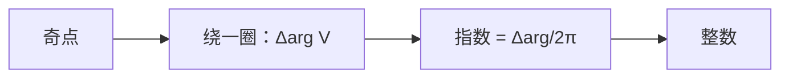

# 奇点与指数

- **难度**：高难 | **涉及章节**：第 10、11 章

## 一句话定义

向量场为零的点叫奇点；绕奇点一圈，箭头方向转过的总角度除以 $2\pi$，就是指数。

## 为什么重要

指数是拓扑不变量：它不能靠局部微调改变，是"奇点为什么消不掉"的定量回答，也是第 11 章绕奇点积分的几何基础。

## 图示

**看图说明**：指数只数"箭头转了几圈"，与场的具体大小无关。

## 详解

**定义**：

$$\text{Index}(V,z_0)=\frac{1}{2\pi}\Delta_\Gamma\arg V(z),$$

$\Gamma$ 是绕 $z_0$ 的小圆，逆时针。

**常见值**：

- $V=z$：$V=e^{i\theta}$，$\Delta\arg=2\pi$，指数 $+1$；
- $V=-z$：$V=e^{i(\theta+\pi)}$，指数 $+1$；
- $V=iz$：$V=e^{i(\theta+\pi/2)}$，指数 $+1$；
- $V=\bar z$：$V=e^{-i\theta}$，$\Delta\arg=-2\pi$，指数 $-1$；
- $V=1/z$：$V=e^{-i\theta}/r$，指数 $-1$。

**整数性**：绕一圈回到起点，箭头方向相同，角度只能差 $2\pi k$。

**不变性**：连续变形不扫过奇点时，角度累计连续且取整数值，故不变。

## 常见误解

- 别以为指数和"箭头长度"有关——实际只与方向变化有关。
- 别以为指数为 0 的奇点一定不存在——实际它可以存在，只是"可消掉"。

## 在书中出现的脉络

| 章节 | 语境 | 关键结论 |
|---|---|---|
| 第 10 章 | 奇点分类 | 源/汇/旋转/鞍点 |
| 第 10 章 | 拓扑 | 指数不变 |
| 第 11 章 | 绕奇点积分 | 指数计权重 |

## 相关概念

- 前置：[通量与环量](c39-通量与环量.md)
- 后续：[解析向量场与无源无旋](c41-解析向量场.md)
- 深度推导：见本页底部折叠片段
