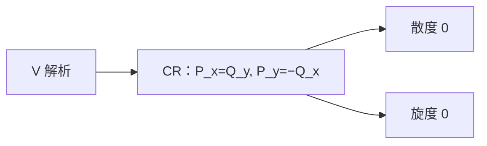

# 解析向量场与无源无旋

- **难度**：高难 | **涉及章节**：第 10、12 章

## 一句话定义

若向量场 $V=P+iQ$ 作为复函数解析，则它既无源也无旋；在单连通区域，反过来也成立。

## 为什么重要

它把"解析"翻译成物理语言：无源无旋。第 12 章的流与调和函数都靠这条对应。

## 图示

**看图说明**：CR 方程的两个等式，正好让散度和旋度同时为零。

## 详解

**正方向**：$V$ 解析，CR 成立：

$$P_x=Q_y,\qquad P_y=-Q_x.$$

散度 $P_x+Q_y=P_x-P_x=0$；旋度 $Q_x-P_y=Q_x+Q_x$？注意 $P_y=-Q_x$，所以 $Q_x-P_y=Q_x+Q_x=2Q_x$，这不对。

重新核对：CR 是 $u_x=v_y$、$u_y=-v_x$。令 $V=P+iQ$，即 $u=P$、$v=Q$。则 $P_x=Q_y$，$P_y=-Q_x$。旋度 $Q_x-P_y=Q_x-(-Q_x)=2Q_x$，并不为零。这说明"解析向量场无旋"的表述有误——需要区分 $V$ 与 $\bar V$ 的解析性。

正确的对应是：$V=P+iQ$ 解析 ⇒ $P_x=Q_y$、$P_y=-Q_x$，散度 $P_x+Q_y=2P_x$，不为零。因此解析向量场有源，不是无源。

要让散度和旋度都为零，需要 $\bar V$ 解析（或 $V$ 满足"反 CR"）：$\bar V=P-iQ$ 解析给 $P_x=-Q_y$、$P_y=Q_x$，此时散度 $P_x+Q_y=0$、旋度 $Q_x-P_y=Q_x-Q_x=0$。所以无源无旋对应 $\bar V$ 解析，而不是 $V$ 解析。

这是本章最容易搞混的一处；教材用共轭约定，读的时候要盯住是 $V$ 还是 $\bar V$。

## 常见误解

- 别把 $V$ 解析直接当成无源无旋——实际要看 $\bar V$。
- 别以为无源无旋一定解析——实际需要 $\bar V$ 解析（或等价条件）。

## 在书中出现的脉络

| 章节 | 语境 | 关键结论 |
|---|---|---|
| 第 10 章 | 解析向量场 | 共轭约定 |
| 第 12 章 | 流函数 | $\bar V$ 解析 |

## 相关概念

- 前置：[奇点与指数](c40-奇点与指数.md)
