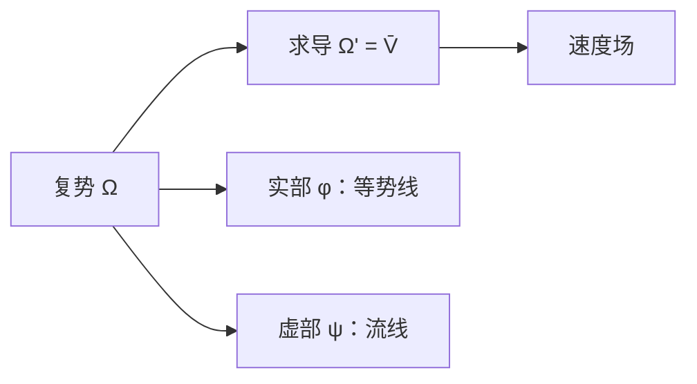

# 复势与流函数

- **难度**：进阶 | **涉及章节**：第 11、12 章

## 一句话定义

无旋不可压流的复势 $\Omega=\phi+i\psi$ 解析，速度 $\bar V=\Omega'$；$\phi$ 是势函数，$\psi$ 是流函数。

## 为什么重要

它把流体力学翻译成复分析：流线、等势线、源、偶极都是解析函数。第 12 章整章建立在这上面。

## 图示

**看图说明**：一个解析函数给出一整幅流图。

## 详解

**条件**：无旋（$v_x-u_y=0$）+ 不可压（$u_x+v_y=0$）。这两个方程正是 $\bar V=u-iv$ 的 CR 方程。

**复势**：$\Omega=\phi+i\psi$，满足 $\Omega'=\phi_x+i\psi_x=u-iv=\bar V$。

- $\phi=$ 常数：等势线；
- $\psi=$ 常数：流线；
- 两族曲线正交（因为 $\Omega$ 共形）。

**常见流**：

| $\Omega$ | 流型 |
|---|---|
| $z$ | 均匀流 |
| $\log z$ | 源/汇 |
| $1/z$ | 偶极 |
| $z+1/z$ | 绕圆柱流 |

## 常见误解

- 别以为 $\Omega$ 的实部是"势"、虚部是"流"就反过来——实际按定义 $\phi$ 势、$\psi$ 流。
- 别以为流线是等势线——实际两族正交。

## 在书中出现的脉络

| 章节 | 语境 | 关键结论 |
|---|---|---|
| 第 11 章 | 复势 | $\Omega'=\bar V$ |
| 第 12 章 | 绕障碍物流 | 保角映射构造 |
| 第 12 章 | 源/汇 | $\log z$ |

## 相关概念

- 前置：[解析向量场与无源无旋](c41-解析向量场.md)
- 后续：[留数定理](c43-留数定理.md)
