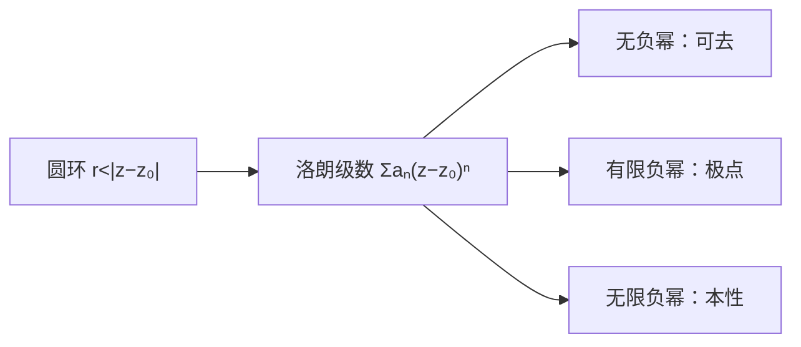

# 洛朗级数与奇点分类

- **难度**：高难 | **涉及章节**：第 11、12 章

## 一句话定义

在圆环内解析的函数可展开成含负幂的洛朗级数；按负幂项多少，奇点分为可去、极点、本性三类。

## 为什么重要

它描述函数在奇点附近的行为，是留数计算、辐角原理、流场局部结构的共同工具。

## 图示

**看图说明**：负幂项的数量决定奇点类型。

## 详解

**洛朗级数**：

$$f(z)=\sum_{n=-\infty}^{\infty}a_n(z-z_0)^n.$$

系数 $a_n=\frac{1}{2\pi i}\oint_C\frac{f(\zeta)}{(\zeta-z_0)^{n+1}}d\zeta$（$C$ 在圆环内）。

**分类**：

- 可去：$a_{-1}=a_{-2}=\cdots=0$，例如 $\sin z/z$ 在 0（补定义后解析）；
- $m$ 阶极点：$a_{-m}\ne0$，更低负幂为 0；
- 本性：无限个负幂项，如 $e^{1/z}$。

**留数**：$a_{-1}$。

**例子**：$\frac{1}{z(z-1)}$ 在 0 的洛朗展开：

$$\frac1{z}\cdot\frac{1}{z-1}=-\frac1z-1-z-\cdots\quad(|z|<1),$$

一阶极点，留数 $-1$。

## 常见误解

- 别以为洛朗级数只能在圆内展开——实际在圆环内展开。
- 别以为可去奇点没有极限——实际极限存在，只是函数值未定义。

## 在书中出现的脉络

| 章节 | 语境 | 关键结论 |
|---|---|---|
| 第 11 章 | 洛朗级数 | 圆环展开 |
| 第 11 章 | 奇点分类 | 三类 |
| 第 12 章 | 流场局部 | 源/偶极 |

## 相关概念

- 前置：[泰勒级数与收敛半径](c37-泰勒级数.md)
- 后续：[留数定理](c43-留数定理.md)
- 深度推导：见本页底部折叠片段
