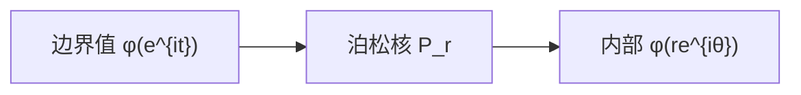

# 泊松公式与狄利克雷问题

- **难度**：高难 | **涉及章节**：第 12 章

## 一句话定义

圆盘上的狄利克雷问题由泊松公式解出：内部值等于边界值乘以泊松核的积分。

$$\phi(re^{i\theta})=\frac{1}{2\pi}\int_0^{2\pi}P_r(\theta-t)\phi(e^{it})\,dt.$$

## 为什么重要

它把"边界条件"变成"内部解"，是流体绕障碍物、热传导、静电场的通用解法。

## 图示

**看图说明**：核是权重，越靠近边界，权重越集中在对应点。

## 详解

**泊松核**：

$$P_r(\theta-t)=\frac{1-r^2}{1-2r\cos(\theta-t)+r^2}.$$

**性质**：

- $P_r>0$，积分为 1（保常数）；
- $r\to0$ 时 $P_r\to1$，回到均值；
- $r\to1$ 时 $P_r$ 变成尖峰，集中在 $t=\theta$。

**推导**：柯西公式

$$f(z)=\frac{1}{2\pi i}\oint\frac{f(\zeta)}{\zeta-z}d\zeta.$$

取 $\zeta=e^{it}$，$z=re^{i\theta}$，整理实部，得泊松核。

**例子**：边界 $\phi=\cos t$，内部 $\phi=r\cos\theta$。这是 $z$ 的实部。

**其他区域**：用黎曼映射把区域搬到圆盘，在圆盘解完再搬回去。

## 常见误解

- 别以为泊松公式只给"近似"——实际是精确解。
- 别以为边界值可以随便给——实际要求连续（否则要放宽到可积）。

## 在书中出现的脉络

| 章节 | 语境 | 关键结论 |
|---|---|---|
| 第 12 章 | 狄利克雷问题 | 边界定内部 |
| 第 12 章 | 泊松核 | 加权平均 |
| 第 12 章 | 黎曼映射 | 搬到圆盘 |

## 相关概念

- 前置：[调和函数与均值性质](c46-调和函数.md)
- 后续：[Blasius 力与力矩](c48-Blasius公式.md)
